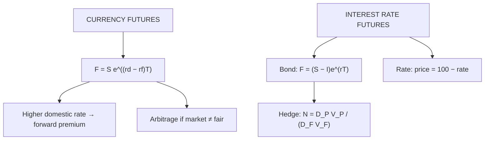

# VF-3: Currency and Interest Rate Futures

Covers: interest rate parity pricing of currency futures, arbitrage when parity breaks, pricing a bond futures contract, rate-based quotes, and the duration-based hedge ratio for a bond portfolio. **(syllabus)** scope, **(textbook)** Hull method, NSE specifics **[VERIFY]**.

## Where this fits in the ESE

A currency futures pricing sum with an arbitrage check is highly likely, either as a 5-marker or inside the 15-mark case. Interest rate futures are usually tested through a bond futures price or a hedge count.

## Currency futures: interest rate parity **(textbook)**

A foreign currency behaves like an asset paying a **yield equal to the foreign interest rate**, so the cost of carry is the interest difference.

**F₀ = S₀ × e^((r_d − r_f)T)**

where S₀ is the spot rate in **domestic currency per unit of foreign** (INR per USD), r_d the domestic (INR) rate and r_f the foreign (USD) rate.

Discrete form often used in Indian classrooms: **F₀ = S₀ × (1 + r_d T) ÷ (1 + r_f T)**.

Rule: if r_d > r_f, the futures price is above spot, so the foreign currency (USD, lower rate) is at a **forward premium** and the rupee (higher rate) is at a **forward discount**. This is parity, not a forecast.

NSE USD/INR futures: lot size USD 1,000, tick ₹0.0025, so one tick = ₹2.50 per lot **[VERIFY]**.

## Worked example 1: price a 3-month USD/INR future

**Data (hypothetical):** spot ₹84.00 per USD, r_INR = 7%, r_USD = 4%, T = 3 months.

1. Continuous: F₀ = 84.00 × e^((0.07 − 0.04) × 0.25) = 84.00 × e^0.0075 = 84.00 × 1.007528 = **₹84.6324**.
2. Discrete: 84.00 × (1 + 0.07 × 0.25) ÷ (1 + 0.04 × 0.25) = 84.00 × 1.0175 ÷ 1.01 = **₹84.6238**.
3. Forward premium = (84.6324 − 84.00) ÷ 84.00 = 0.75% for 3 months, about 3.0% annualised ≈ r_d − r_f ✓.
4. Contract value for one lot = 84.6324 × 1,000 = ₹84,632.

**Interpretation.** The 3% interest gap shows up as a 0.75% premium over three months. Both forms agree to the first decimal; state the convention you use.

## Worked example 2: currency arbitrage

**Data:** same inputs; the market futures price is **₹85.20** (above ₹84.6324).

**Step 1.** Futures overpriced, so borrow rupees, buy dollars, sell futures. For every USD 1,000 (one lot) to be delivered at T:

| Time | Action | Cash flow (₹) |
|---|---|---|
| t = 0 | Buy USD 990.05 spot (= 1,000 × e^(−0.04 × 0.25)) at ₹84 | −83,164.19 |
| t = 0 | Borrow ₹83,164.19 at 7% | +83,164.19 |
| t = 0 | Deposit USD 990.05 at 4% | 0 |
| t = 0 | Sell 1 lot of futures at ₹85.20 | 0 |
| **Net at t = 0** | | **0** |
| t = T | USD deposit has grown to USD 1,000: deliver against futures | +85,200.00 |
| t = T | Repay rupee loan: 83,164.19 × e^0.0175 | −84,632.37 |
| **Net at T** | | **+567.63 per lot** |

**Reverse case.** If the market price were ₹84.20 (below fair), borrow dollars, convert, invest rupees and buy futures: profit per USD = 84.6324 − 84.20 = ₹0.4324, or **₹432.37 per lot**.

**Interpretation.** A gap of ₹0.57 per USD is worth ₹567.63 on a lot of USD 1,000 and is locked in with no currency risk. In practice dealers' spreads, margins and rate differences between borrowing and lending narrow the profitable range.

## Interest rate futures **(textbook, Indian context [VERIFY])**

An interest rate future is on a **bond price or an interest rate**:
- **Bond futures** (US T-bond, Indian 10-year G-Sec futures on a notional coupon bond). Rising yields mean falling prices, so a **short** futures position hedges a bond portfolio against rising rates.
- **Rate-based futures** (T-bill, Eurodollar style) quote **price = 100 − rate**. A price of 93.00 implies a 7% rate.

In India, interest rate futures are cash settled **[VERIFY]**. Hull notes that a deliverable bond contract has a **conversion factor** and a **cheapest-to-deliver** bond; for the exam, use the notional bond.

## Worked example 3: price a bond futures contract

**Data (hypothetical):** a bond has a cash (market) price of ₹98.00 per ₹100 face. It pays a ₹3.00 coupon in 2 months. The futures contract expires in 5 months. r = 6% for all maturities.

1. PV of coupon: I = 3.00 × e^(−0.06 × 2/12) = 3.00 × 0.990050 = **₹2.9701**.
2. F₀ = (98.00 − 2.9701) × e^(0.06 × 5/12) = 95.0299 × e^0.025 = 95.0299 × 1.025315 = **₹97.4355**.

**Interpretation.** The coupon is received by the bond holder, not the futures holder, so it is deducted like a dividend: carry = interest minus coupon income.

## Worked example 4: duration-based hedge of a bond portfolio

**Data (hypothetical):** a bond portfolio worth ₹10 crore has a modified duration of 6.2. A bond futures contract has face ₹2,00,000 and a price of ₹98 per ₹100 (value ₹1,96,000), with futures duration 5.8. How many contracts hedge the portfolio?

**Formula (Hull):** N = (D_P × V_P) ÷ (D_F × V_F).

1. Numerator = 6.2 × 10,00,00,000 = 62,00,00,000.
2. Denominator = 5.8 × 1,96,000 = 11,36,800.
3. N = 62,00,00,000 ÷ 11,36,800 = 545.39, so **545 contracts short**.

**Interpretation.** If yields rise, the portfolio loses and the short futures gain, offsetting. The match is only good for small, parallel yield shifts; duration is a first-order measure.

## Traps

- **Quote direction.** INR per USD. Reversing it inverts the premium.
- **Parity is r_d − r_f, not r_f − r_d.** The higher-rate currency is at a forward discount, the lower-rate one at a premium; check the sign against the numbers (7% INR, 4% USD gives F above S).
- **Coupon timing.** Discount the coupon from its payment date, then compound over the contract life.
- **Price = 100 − rate** applies to rate-quoted futures, not bond-price futures.
- **Lot size.** Always multiply per-unit gain by lot size.

## What to remember

- F₀ = S₀e^((r_d − r_f)T): ₹84 spot gives ₹84.6324 (continuous) or ₹84.6238 (discrete).
- Arbitrage at ₹85.20: profit ₹567.63 per USD 1,000 lot; at ₹84.20, ₹432.37.
- Bond futures: F₀ = (S₀ − I)e^(rT): ₹98 bond gives ₹97.4355.
- Hedge count N = D_P V_P ÷ (D_F V_F): 545 contracts.
- Rate-based futures: price = 100 − rate.

## Concept map

## Flashcards
Q: Interest rate parity formula for a currency future?
A: F₀ = S₀ e^((r_d − r_f)T), with S₀ in domestic currency per unit of foreign currency.

Q: Spot ₹84, r_INR 7%, r_USD 4%, 3 months. Fair futures price?
A: 84 × e^0.0075 = ₹84.6324 (discrete form ₹84.6238).

Q: Market futures ₹85.20 vs fair ₹84.6324. Trade and profit per lot of USD 1,000?
A: Borrow INR, buy USD, deposit USD, sell futures; profit ₹567.63 per lot.

Q: Market futures ₹84.20 vs fair ₹84.6324. Profit per lot?
A: ₹432.37 (borrow USD, invest INR, buy futures).

Q: Why does the lower-rate currency trade at a forward premium?
A: Parity gives F > S when the domestic rate exceeds the foreign rate, so the foreign (lower-rate) currency costs more in the futures market and the higher-rate currency is at a forward discount.

Q: Bond ₹98, ₹3 coupon in 2 months, 5-month future, r = 6%. Futures price?
A: (98 − 2.9701) × e^0.025 = ₹97.4355.

Q: Hedge formula for a bond portfolio using bond futures?
A: N = (D_P × V_P) ÷ (D_F × V_F).

Q: Rate-based future quoted 93.00. Implied rate?
A: 7% (price = 100 − rate).

Q: Tick value of USD/INR futures?
A: 0.0025 × 1,000 = ₹2.50 per lot [VERIFY].

## Sources
- BBA301F-6 syllabus, Unit 3 (currency and interest futures)
- Hull, *Options, Futures and Other Derivatives* (6th ed.), ch. 3, 5 and 6; NSE currency and interest rate contract specifications **[VERIFY]**
- Previous: [[Derivatives Unit 3 - VF-2 Cash and Carry Arbitrage]] · Next: [[Derivatives Unit 3 - VF-4 Hedging and Optimal Hedge Ratio]]
- [[Derivatives Unit 3 - Valuation of Future Contracts MOC (Node Map)]]
