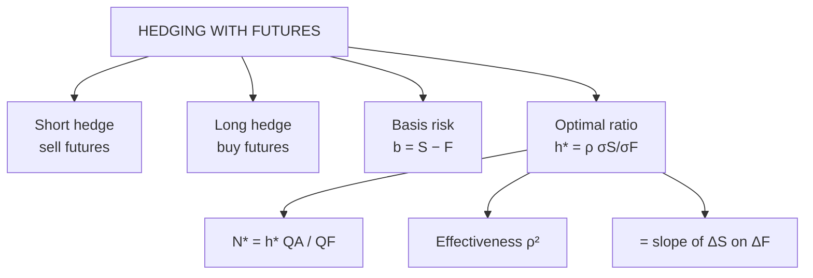

# VF-4: Hedging with Futures and the Optimal Hedge Ratio

Covers: short and long hedges, basis and basis risk, the effective price from a hedge, the minimum-variance hedge ratio h* = ρ × σS/σF, the number of contracts, hedge effectiveness, and estimating h* from data by regression. **(syllabus)** scope, **(textbook)** Hull method.

## Where this fits in the ESE

"Optimal hedging" is a named topic and a calculation favourite: formula, number of contracts, effectiveness ρ². Expect a 5-mark sum or one part of the 15-mark case. The regression-style data question is the hard variant.

## Short and long hedges **(textbook)**

| Hedge | Who | Position | Protects against |
|---|---|---|---|
| **Short hedge** | Holder or future seller of the asset (farmer, miller, fund manager) | Sell futures | Price fall |
| **Long hedge** | Future buyer of the asset (airline buying fuel, importer) | Buy futures | Price rise |

A hedge does not **raise** profit. It narrows the range of outcomes.

## Basis and basis risk

**Basis = Spot − Futures.** Hedge at time 1, lift it at time 2.

**Short hedge: effective price = S₂ + (F₁ − F₂) = F₁ + b₂**, where b₂ = S₂ − F₂ is the basis when the hedge is closed.

*Interpretation:* if basis is known at lift time, the hedged price is known today. The uncertainty left is **basis risk**: the basis at time 2 is unknown. Basis risk arises when the hedge date differs from the contract expiry, or the futures asset differs from the exposure (**cross hedge**).

### Worked example 1: short hedge, effective price

**Data (hypothetical):** a producer expects to sell 1,000 units of a commodity in 3 months. Today the 3-month futures price is ₹2,500. The producer sells 1,000 units of futures now.

| Scenario | Spot at T (S₂) | Futures at T (F₂) | Basis (S₂ − F₂) | Futures gain (F₁ − F₂) | Effective price | Total (₹) |
|---|---|---|---|---|---|---|
| Fall | 2,380 | 2,395 | −15 | +105 | 2,380 + 105 = **2,485** | 24,85,000 |
| Rise | 2,700 | 2,712 | −12 | −212 | 2,700 − 212 = **2,488** | 24,88,000 |

1. Unhedged: ₹23,80,000 (fall) or ₹27,00,000 (rise).
2. Hedged: ₹24,85,000 or ₹24,88,000.
3. **Interpretation.** The hedged price is within ₹3 per unit across a ₹320 swing in spot. The ₹3 gap is basis risk (basis −15 vs −12). The producer gave up the extra ₹2,12,000 gain in the rise scenario to avoid a ₹1,05,000 shortfall in the fall scenario (24,85,000 hedged against 23,80,000 unhedged).

## Optimal hedge ratio **(textbook)**

The **hedge ratio h** is the number of futures units sold per unit of exposure. h = 1 is a perfect hedge only if spot and futures move one-for-one. The ratio that **minimises the variance** of the hedged position is

**h\* = ρ × (σS ÷ σF)**

where
- ρ = correlation between changes in spot (ΔS) and in futures (ΔF),
- σS = standard deviation of ΔS, σF = standard deviation of ΔF.

Equivalent: h\* = Cov(ΔS, ΔF) ÷ Var(ΔF) = the **slope of a regression of ΔS on ΔF**.

**Number of contracts:** **N\* = h\* × Q_A ÷ Q_F**, where Q_A = size of exposure and Q_F = size of one futures contract. Round to the nearest whole number.

**Hedge effectiveness = ρ²** = proportion of variance removed. Residual standard deviation of the hedged position = σS × √(1 − ρ²) (per unit of exposure, when h = h\*).

### Worked example 2: from volatilities and correlation

**Data (hypothetical):** an airline will buy **2,00,000 litres of jet fuel** in 3 months and hedges with a futures contract on a related fuel; one contract = 50,000 litres. σS = 3.2%, σF = 4.0% (changes over the hedge period), ρ = 0.85.

1. h\* = 0.85 × (3.2 ÷ 4.0) = 0.85 × 0.80 = **0.68**.
2. N\* = 0.68 × 2,00,000 ÷ 50,000 = 0.68 × 4 = **2.72**, round to **3 long contracts**.
3. Effectiveness = ρ² = 0.85² = **72.25%** of variance removed.
4. Residual sd = σS × √(1 − 0.7225) = σS × √0.2775 = 0.527σS, about **53%** of the unhedged standard deviation.
5. Naive h = 1 would buy 4 contracts. That over-hedges because futures are more volatile than spot.

**Decision line.** Buy 3 contracts (long hedge). The hedge removes 72% of variance, leaving basis and cross-hedge risk. Not hedging at all leaves 100%.

### Worked example 3: estimating h\* from data

**Data (hypothetical weekly changes, ₹):**

| Week | ΔF | ΔS | ΔF × ΔS | ΔF² | ΔS² |
|---|---|---|---|---|---|
| 1 | 2 | 1.8 | 3.6 | 4 | 3.24 |
| 2 | −1 | −1.0 | 1.0 | 1 | 1.00 |
| 3 | 3 | 2.2 | 6.6 | 9 | 4.84 |
| 4 | −2 | −1.6 | 3.2 | 4 | 2.56 |
| 5 | 1 | 1.2 | 1.2 | 1 | 1.44 |
| 6 | −3 | −2.6 | 7.8 | 9 | 6.76 |
| **Sum** | 0 | 0.0 | **23.4** | **28** | **19.84** |

Both columns have mean zero, so deviations from the mean are the data themselves. (If the means are not zero, subtract them first.)

1. h\* = ΣΔFΔS ÷ ΣΔF² = 23.4 ÷ 28 = **0.8357**.
2. ρ = 23.4 ÷ √(28 × 19.84) = 23.4 ÷ 23.57 = **0.9928**.
3. ρ² = **0.9857**, so 98.6% of variance is removed.
4. Cross-check by the other formula: σS/σF = √(19.84 ÷ 28) = 0.8418; h\* = 0.9928 × 0.8418 = 0.8357 ✓.
5. **Hedging 10,000 units with contracts of 1,000 units:** N\* = 0.8357 × 10,000 ÷ 1,000 = 8.36, so **8 contracts**.

**Interpretation.** The slope below 1 says the futures price moves a little more than spot (about 1.2 futures rupees for each spot rupee), so selling less than a one-to-one quantity gives the best hedge.

## Practical points

- **Tailing the hedge**: daily settlement makes the exact hedge slightly smaller than N\*; Hull mentions this, but for the exam use N\* unadjusted.
- **Hedge a month other than expiry**: choose a contract expiring just after the exposure.
- **Over-hedge risk**: if the exposure disappears the futures become a speculative position.

## Traps

- **Direction.** Short futures for a seller of the asset; long futures for a buyer.
- **σS/σF is spot over futures.** Reversing it gives 1.25 instead of 0.80.
- **h\* ≠ ρ.** Correlation alone is not the hedge ratio.
- **Effectiveness is ρ², not ρ.** A ρ of 0.85 removes 72%, not 85%, of variance.
- **Use changes, not price levels,** in the regression.

## What to remember

- Short hedge sells futures (price fall); long hedge buys futures (price rise).
- Effective price = F₁ + b₂ (short hedge); basis risk is the only uncertainty.
- h\* = ρσS/σF = Cov/Var(F); N\* = h\* × Q_A ÷ Q_F.
- Example: 0.85 × 3.2/4.0 = 0.68; N\* = 2.72 → 3; ρ² = 72.25%.
- Data example: h\* = 23.4/28 = 0.8357; ρ = 0.9928; 8 contracts.

## Concept map

## Flashcards
Q: Minimum-variance hedge ratio formula?
A: h* = ρ × σS ÷ σF, which equals Cov(ΔS, ΔF) ÷ Var(ΔF).

Q: Number of futures contracts for the optimal hedge?
A: N* = h* × Q_A ÷ Q_F (exposure size over contract size), rounded.

Q: ρ = 0.85, σS = 3.2%, σF = 4.0%. h*?
A: 0.85 × 0.80 = 0.68.

Q: Exposure 2,00,000 litres, contract 50,000 litres, h* = 0.68. Contracts?
A: 0.68 × 4 = 2.72, round to 3.

Q: Hedge effectiveness for ρ = 0.85?
A: ρ² = 72.25% of the variance is removed.

Q: What is the effective price of a short hedge?
A: S₂ + (F₁ − F₂) = F₁ + basis at lift (b₂).

Q: Who uses a long hedge?
A: A buyer of the asset in future, such as an importer or an airline, who fears a price rise.

Q: What is basis risk?
A: Uncertainty about the basis (spot − futures) when the hedge is lifted, leaving the hedged price slightly uncertain.

Q: Data: ΣΔFΔS = 23.4, ΣΔF² = 28. h*?
A: 23.4 ÷ 28 = 0.8357.

Q: Why is h = 1 not always optimal?
A: Spot and futures changes do not move one-for-one and are not perfectly correlated; h* adjusts for relative volatility and correlation.

## Sources
- BBA301F-6 syllabus, Unit 3 (hedging, optimal hedging)
- Hull, *Options, Futures and Other Derivatives* (6th ed.), ch. 3
- Previous: [[Derivatives Unit 3 - VF-3 Currency and Interest Rate Futures]] · Next: [[Derivatives Unit 3 - VF-5 Stock and Portfolio Hedging]]
- [[Derivatives Unit 3 - Valuation of Future Contracts MOC (Node Map)]]
