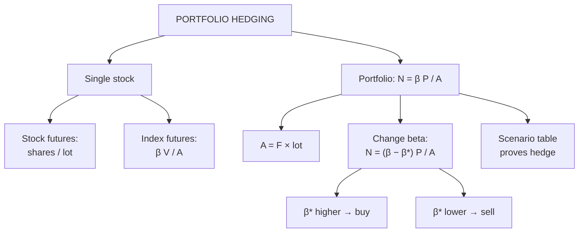

# VF-5: Stock and Portfolio Hedging with Index Futures

Covers: hedging one share with stock futures or index futures, the beta-based number of contracts N = β × P ÷ A, scenario checks, and changing a portfolio's beta up or down. **(syllabus)** scope, **(textbook)** Hull method.

## Where this fits in the ESE

Portfolio hedging with beta is the most predictable 5- to 10-mark numerical from Unit 3 and the usual second part of the 15-mark case. Marks are for: the formula, the contract value A, the rounded N, and a scenario table that proves the hedge.

## Hedging a single stock

| Route | Contracts | Residual risk |
|---|---|---|
| **Stock futures** (same share) | Shares held ÷ lot size | Only basis risk; near-perfect hedge |
| **Index futures** | β × value of shares ÷ index contract value | Stock-specific (unsystematic) risk remains |

Index futures are cheaper and more liquid but hedge only the **market** component, which is why beta enters the formula.

### Worked example 1: single stock

**Data (hypothetical):** an investor holds **2,000 shares** priced at **₹800** (value ₹16,00,000). Stock futures lot = 500 shares. The share's β to the index is 1.1. Index futures: price 22,000, lot 50 units (contract value 22,000 × 50 = ₹11,00,000).

1. **Stock futures:** 2,000 ÷ 500 = **4 contracts short**. Done.
2. **Index futures:** N = β × V ÷ A = 1.1 × 16,00,000 ÷ 11,00,000 = 17,60,000 ÷ 11,00,000 = 1.6, so **2 index contracts short**.
3. **Interpretation.** The stock-futures hedge also covers the share's own risk. The index hedge removes only market risk; a result driven by company news remains. Index futures need only 2 lots against 4, which suits a small holder with a diversified view of the market but not a view on this company.

## Hedging a portfolio **(textbook)**

Use the portfolio's **beta (β)** against the index. The number of index futures to sell is

**N\* = β × P ÷ A**

where P = current value of the portfolio and A = value of one index futures contract = futures price × lot size.

To **change beta** from β to a target β\*: **N = (β − β\*) × P ÷ A**. Positive N: sell futures. Negative N: buy futures. Setting β\* = 0 gives N\* above.

## Worked example 2: full hedge, scenario table

**Data (hypothetical):** portfolio ₹5,00,00,000 (₹5 crore), β = 1.2. Index futures price 22,000, lot 50 units, so A = 22,000 × 50 = **₹11,00,000**.

1. N\* = 1.2 × 5,00,00,000 ÷ 11,00,000 = 6,00,00,000 ÷ 11,00,000 = 54.55, round to **55 contracts short**.
2. **Scenario check** (assume the futures move by the same percentage as the index, ignore dividends and the risk-free rate; the portfolio moves β times the index):

| Index move | Portfolio change = 1.2 × move × ₹5 cr (₹) | Futures P&L = −55 × 50 × 22,000 × move (₹) | Net (₹) |
|---|---|---|---|
| −5% | −30,00,000 | +30,25,000 | **+25,000** |
| +5% | +30,00,000 | −30,25,000 | **−25,000** |

3. Futures P&L at −5%: 55 × 50 = 2,750 index units; 22,000 × 5% = 1,100 points; 2,750 × 1,100 = ₹30,25,000 ✓.
4. **Decision line.** The ₹30,00,000 portfolio loss is almost fully offset; the ±₹25,000 residual arises only from rounding 54.55 up to 55. The hedge locks the portfolio near its starting value, **giving up the +5% gain** as well. The hedge is justified if you fear a fall but do not want to sell the shares (tax, long-term holding).

## Worked example 3: reduce beta to 0.4

Same portfolio. A manager expects a short-term fall but wants to keep some exposure.

N = (1.2 − 0.4) × 5,00,00,000 ÷ 11,00,000 = 0.8 × 45.4545 = 36.36, so **36 contracts short**.

(45.4545 = 5,00,00,000 ÷ 11,00,000.) Portfolio beta drops from 1.2 to about 0.4; a 5% index fall now costs about 0.4 × 5% × ₹5 crore = ₹10,00,000 instead of ₹30,00,000.

## Worked example 4: raise beta to 1.6

An optimistic manager wants more market exposure without buying shares.

N = (1.6 − 1.2) × 5,00,00,000 ÷ 11,00,000 = 0.4 × 45.4545 = 18.18, so **buy 18 contracts**. A 5% index rise now yields about 1.6 × 5% × ₹5 crore = ₹40,00,000.

## CAPM view

CAPM: expected return = R_f + β(R_m − R_f). A fully hedged portfolio (β → 0) earns about the **risk-free rate plus alpha**. If the manager has no stock-picking skill, hedging earns only R_f, so a permanent hedge is pointless: it is for temporary protection.

## Indian practice **[VERIFY]**

Nifty and Bank Nifty futures are the main hedging instruments; contracts are cash settled; the lot size is revised by NSE, so read the lot from the question. Betas are estimated by regressing portfolio returns on index returns over 2 to 5 years. Hedging also incurs margin (SPAN) and transaction costs.

## Traps

- **A is the value of one futures contract**, not the index level alone: multiply by the lot size.
- **Sell futures to hedge a long portfolio.** Buy only to raise beta.
- **Use beta, not 1.** Without beta the 1.2 portfolio is under-hedged (45 contracts, not 55).
- **Round N.** Do not report fractional contracts, but state the residual.
- **A hedge costs the upside.** Scenario tables must show both directions.

## What to remember

- N\* = β × P ÷ A; A = futures price × lot size.
- ₹5 crore, β 1.2, A ₹11,00,000 gives 54.55, so 55 short; ±5% leaves ±₹25,000 net.
- Change beta: N = (β − β\*) × P ÷ A; to 0.4: 36 short; to 1.6: 18 long.
- Stock futures give a near-perfect hedge; index futures leave stock-specific risk.
- A full hedge earns about the risk-free rate.

## Concept map

## Flashcards
Q: Number of index futures to hedge a portfolio?
A: N* = β × P ÷ A, where A = futures price × lot size.

Q: Portfolio ₹5 crore, β 1.2, index futures 22,000, lot 50. Contracts?
A: A = ₹11,00,000; N = 54.55, round to 55 short.

Q: Index falls 5%. Net result of the 55-contract hedge?
A: Portfolio −₹30,00,000, futures +₹30,25,000, net +₹25,000.

Q: How many contracts to cut beta from 1.2 to 0.4 for the same portfolio?
A: (1.2 − 0.4) × 5,00,00,000 ÷ 11,00,000 = 36.36, so 36 short.

Q: How many contracts to raise beta to 1.6?
A: 0.4 × 5,00,00,000 ÷ 11,00,000 = 18.18, so buy 18.

Q: 2,000 shares, lot 500, hedged with stock futures. Contracts?
A: 4 short.

Q: Why can index futures not hedge stock-specific risk?
A: They track the market; company-specific moves are unrelated to the index.

Q: What return does a fully beta-hedged portfolio earn (CAPM)?
A: About the risk-free rate plus any alpha.

Q: What is the cost of hedging a long portfolio?
A: It gives up the upside as well as the downside, plus margin and transaction costs.

## Sources
- BBA301F-6 syllabus, Unit 3 (stock and portfolio hedging)
- Hull, *Options, Futures and Other Derivatives* (6th ed.), ch. 3 (index futures hedging)
- Previous: [[Derivatives Unit 3 - VF-4 Hedging and Optimal Hedge Ratio]] · Next: [[Derivatives Unit 3 - VF-6 Unit 3 Exam Answers]]
- [[Derivatives Unit 3 - Valuation of Future Contracts MOC (Node Map)]]
