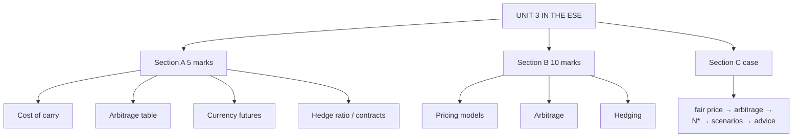

# VF-6: Unit 3 Exam Answers

Covers: what the ESE will ask from Unit 3, 5-mark and 10-mark skeletons, and a 15-mark case layout (pricing, arbitrage and portfolio hedge) with a full model answer.

## What the test will ask

ESE: Section A three 5-mark questions with choice, Section B two 10-mark questions with choice, Section C one 15-mark case. Unit 3 has the most teaching hours (12 of 45) and the most numerical topics, so it is the likeliest source of the case. A case that combines **a fair-price calculation, an arbitrage check and a beta hedge** is the natural shape. This is a judgement from the syllabus wording.

## Five-mark answer skeletons

**1. Cost of carry price (VF-1).** Formula for the asset type; PV of income; substitute; compare with market; contango or backwardation (₹1,000 gives ₹1,035.62; with dividend ₹1,015.15).

**2. Cash-and-carry arbitrage (VF-2).** Fair price; direction rule; two-column table t = 0 and t = T; profit (₹14.38).

**3. Currency futures price (VF-3).** Parity formula; substitute (₹84 → ₹84.6324); forward premium; one line on arbitrage.

**4. Optimal hedge ratio (VF-4).** h\* = ρσS/σF; N\* = h\*Q_A/Q_F; effectiveness ρ²; example (0.68, 2.72 → 3, 72.25%).

**5. Portfolio hedge (VF-5).** N\* = βP/A; A = F × lot; round; scenario table ±5%.

**6. Basis and basis risk (VF-4).** Definition, short hedge effective price F₁ + b₂, example ₹2,485 and ₹2,488.

## Ten-mark answer skeletons

**A. Pricing of futures by the cost-of-carry model.** Logic → formulas for five cases → three worked values (no income ₹1,035.62; dividend ₹1,015.15; index 22,315.74) → basis, contango, backwardation → implied financing rate → limits (taxes, borrow-lend gap, short-sale limits).

**B. Arbitrage opportunities in futures.** Rule → cash and carry table → reverse table → dividend case → no-arbitrage band → price effects → practical limits in India.

**C. Hedging using futures.** Short vs long hedge → basis risk → optimal ratio → number of contracts → effectiveness → portfolio hedge with beta → changing beta → limitations (cost of the upside, margin liquidity).

**D. Currency and interest rate futures.** Parity → price → arbitrage → bond futures pricing → duration hedge count → NSE contracts **[VERIFY]**.

## Fifteen-mark case layout (pricing, arbitrage, hedge)

1. **Fair futures price (3):** formula, yield, T, substitution.
2. **Arbitrage decision and profit (4):** direction, table, per unit and per lot.
3. **Hedge contracts (3):** A, N\*, rounded N.
4. **Scenario check (3):** ±move, portfolio, futures, net.
5. **Recommendation and risks (2).**

### Model answer, laid out as the exam answer

**Data (hypothetical):** index spot 24,000; r = 7% (continuous); dividend yield 1.3%; 2-month futures trade at 24,300; lot 50 units. A fund holds a **₹8 crore portfolio with β = 1.25** and fears a fall.

1. **Fair price.** T = 2/12 = 0.1667. F\* = 24,000 × e^((0.07 − 0.013) × 0.1667) = 24,000 × e^0.0095 = 24,000 × 1.009545 = **24,229.09**.
2. **Arbitrage.** Market 24,300 > 24,229.09: futures overpriced.
   - **Cash and carry:** borrow, buy the index basket, sell futures. Profit = 24,300 − 24,229.09 = **70.91 index points** = 70.91 × 50 = **₹3,546 per lot** at expiry.

| Time | Action | Cash flow per index unit |
|---|---|---|
| t = 0 | Buy e^(−0.013 × 0.1667) = 0.997836 of an index unit, with dividends reinvested: cost 24,000 × 0.997836 = 23,948.06, borrowed at 7% | 0 |
| t = 0 | Sell one futures at 24,300 | 0 |
| t = T | Basket has grown to exactly one index unit, worth S_T. Futures settlement pays 24,300 − S_T. Together | +24,300.00 |
| t = T | Repay loan: 23,948.06 × e^0.011667 = 23,948.06 × 1.011735 | −24,229.09 |
| **Net at T** | | **+70.91** |

   The spot price S_T cancels, so the profit is certain. (Buying the fraction e^(−qT) of the index is the standard way to reinvest dividends exactly; in an exam, state it in one line.)

3. **Hedge contracts.** A = 24,300 × 50 = **₹12,15,000**. N\* = β × P ÷ A = 1.25 × 8,00,00,000 ÷ 12,15,000 = 1,00,00,000 ÷ 12,15,000 = 82.30, so **82 contracts short**.
4. **Scenario check** (futures move with the index; portfolio moves β times the index):

| Index move | Portfolio (₹) | Futures P&L = −82 × 50 × 24,300 × move (₹) | Net (₹) |
|---|---|---|---|
| −6% | −60,00,000 | +59,77,800 | **−22,200** |
| +6% | +60,00,000 | −59,77,800 | **+22,200** |

   (82 × 50 = 4,100 units; 24,300 × 6% = 1,458; 4,100 × 1,458 = 59,77,800 ✓.)

5. **Recommendation.** The hedge of 82 contracts keeps the net result within ±₹22,200 for a ±6% index move against ₹60,00,000 unhedged. If the fund only wants to cut beta to 0.5: N = (1.25 − 0.5) × 8,00,00,000 ÷ 12,15,000 = **49.38, so 49 contracts**. A pure arbitrageur should do the cash-and-carry; a fund holding the shares can **overlay** by selling the overpriced futures, locking in the premium.
   **Risks:** margin calls on the short futures if the index rises (liquidity), beta estimation error, tracking error, and the cost of giving up the upside.

Close with: *figures are hypothetical; a real desk would use the exchange's current lot size and the day's futures quote.*

## Time rule

If short of time: write the fair-price formula with numbers, the one-line direction decision with the profit, then N\* = βP/A and the rounded contracts. A short scenario line (−6% nets −₹22,200) secures the interpretation marks.

## What to remember

- Case order: fair price → compare → arbitrage profit → A → N\* → scenario → advice.
- Numbers: fair 24,229.09; profit 70.91 points (₹3,546 a lot); A ₹12,15,000; 82 contracts; net ±₹22,200; beta 0.5 needs 49.
- Always show both an up and a down scenario for a hedge.
- Name the margin and liquidity risk.

## Concept map

## Flashcards
Q: Order of steps in the pricing-arbitrage-hedge case?
A: Fair price, compare with market, arbitrage direction and profit, contract value A, N* = βP/A, scenario table, recommendation with risks.

Q: Index 24,000, r 7%, q 1.3%, 2 months. Fair futures price?
A: 24,000 × e^0.0095 = 24,229.09.

Q: Market futures 24,300 vs fair 24,229.09. Trade and profit per lot of 50?
A: Cash and carry; 70.91 points × 50 = about ₹3,546 per lot.

Q: Portfolio ₹8 crore, β 1.25, futures 24,300, lot 50. Contracts?
A: A = ₹12,15,000; N = 82.30, so 82 short.

Q: Index falls 6% with the 82-contract hedge. Net result?
A: Portfolio −₹60,00,000, futures +₹59,77,800, net −₹22,200.

Q: Contracts to cut beta to 0.5?
A: (1.25 − 0.5) × 8,00,00,000 ÷ 12,15,000 = 49.38, so 49 short.

Q: Skeleton for the 10-mark arbitrage answer?
A: Rule, cash-and-carry table, reverse table, dividend case, band, price effect, practical limits.

Q: What risk must a futures hedge answer mention?
A: Margin calls (liquidity) and basis or beta estimation risk, plus the sacrificed upside.

## Sources
- BBA301F-6 syllabus, Unit 3 and ESE pattern
- [[Derivatives Unit 3 - Valuation of Future Contracts MOC (Node Map)]]
