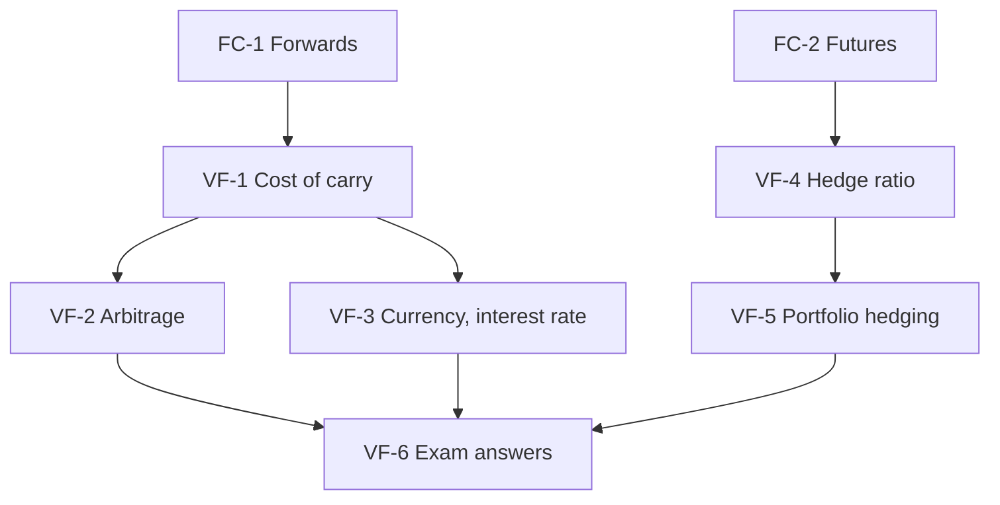

# Derivatives Unit 3: Valuation of Future Contracts, node map

ESE: 50 marks, Section A 3 x 5, Section B 2 x 10, Section C one 15-mark case. Unit 3 is the heaviest unit (12 of 45 hours) and the most numerical: CO2 (pricing) and CO3 (hedging). The 15-mark case most likely combines a fair price, an arbitrage check and a beta hedge. All examples are **hypothetical**.

## Nodes

| Node | Topic | Deps | Minutes | Exam focus |
|---|---|---|---|---|
| VF-1 | Cost of Carry Pricing | FC-1 | 40 | yes |
| VF-2 | Cash and Carry Arbitrage | VF-1 | 35 | yes |
| VF-3 | Currency and Interest Rate Futures | VF-1 | 40 | yes |
| VF-4 | Hedging and Optimal Hedge Ratio | FC-2 | 45 | yes |
| VF-5 | Stock and Portfolio Hedging | VF-4 | 40 | yes |
| VF-6 | Unit 3 Exam Answers | VF-1 to VF-5 | 35 | yes |

Total reading time: about 235 minutes.

## Dependency graph

## Headline numbers to know

- Cost of carry: ₹1,000 at 7%: 3 months ₹1,017.65; 6 months ₹1,035.62; with ₹20 dividend in 2 months ₹1,015.15. Index 22,000, q 1.3%, 3 months: 22,315.74.
- Arbitrage: market ₹1,050 gives +₹14.38; market ₹1,020 gives +₹15.62; with dividend and market ₹1,030 gives +₹14.85. Band at 8%/6%: ₹1,030.45 to ₹1,040.81.
- Currency: spot ₹84, 7% vs 4%, 3 months: ₹84.6324 (discrete ₹84.6238); at ₹85.20 profit ₹567.63 per USD 1,000 lot; at ₹84.20 ₹432.37.
- Bond future ₹97.4355; duration hedge 545 contracts.
- Hedge ratio: 0.68, 2.72 → 3 contracts, ρ² 72.25%; data case h\* 0.8357, ρ 0.9928, 8 contracts.
- Portfolio ₹5 crore, β 1.2, A ₹11,00,000: 55 contracts; ±5% nets ±₹25,000; beta to 0.4 needs 36; to 1.6 buys 18.
- Case: fair 24,229.09; profit ₹3,546 per lot; 82 contracts; ±6% nets ±₹22,200.

## Links
- [[Derivatives MOC]]
