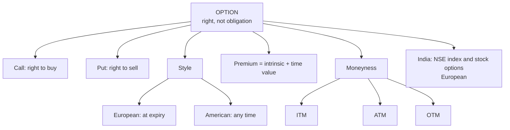

# OS-1: Option Terminology, Types and Moneyness

Covers: what an option is, every term the syllabus lists, European vs American, call and put, moneyness (ITM, ATM, OTM), intrinsic value and time value, and exchange-traded options in India. **(syllabus)** scope, **(textbook)** Hull method, NSE details **[VERIFY]**.

## Where this fits in the ESE

Definitions and moneyness come up as a 5-mark note or as the first step of any strategy question. The intrinsic/time value split links to Unit 5 pricing. Learn the terms exactly.

## What an option is **(textbook)**

An **option** is a contract giving the buyer the **right, not the obligation**, to buy (call) or sell (put) an underlying at a fixed price on or before a fixed date. The buyer pays a **premium** upfront; the seller (writer) receives it and must perform if the buyer exercises.

## Terminology

| Term | Meaning |
|---|---|
| **Call option** | Right to **buy** the underlying at the strike |
| **Put option** | Right to **sell** the underlying at the strike |
| **Holder / buyer / long** | Pays the premium, has the right |
| **Writer / seller / short** | Receives the premium, has the obligation |
| **Strike (exercise) price K** | Fixed price at which the underlying is bought or sold |
| **Premium** | Price of the option, paid by the buyer |
| **Expiry date** | Last day the option can be exercised |
| **European option** | Exercisable **only at expiry** |
| **American option** | Exercisable **any time up to expiry** |
| **Exercise** | Using the right |
| **Assignment** | Writer is notified that the buyer has exercised |
| **Lot size** | Number of units per contract |
| **Underlying** | Share, index, currency, futures |
| **Open interest** | Number of outstanding option contracts |

## Intrinsic value and time value

- **Intrinsic value:** call = max(S − K, 0); put = max(K − S, 0). It is the payoff if exercised now.
- **Time value = Premium − Intrinsic value.** It is always ≥ 0 and shrinks to zero at expiry.

## Moneyness

| | Call | Put |
|---|---|---|
| **In the money (ITM)** | S > K | S < K |
| **At the money (ATM)** | S = K | S = K |
| **Out of the money (OTM)** | S < K | S > K |

ITM options have intrinsic value; ATM and OTM options have only time value. Deep ITM options move almost point-for-point with the underlying; far OTM options are cheap and rarely pay.

## Worked example: classify and decompose (illustrative index options)

**Data (hypothetical, parity-consistent premiums):** index spot S = 22,000, one-month options, lot size 50 (illustrative; use the NSE lot size in the exam **[VERIFY]**).

| Strike | Call premium | Call status | Intrinsic | Time value | Put premium | Put status | Intrinsic | Time value |
|---|---|---|---|---|---|---|---|---|
| 21,800 | 480 | ITM | 200 | 280 | 153 | OTM | 0 | 153 |
| 22,000 | 250 | ATM | 0 | 250 | 122 | ATM | 0 | 122 |
| 22,200 | 145 | OTM | 0 | 145 | 216 | ITM | 200 | 16 |

1. Call 21,800: S − K = 200 → ITM; time value = 480 − 200 = 280.
2. Put 22,200: K − S = 200 → ITM; time value = 216 − 200 = 16.
3. **Cost of buying one lot** of the 22,000 call: 250 × 50 = **₹12,500**, the most the buyer can lose.

**Result at expiry for the 22,000 call and the 22,000 put:**

| Index at expiry | Call P&L per unit | Call P&L per lot | Put P&L per unit | Put P&L per lot |
|---|---|---|---|---|
| 22,400 | 400 − 250 = +150 | +₹7,500 | 0 − 122 = −122 | −₹6,100 |
| 21,900 | 0 − 250 = −250 | −₹12,500 | 100 − 122 = −22 | −₹1,100 |
| 21,700 | −250 | −₹12,500 | 300 − 122 = +178 | +₹8,900 |

Breakeven: call 22,000 + 250 = **22,250**; put 22,000 − 122 = **21,878**.

**Interpretation.** The call buyer needs the index to rise more than the premium (250 points) just to break even. Time value is the price of that chance and decays daily. The buyer's loss is capped at the premium; the seller's is not.

## Exchange-traded options in India **[VERIFY]**

- Index options (Nifty, Bank Nifty and others) and stock options trade on NSE; both are **European** and index options are **cash settled**; stock options are physically settled.
- Strikes are listed at fixed intervals around the current price; premiums are quoted in rupees per unit.
- The buyer pays the premium upfront; the seller pays **SPAN plus exposure margin**.
- Weekly and monthly expiries exist for selected indices; the number of weekly expiries and the lot sizes have been revised by SEBI/NSE in recent years.
- Clearing corporation guarantees performance.

## Traps

- **European does not mean in Europe.** It means exercise only at expiry.
- **Put ITM is S < K**, the reverse of a call.
- **Premium vs intrinsic.** An ITM option's premium is higher than intrinsic value because of time value.
- **ATM has zero intrinsic value**, not zero premium.
- **Seller's obligation.** Only the writer posts margin.

## What to remember

- Call = right to buy; put = right to sell; buyer pays premium; writer is obliged.
- European exercises at expiry only; American any time.
- Call ITM if S > K; put ITM if S < K.
- Premium = intrinsic value + time value.
- Example: call 22,000 @250: breakeven 22,250; max loss ₹12,500 per lot of 50.

## Concept map

## Flashcards
Q: Define a call option.
A: A contract giving the buyer the right, not the obligation, to buy the underlying at the strike on or before expiry, for a premium.

Q: Define a put option.
A: A contract giving the buyer the right, not the obligation, to sell the underlying at the strike on or before expiry, for a premium.

Q: European vs American option?
A: European can be exercised only at expiry; American at any time up to expiry.

Q: When is a call in the money? A put?
A: Call: S > K. Put: S < K.

Q: Formula for time value?
A: Premium − intrinsic value.

Q: Index 22,000, call strike 21,800 premium 480. Intrinsic and time value?
A: Intrinsic 200, time value 280; the call is ITM.

Q: Call 22,000 bought at ₹250, lot 50. Breakeven and maximum loss?
A: Breakeven 22,250; maximum loss ₹12,500 per lot.

Q: Who pays margin in an option contract?
A: The seller (writer); the buyer pays only the premium.

Q: Are NSE index options European or American?
A: European, cash settled [VERIFY].

## Sources
- BBA301F-6 syllabus, Unit 4 (U5-T1 in the syllabus numbering: option terminologies, types, moneyness, exchange traded options)
- Hull, *Options, Futures and Other Derivatives* (6th ed.), ch. 1 and ch. 8; NSE specifications **[VERIFY]**
- Previous: [[Derivatives Unit 1 - DI-1 Derivatives Forwards Futures and Options]] · Next: [[Derivatives Unit 4 - OS-2 Payoffs and Breakevens]]
- [[Derivatives Unit 4 - Options and Strategies MOC (Node Map)]]
