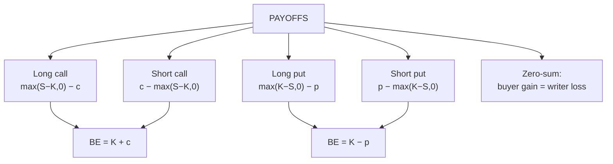

# OS-2: Payoffs and Breakevens of Calls and Puts

Covers: the four basic positions (long call, short call, long put, short put), payoff vs profit, breakeven, maximum gain and loss, and a table for each. Every strategy in OS-4 to OS-7 is built from these four. **(syllabus)** scope, **(textbook)** Hull method.

## Where this fits in the ESE

A payoff table with breakeven and a diagram description is a standard 5-mark question. Strategy sums (OS-4 to OS-7) are the 10-mark and case material, and they all start with these four lines. Learn the table cold.

## Payoff vs profit

- **Payoff** at expiry ignores the premium.
- **Profit = payoff − premium paid** (for a buyer) or **premium received − payoff** (for a seller).
- **Breakeven** is the spot price at expiry where profit is zero.

## The four positions **(textbook)**

| Position | Payoff at expiry | Profit | Breakeven | Max profit | Max loss | View |
|---|---|---|---|---|---|---|
| **Long call** | max(S − K, 0) | max(S − K, 0) − c | K + c | Unlimited | c | Bullish |
| **Short call** | −max(S − K, 0) | c − max(S − K, 0) | K + c | c | Unlimited | Neutral to bearish |
| **Long put** | max(K − S, 0) | max(K − S, 0) − p | K − p | K − p | p | Bearish |
| **Short put** | −max(K − S, 0) | p − max(K − S, 0) | K − p | p | K − p | Neutral to bullish |

For every pair, **the buyer's profit is the seller's loss**. Options are a zero-sum game before costs.

## Worked example: all four positions

**Data (hypothetical):** strike K = ₹100; call premium c = ₹6; put premium p = ₹4. (This is the Unit 4 teaching board used in OS-4 to OS-8.)

| S at expiry | Long call | Short call | Long put | Short put |
|---|---|---|---|---|
| 80 | −6 | +6 | +16 | −16 |
| 90 | −6 | +6 | +6 | −6 |
| 94 | −6 | +6 | +2 | −2 |
| 96 | −6 | +6 | 0 | 0 |
| 100 | −6 | +6 | −4 | +4 |
| 106 | 0 | 0 | −4 | +4 |
| 110 | +4 | −4 | −4 | +4 |
| 120 | +14 | −14 | −4 | +4 |

Check each cell: long call at 110 = (110 − 100) − 6 = +4; long put at 80 = (100 − 80) − 4 = +16; short put at 90 = 4 − 10 = −6.

**Breakevens:** call 100 + 6 = **106**; put 100 − 4 = **96**.

**Decision line and interpretation.**
1. Long call: loss capped at ₹6, gain unlimited above 106. Use it when bullish with limited capital at risk.
2. Short call: gain capped at ₹6, loss unlimited above 106. It earns the premium if the price stays below 106 but is dangerous in a rally.
3. Long put: maximum profit is ₹96 per unit (if the price falls to zero); loss capped at ₹4.
4. Short put: collects ₹4 but can lose up to ₹96. It is a bullish-to-neutral bet that obliges you to buy at ₹100.

## Diagram description (for a 5-mark answer)

Describe each diagram in one sentence rather than drawing everything:

- **Long call:** flat at −c until K, then rises at 45°; crosses zero at K + c.
- **Short call:** mirror image: flat at +c until K, then falls at 45°.
- **Long put:** falls at 45° from the left to K (profit large when S is low), flat at −p to the right of K.
- **Short put:** mirror image of the long put.

If asked to sketch, mark K, the breakeven, the premium level, and the maximum gain/loss.

## Payoff on the underlying: the basis for strategies

The underlying itself has a linear payoff S − S₀. An option is a **kinked** payoff. Combining options with a position in the share produces covered calls and protective puts (OS-4); combining options with each other produces spreads and combinations (OS-5 to OS-7).

## Worked example 2: exam-style, index options

**Question (hypothetical):** A trader buys a Nifty-style call, strike 22,000, premium 250, lot 50, and another trader sells it. Index at expiry is 22,400. Find each side's profit.

1. Payoff = 22,400 − 22,000 = 400 per unit.
2. Buyer's profit = 400 − 250 = 150 per unit × 50 = **₹7,500**.
3. Seller's profit = 250 − 400 = −150 per unit × 50 = **−₹7,500**.
4. Interpretation: the buyer gains because the index is above the breakeven 22,250. The seller's loss equals the buyer's gain.

## Traps

- **Payoff vs profit.** The payoff diagram starts at zero; the profit diagram is shifted down by the premium.
- **Same breakeven for long and short** of the same option, but opposite sign of profit.
- **Put breakeven is K − p**, not K + p.
- **Short call loss is unlimited** (the price has no ceiling); the short put's loss is limited to K − p.
- **Multiply by the lot size** for the rupee answer.

## What to remember

- Long call: −c below K, gains above K + c; breakeven K + c.
- Long put: gains below K − p; loss capped at p.
- Writer's profit is the buyer's loss; writer's gain is capped at the premium.
- Board (K 100, c 6, p 4): breakevens 106 and 96.
- Payoff = ignore premium; profit = include premium.

## Concept map

## Flashcards
Q: Profit of a long call at expiry?
A: max(S − K, 0) − c, where c is the premium paid.

Q: Breakeven of a call and of a put?
A: Call: K + c. Put: K − p.

Q: Maximum loss of a long call? Of a short call?
A: Long call: the premium. Short call: unlimited.

Q: K = 100, call premium 6. Long call profit at S = 110?
A: (110 − 100) − 6 = +4.

Q: K = 100, put premium 4. Long put profit at S = 80?
A: 20 − 4 = +16.

Q: K = 100, put premium 4. Short put profit at S = 90?
A: 4 − 10 = −6.

Q: Maximum profit of a long put?
A: K − p (the underlying falls to zero).

Q: Index call 22,000 bought at 250, index ends at 22,400, lot 50. Buyer's profit?
A: (400 − 250) × 50 = ₹7,500.

Q: Payoff vs profit?
A: Payoff ignores the premium; profit includes it (payoff minus premium paid, or premium received minus payoff).

## Sources
- BBA301F-6 syllabus, Unit 4 (payoffs and payoff diagrams, call and put options)
- Hull, *Options, Futures and Other Derivatives* (6th ed.), ch. 8 and ch. 10
- Previous: [[Derivatives Unit 4 - OS-1 Option Terminology Types and Moneyness]] · Next: [[Derivatives Unit 4 - OS-3 Factors Affecting Option Premium]]
- [[Derivatives Unit 4 - Options and Strategies MOC (Node Map)]]
