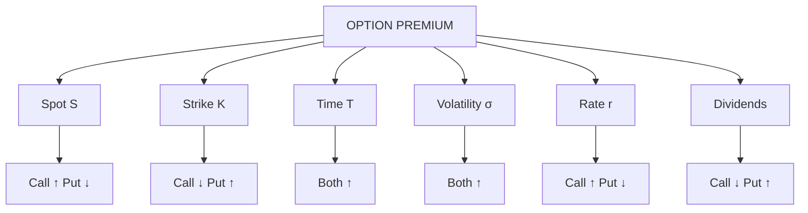

# OS-3: Factors Affecting the Option Premium

Covers: the six drivers of an option's price (spot, strike, time, volatility, interest rate, dividends), the direction of each effect on calls and puts, and numbers that show the effect. **(syllabus)** scope, **(textbook)** Hull method.

## Where this fits in the ESE

"Factors affecting option premium" is a named syllabus topic and a near-certain 5-mark theory question. The direction table is the answer; the numbers make it stick and link to the Greeks (OP-5).

## The six factors **(textbook)**

| Factor | Effect on call | Effect on put | Reason |
|---|---|---|---|
| **Spot price S ↑** | ↑ | ↓ | Call gets more intrinsic value; put less |
| **Strike price K ↑** | ↓ | ↑ | Call right to buy at a higher price is worth less |
| **Time to expiry T ↑** | ↑ | ↑ (usually) | More time for a favourable move |
| **Volatility σ ↑** | ↑ | ↑ | Bigger swings raise the upside; the downside is capped at the premium |
| **Interest rate r ↑** | ↑ | ↓ | Present value of K falls; call cheaper to hold than the share |
| **Dividends ↑** | ↓ | ↑ | Share price drops on the ex-date |

Two caveats: for deep ITM European puts, longer time can reduce value (the strike is received later, so it is discounted); American options always gain from extra time.

## Worked example: how the premium moves

**Data (hypothetical, from Black-Scholes in OP-4):** base case S = K = ₹100, r = 6%, σ = 20%, T = 6 months (0.5). Premiums: **call ₹7.16, put ₹4.20**.

Change **one** factor at a time:

| Change from base | Call (₹) | Put (₹) | Call moves | Put moves |
|---|---|---|---|---|
| Base | 7.16 | 4.20 | | |
| S = 110 | 14.46 | 1.50 | ↑ | ↓ |
| S = 90 | 2.48 | 9.52 | ↓ | ↑ |
| K = 110 | 3.06 | 9.81 | ↓ | ↑ |
| K = 90 | 13.85 | 1.19 | ↑ | ↓ |
| σ = 30% | 9.88 | 6.93 | ↑ | ↑ |
| σ = 10% | 4.50 | 1.55 | ↓ | ↓ |
| T = 1 year | 10.99 | 5.17 | ↑ | ↑ |
| T = 3 months | 4.75 | 3.26 | ↓ | ↓ |
| r = 10% | 8.28 | 3.40 | ↑ | ↓ |
| r = 2% | 6.12 | 5.13 | ↓ | ↑ |
| Dividend yield 3% | 6.28 | 4.81 | ↓ | ↑ |

**Interpretation.**
1. Volatility is the only factor you cannot observe. Raising σ from 20% to 30% lifts the ATM call by 38% (7.16 → 9.88). That is why traders talk about **implied volatility** (India VIX is a measure of expected Nifty volatility from option prices **[VERIFY]**).
2. Time value decays: from one year to three months the call falls from 10.99 to 4.75. Decay accelerates near expiry, a cost for buyers and a gain for sellers.
3. Interest rates and dividends matter little for short-dated options but move longer ones.

## Time value decay in one picture

Time value is highest for ATM options and falls towards zero at expiry along a curve that steepens in the last weeks. A buyer needs the move to be **fast enough** to beat time decay. A seller profits from decay if the price stays range-bound.

## Intrinsic value bounds

An option's premium cannot be below its intrinsic value (a European call below S − Ke^(−rT) gives arbitrage: OP-1). Premium above intrinsic value is the time value, and it is highest ATM.

## Exam answer layout

1. State the six factors in a table with the direction for calls and puts.
2. Give one sentence of reason for each.
3. Add one numerical illustration (the base case changes).
4. Close with the volatility point: it is the key unobservable and the basis for implied volatility.

## Traps

- **Volatility raises both calls and puts.** Many students say it lowers the put.
- **Higher interest rate lowers the put**, not raises it.
- **Time can hurt a deep ITM European put.** For a standard answer say "usually increases".
- **Strike effect is opposite for calls and puts.**
- **Dividends** matter for the ex-dividend date; for an index use the yield.

## What to remember

- S↑: call↑ put↓. K↑: call↓ put↑. σ↑: both↑. T↑: both↑. r↑: call↑ put↓. Dividends↑: call↓ put↑.
- Base case ₹7.16 call, ₹4.20 put; σ 30% gives ₹9.88 and ₹6.93.
- Premium = intrinsic + time value; time value decays faster near expiry.
- Volatility is estimated from implied prices.

## Concept map

## Flashcards
Q: Effect of a higher spot price on call and put premiums?
A: Call premium rises; put premium falls.

Q: Effect of a higher strike on call and put premiums?
A: Call premium falls; put premium rises.

Q: Effect of higher volatility on call and put premiums?
A: Both rise.

Q: Effect of a higher interest rate on call and put premiums?
A: Call rises; put falls.

Q: Effect of a higher dividend on call and put premiums?
A: Call falls; put rises.

Q: Effect of more time to expiry?
A: Both usually rise (time value is higher); deep ITM European puts can be an exception.

Q: Base call 7.16 and put 4.20 (S = K = 100, σ 20%, T 0.5). Call at σ = 30%?
A: 9.88 (put 6.93).

Q: Why is time value highest ATM?
A: The chance of moving in or out of the money is greatest there, with no intrinsic value to anchor the price.

Q: What is implied volatility?
A: The volatility that, put into a pricing model, reproduces the market premium.

## Sources
- BBA301F-6 syllabus, Unit 4 (factors affecting options premium)
- Hull, *Options, Futures and Other Derivatives* (6th ed.), ch. 9; values computed from the Black-Scholes formulas in [[Derivatives Unit 5 - OP-4 Black-Scholes Model]]
- Previous: [[Derivatives Unit 4 - OS-2 Payoffs and Breakevens]] · Next: [[Derivatives Unit 4 - OS-4 Uncovered and Covered Positions]]
- [[Derivatives Unit 4 - Options and Strategies MOC (Node Map)]]
