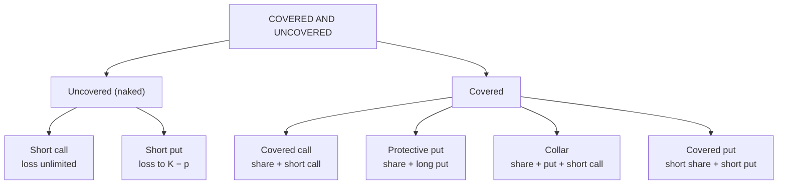

# OS-4: Uncovered and Covered Positions

Covers: naked (uncovered) calls and puts, covered call, protective put, collar, the payoff table and breakeven for each, and the margin point in India. **(syllabus)** scope, **(textbook)** Hull method.

## Where this fits in the ESE

The syllabus lists four strategy families: Uncovered, Covered, Spread, Combination. This node covers the first two. A 5-mark question asks for the payoff table and breakeven of the covered call or protective put.

All premiums come from the Unit 4 teaching board: **share price ₹100; call K100 ₹6, call K110 ₹2.50; put K100 ₹4, put K95 ₹2.50**. They are round hypothetical numbers.

## Uncovered (naked) positions

A position is **uncovered** if the option is sold without holding the underlying (or an offsetting option).

**Naked call (short call):** Profit = c − max(S − K, 0). Loss is **unlimited**. Breakeven K + c.

**Naked put (short put):** Profit = p − max(K − S, 0). Loss limited to K − p. Breakeven K − p.

| S at expiry | Naked call, K100 sold at ₹6 | Naked put, K100 sold at ₹4 |
|---|---|---|
| 80 | +6 | −16 |
| 90 | +6 | −6 |
| 96 | +6 | 0 |
| 100 | +6 | +4 |
| 106 | 0 | +4 |
| 110 | −4 | +4 |
| 130 | −24 | +4 |

Naked call breakeven 106; naked put breakeven 96.

**Why dangerous.** A share price jump leaves the call writer with a large loss. Because of this, the exchange charges the writer **SPAN plus exposure margin**, rises in volatile conditions, and brokers screen retail traders for naked selling **[VERIFY]**.

## Covered positions

A position is **covered** if the option risk is offset by the underlying (or another option).

### 1. Covered call: long share + short call

Buy the share at ₹100; sell a call K110 for ₹2.50.
Profit = (S − 100) + 2.50 − max(S − 110, 0).

| S at expiry | Share P&L | Call P&L | **Net** |
|---|---|---|---|
| 80 | −20 | +2.5 | **−17.5** |
| 90 | −10 | +2.5 | **−7.5** |
| 97.5 | −2.5 | +2.5 | **0** |
| 100 | 0 | +2.5 | **+2.5** |
| 110 | +10 | +2.5 | **+12.5** |
| 120 | +20 | −7.5 | **+12.5** |

- **Maximum profit** = (110 − 100) + 2.5 = **₹12.50**, reached at any price ≥ 110.
- **Breakeven** = 100 − 2.5 = **₹97.50**.
- **Maximum loss** = ₹97.50 (price to zero); the premium softens a fall by ₹2.50 only.

**Interpretation.** A covered call gives up upside above ₹110 in return for ₹2.50 income. It suits an investor with a neutral-to-mildly-bullish view who already owns the share. It is **not** a hedge against a crash.

### 2. Protective put: long share + long put

Buy the share at ₹100; buy a put K95 for ₹2.50.
Profit = (S − 100) + max(95 − S, 0) − 2.50.

| S at expiry | Share P&L | Put P&L | **Net** |
|---|---|---|---|
| 80 | −20 | +12.5 | **−7.5** |
| 90 | −10 | +2.5 | **−7.5** |
| 95 | −5 | −2.5 | **−7.5** |
| 100 | 0 | −2.5 | **−2.5** |
| 102.5 | +2.5 | −2.5 | **0** |
| 110 | +10 | −2.5 | **+7.5** |
| 120 | +20 | −2.5 | **+17.5** |

- **Maximum loss** = 5 + 2.5 = **₹7.50** below ₹95.
- **Breakeven** = 100 + 2.5 = **₹102.50**.
- **Maximum profit:** unlimited.

**Interpretation.** The put is **insurance**: the premium (₹2.50) is the cost, the strike (₹95) is the floor. The investor keeps all the upside. This looks like a long call (put-call parity, OP-2).

### 3. Collar: long share + long put K95 + short call K110

Premiums cancel (₹2.50 paid, ₹2.50 received), so it is a **zero-cost collar**.

| S at expiry | Net P&L |
|---|---|
| 80 | −5 |
| 95 | −5 |
| 100 | 0 |
| 110 | +10 |
| 120 | +10 |

Loss limited to ₹5 (floor at 95), gain limited to ₹10 (cap at 110). It fixes the range of outcomes at zero net premium.

### 4. Covered put: short share + short put

Short sell the share and sell a put: profits if the price falls moderately, loses if it rises. It is the mirror of the covered call.

## Compare the covered strategies

| Strategy | Max profit | Max loss | Breakeven | View |
|---|---|---|---|---|
| Covered call | 12.50 | 97.50 | 97.50 | Neutral, mildly bullish |
| Protective put | Unlimited | 7.50 | 102.50 | Bullish with insurance |
| Collar | 10 | 5 | 100 | Protect gains cheaply |
| Naked call | 6 | Unlimited | 106 | Neutral, bearish |
| Naked put | 4 | 96 | 96 | Neutral, bullish |

## Exam layout for a strategy answer

1. Name the strategy and the view.
2. Write the position (legs, strikes, premiums) and the net premium.
3. State the profit formula.
4. Draw the payoff table at six or seven prices, including breakeven and strikes.
5. State max profit, max loss, breakeven.
6. One-line interpretation: when to use it and what it gives up.

## Traps

- **Covered call is not risk free.** The share can still fall.
- **Naked put is bullish**, even though it is "short".
- **Protective put breakeven is above the purchase price** by the premium.
- **Both legs in the table:** show the share P&L and option P&L separately before adding.
- **Margin applies to naked sellers**, not to the covered call in the same way (SPAN gives offsets) **[VERIFY]**.

## What to remember

- Naked call: max profit 6, loss unlimited, breakeven 106. Naked put: max profit 4, max loss 96, breakeven 96.
- Covered call: max profit 12.50, breakeven 97.50.
- Protective put: max loss 7.50, breakeven 102.50, unlimited upside.
- Zero-cost collar: range −5 to +10.
- Selling options earns the premium but sells protection.

## Concept map

## Flashcards
Q: What makes a call position "uncovered"?
A: The writer sells the call without owning the underlying, so the loss is unlimited.

Q: Covered call formula for profit?
A: (S − purchase price) + call premium − max(S − K, 0).

Q: Share ₹100, short call K110 at ₹2.50. Maximum profit and breakeven?
A: Maximum profit ₹12.50; breakeven ₹97.50.

Q: Share ₹100, long put K95 at ₹2.50. Maximum loss and breakeven?
A: Maximum loss ₹7.50; breakeven ₹102.50.

Q: What does a collar do?
A: Combines a protective put and a covered call to fix a range of outcomes at low or zero net premium.

Q: Zero-cost collar from the board: long put 95, short call 110. Range of P&L?
A: −₹5 to +₹10.

Q: Why does a naked put writer have a loss limit?
A: The share cannot fall below zero; the maximum loss is K − p.

Q: What is a protective put similar to?
A: A long call (by put-call parity).

## Sources
- BBA301F-6 syllabus, Unit 4 (uncovered and covered strategies)
- Hull, *Options, Futures and Other Derivatives* (6th ed.), ch. 10
- Previous: [[Derivatives Unit 4 - OS-3 Factors Affecting Option Premium]] · Next: [[Derivatives Unit 4 - OS-5 Spreads]]
- [[Derivatives Unit 4 - Options and Strategies MOC (Node Map)]]
