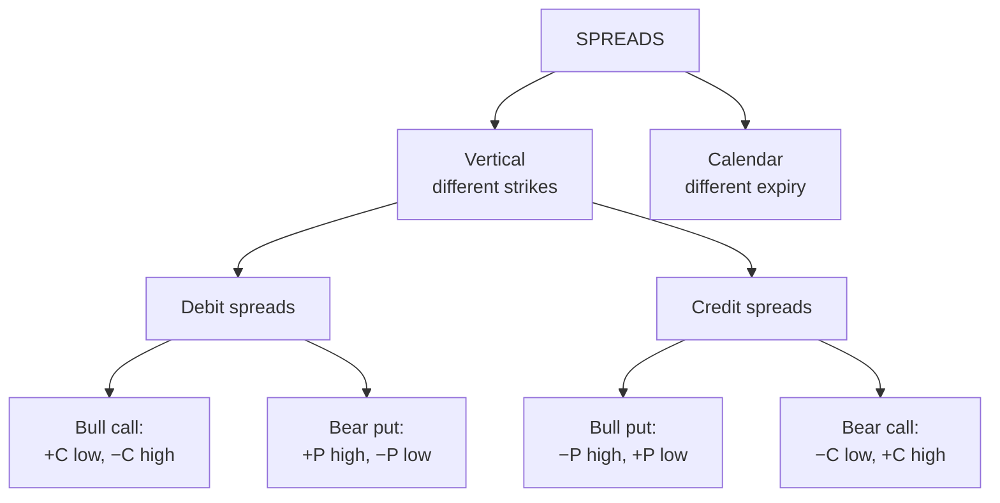

# OS-5: Spreads

Covers: vertical spreads (bull call, bear put, bull put, bear call) with payoff tables and breakevens, debit vs credit, and the calendar spread concept. **(syllabus)** scope, **(textbook)** Hull method.

## Where this fits in the ESE

Bull call and bear put spreads are the standard 5-mark payoff table. The shape (limited profit, limited loss) is also a typical 10-mark comparison with straddles. Use the Unit 4 board: **calls K100 ₹6, K110 ₹2.50; puts K110 ₹9, K100 ₹4, K90 ₹1.50**.

## What a spread is **(textbook)**

A **spread** combines options of the **same type** (both calls or both puts) on the same underlying with **different strikes or expiries**. A **vertical** spread differs in strike; a **calendar** spread differs in expiry. Spreads cap both profit and loss and cost less than a naked option.

## Bull call spread (debit)

**Buy low-strike call, sell high-strike call.** View: moderately bullish.

*Position:* buy call K100 at ₹6; sell call K110 at ₹2.50. **Net debit = 6 − 2.5 = ₹3.50.**

Profit = max(S − 100, 0) − max(S − 110, 0) − 3.50.

| S at expiry | Long call 100 | Short call 110 | Net premium | **Profit** |
|---|---|---|---|---|
| 90 | 0 | 0 | −3.5 | **−3.5** |
| 100 | 0 | 0 | −3.5 | **−3.5** |
| 103.5 | 3.5 | 0 | −3.5 | **0** |
| 110 | 10 | 0 | −3.5 | **+6.5** |
| 120 | 20 | −10 | −3.5 | **+6.5** |

- **Maximum loss** = net debit = **₹3.50** (S ≤ 100).
- **Maximum profit** = (110 − 100) − 3.5 = **₹6.50** (S ≥ 110).
- **Breakeven** = 100 + 3.5 = **₹103.50**.

**Interpretation.** The spread is cheaper than the naked call (₹3.50 vs ₹6) because selling the 110 call finances part of it. The price is the cap: no gain above ₹110.

## Bear put spread (debit)

**Buy high-strike put, sell low-strike put.** View: moderately bearish.

*Position:* buy put K110 at ₹9; sell put K100 at ₹4. **Net debit = 9 − 4 = ₹5.**

Profit = max(110 − S, 0) − max(100 − S, 0) − 5.

| S at expiry | Long put 110 | Short put 100 | Net premium | **Profit** |
|---|---|---|---|---|
| 90 | 20 | −10 | −5 | **+5** |
| 100 | 10 | 0 | −5 | **+5** |
| 105 | 5 | 0 | −5 | **0** |
| 110 | 0 | 0 | −5 | **−5** |
| 120 | 0 | 0 | −5 | **−5** |

- **Maximum profit** = (110 − 100) − 5 = **₹5** (S ≤ 100).
- **Maximum loss** = **₹5** (S ≥ 110).
- **Breakeven** = 110 − 5 = **₹105**.

## Credit spreads

Credit spreads **receive** a net premium and profit if the market does **not** move against them.

**Bull put spread (credit):** sell put K100 at ₹4; buy put K90 at ₹1.50. Net credit **₹2.50**.

| S at expiry | Profit |
|---|---|
| 80 | −7.5 |
| 90 | −7.5 |
| 97.5 | 0 |
| 100 | +2.5 |
| 110 | +2.5 |

Maximum profit **₹2.50** (S ≥ 100); maximum loss (100 − 90) − 2.5 = **₹7.50**; breakeven **₹97.50**.

**Bear call spread (credit):** sell call K100 at ₹6; buy call K110 at ₹2.50. Net credit **₹3.50**; maximum profit ₹3.50 (S ≤ 100); maximum loss 10 − 3.5 = **₹6.50**; breakeven ₹103.50. It is the mirror image of the bull call spread.

## Summary of vertical spreads

| Spread | Legs | Net | Max profit | Max loss | Breakeven | View |
|---|---|---|---|---|---|---|
| Bull call | +C100, −C110 | Debit 3.5 | 6.5 | 3.5 | 103.5 | Moderately bullish |
| Bear put | +P110, −P100 | Debit 5 | 5 | 5 | 105 | Moderately bearish |
| Bull put | −P100, +P90 | Credit 2.5 | 2.5 | 7.5 | 97.5 | Neutral to bullish |
| Bear call | −C100, +C110 | Credit 3.5 | 3.5 | 6.5 | 103.5 | Neutral to bearish |

Max profit + max loss = difference between strikes in every vertical spread (3.5 + 6.5 = 10; 5 + 5 = 10; 2.5 + 7.5 = 10).

## Calendar (time) spread: concept only

Sell a near-expiry option and buy a far-expiry option at the **same strike**. Near-term time value decays faster, so the spread gains if the price stays near the strike. It is a bet on time decay and on volatility staying flat. Exam answers usually need a definition and a use, not a table.

## Exam layout

1. Name the spread and the view.
2. List the legs, strikes and premiums; compute net debit or credit.
3. Draw the payoff table at five prices (below lower strike, breakeven, between, upper strike, above).
4. State maximum profit, maximum loss and breakeven.
5. One line: why choose the spread over the naked option (cost) and what is given up (the cap).

## Traps

- **Bull spread buys the lower strike** (calls) and **buys the higher strike** (puts for the bear). Check the long leg is the dearer one for a debit spread.
- **Net debit = long premium − short premium.**
- **Max profit + max loss = strike gap** for all four spreads.
- **Breakeven for the bear put** uses the higher strike minus the debit.
- **Do not confuse the vertical (strike) and calendar (expiry)** spreads.

## What to remember

- Bull call 100/110: debit 3.5, max profit 6.5, max loss 3.5, breakeven 103.5.
- Bear put 110/100: debit 5, max profit 5, max loss 5, breakeven 105.
- Bull put: credit 2.5, max loss 7.5, breakeven 97.5.
- Max profit + max loss = strike gap.
- Spreads cap both profit and loss; cheaper than naked options.

## Concept map

## Flashcards
Q: Construct a bull call spread.
A: Buy a call at a lower strike and sell a call at a higher strike (same expiry); net debit.

Q: Bull call: buy C100 at 6, sell C110 at 2.50. Net debit, max profit, breakeven?
A: Debit ₹3.50; max profit ₹6.50; breakeven ₹103.50.

Q: Bear put: buy P110 at 9, sell P100 at 4. Net debit, max profit, breakeven?
A: Debit ₹5; max profit ₹5; breakeven ₹105.

Q: Bull put credit spread: sell P100 at 4, buy P90 at 1.50. Max loss and breakeven?
A: Max loss ₹7.50; breakeven ₹97.50 (credit ₹2.50).

Q: In any vertical spread, max profit plus max loss equals what?
A: The difference between the strikes.

Q: Why use a spread rather than a naked call?
A: It costs less and caps the loss, in exchange for capping the profit.

Q: What is a calendar spread?
A: Selling a near-expiry option and buying a far-expiry option at the same strike to profit from time decay.

Q: Which view fits a bear put spread?
A: Moderately bearish: profit if the price falls but with a limited gain.

## Sources
- BBA301F-6 syllabus, Unit 4 (spreads)
- Hull, *Options, Futures and Other Derivatives* (6th ed.), ch. 10
- Previous: [[Derivatives Unit 4 - OS-4 Uncovered and Covered Positions]] · Next: [[Derivatives Unit 4 - OS-6 Straddle Strangle Strip and Strap]]
- [[Derivatives Unit 4 - Options and Strategies MOC (Node Map)]]
