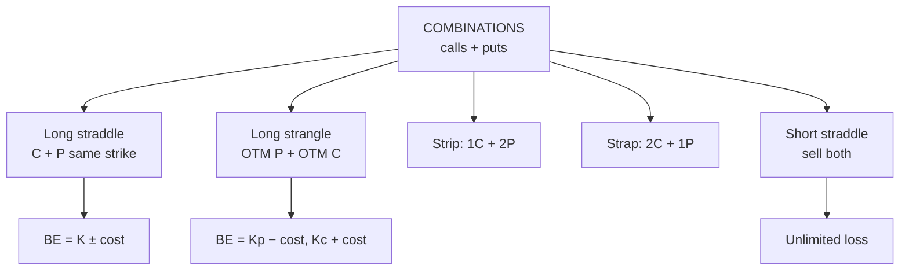

# OS-6: Combinations: Straddle, Strangle, Strip and Strap

Covers: combinations, which use **calls and puts together** on the same underlying. Long and short straddle, strangle, strip and strap, with payoff tables and two breakevens each. **(syllabus)** scope, **(textbook)** Hull method.

## Where this fits in the ESE

"Combination" is the fourth family in the syllabus. The long straddle and strangle with two breakevens are the usual 5-mark sums; a comparison of straddle and strangle is a likely 10-mark item. Board: **call K100 ₹6; put K100 ₹4; put K95 ₹2.50; call K105 ₹4**.

## What a combination is **(textbook)**

A **combination** takes a position in **both calls and puts** on the same underlying. The trader is betting on **volatility** (big move, or no move), not on the direction.

## Long straddle

**Buy a call and a put at the same strike and expiry.** View: expects a big move, direction unknown.

*Position:* buy call K100 (₹6) + buy put K100 (₹4). **Cost = ₹10.**

Profit = max(S − 100, 0) + max(100 − S, 0) − 10 = |S − 100| − 10.

| S at expiry | Call payoff | Put payoff | **Profit** |
|---|---|---|---|
| 80 | 0 | 20 | **+10** |
| 90 | 0 | 10 | **0** |
| 100 | 0 | 0 | **−10** |
| 110 | 10 | 0 | **0** |
| 120 | 20 | 0 | **+10** |

- **Maximum loss** = ₹10 (at S = 100).
- **Breakevens:** 100 − 10 = **₹90** and 100 + 10 = **₹110**.
- **Maximum profit:** unlimited upside; downside up to ₹90 (price to zero).

**Interpretation.** The price must move by more than ₹10 (10%) either way. Suited to an event such as a result or a budget, when the outcome is uncertain but the move is expected to be large. Time decay hurts, so the move must be quick.

## Short straddle

Sell the call and the put at the same strike: collect ₹10. Profit = 10 − |S − 100|: maximum gain ₹10 at S = 100; breakevens 90 and 110; **loss unlimited**. A bet on a quiet market; very risky.

| S | Profit |
|---|---|
| 80 | −10 |
| 90 | 0 |
| 100 | +10 |
| 110 | 0 |
| 120 | −10 |

## Long strangle

**Buy an OTM call and an OTM put with different strikes (same expiry).** Cheaper than a straddle but needs a bigger move.

*Position:* buy put K95 (₹2.50) + buy call K105 (₹4). **Cost = ₹6.50.**

Profit = max(95 − S, 0) + max(S − 105, 0) − 6.5.

| S at expiry | Put payoff | Call payoff | **Profit** |
|---|---|---|---|
| 80 | 15 | 0 | **+8.5** |
| 88.5 | 6.5 | 0 | **0** |
| 90 | 5 | 0 | **−1.5** |
| 95 | 0 | 0 | **−6.5** |
| 100 | 0 | 0 | **−6.5** |
| 105 | 0 | 0 | **−6.5** |
| 110 | 0 | 5 | **−1.5** |
| 111.5 | 0 | 6.5 | **0** |
| 120 | 0 | 15 | **+8.5** |

- **Maximum loss** = ₹6.50, anywhere between 95 and 105.
- **Breakevens:** 95 − 6.5 = **₹88.50** and 105 + 6.5 = **₹111.50**.

**Straddle vs strangle.** The straddle costs ₹10 and breaks even at 90/110 (a ±10% move); the strangle costs ₹6.50 but breaks even at 88.50/111.50 (a ±11.5% move). The strangle risks less money but needs a bigger move, and its loss zone is wider (95 to 105).

## Strip and strap (modified straddles)

Both use the **same strike and expiry** but unequal numbers of calls and puts.

| | Strip | Strap |
|---|---|---|
| Position | 1 call + **2 puts** | **2 calls** + 1 put |
| View | Big move, **down** more likely | Big move, **up** more likely |
| Cost (K100, c 6, p 4) | 6 + 8 = **14** | 12 + 4 = **16** |
| Downside breakeven | 100 − 14 ÷ 2 = **93** | 100 − 16 = **84** |
| Upside breakeven | 100 + 14 = **114** | 100 + 16 ÷ 2 = **108** |

Profit tables:

| S at expiry | Strip profit | Strap profit |
|---|---|---|
| 70 | +46 | +14 |
| 84 | +18 | 0 |
| 86 | +14 | −2 |
| 93 | 0 | −9 |
| 100 | −14 | −16 |
| 108 | −6 | 0 |
| 110 | −4 | +4 |
| 114 | 0 | +12 |
| 130 | +16 | +44 |

Check: strip at 70 = 2 × 30 − 14 = 46; strap at 130 = 2 × 30 − 16 = 44.

## Combinations compared

| Strategy | Cost | Breakevens | Max loss | View |
|---|---|---|---|---|
| Long straddle | 10 | 90, 110 | 10 | Big move, either way |
| Long strangle | 6.5 | 88.5, 111.5 | 6.5 | Bigger move, cheaper |
| Strip | 14 | 93, 114 | 14 | Big move, bias down |
| Strap | 16 | 84, 108 | 16 | Big move, bias up |
| Short straddle | +10 credit | 90, 110 | Unlimited | Quiet market |

## Exam layout

1. Name the strategy; state the view (volatility).
2. Legs, strikes and total cost (or credit).
3. Profit formula.
4. Table: below lower BE, lower BE, middle, upper BE, above.
5. Max loss, both breakevens, profit potential.
6. Interpretation: events, time decay, comparison with the alternative.

## Traps

- **Two breakevens, not one.** Lower = K − cost; upper = K + cost (straddle).
- **Strangle breakevens use each option's own strike:** put strike minus total cost; call strike plus total cost.
- **Strip/strap breakevens split the cost** on the side with two options.
- **Short straddle is not hedged.** Loss is unlimited on the upside.
- **Direction is irrelevant for the straddle,** but the size of the move is not.

## What to remember

- Long straddle: cost 10, breakevens 90 and 110, max loss 10.
- Long strangle: cost 6.50, breakevens 88.50 and 111.50, max loss 6.50 (cheaper, needs a bigger move).
- Strip: 1 call + 2 puts (cost 14; BE 93 and 114). Strap: 2 calls + 1 put (cost 16; BE 84 and 108).
- Buyers of combinations want volatility; sellers want calm.
- Time decay is the buyer's enemy.

## Concept map

## Flashcards
Q: Construct a long straddle.
A: Buy a call and a put with the same strike and expiry.

Q: Straddle K100, call 6, put 4. Cost, breakevens, max loss?
A: Cost ₹10; breakevens 90 and 110; max loss ₹10 at S = 100.

Q: Strangle: buy put K95 at 2.50, call K105 at 4. Cost and breakevens?
A: Cost ₹6.50; breakevens ₹88.50 and ₹111.50.

Q: Why choose a strangle over a straddle?
A: It costs less (₹6.50 vs ₹10), at the price of needing a larger move.

Q: What is a strip? A strap?
A: Strip: 1 call + 2 puts (bearish bias). Strap: 2 calls + 1 put (bullish bias); same strike.

Q: Strip K100 (call 6, put 4): cost and breakevens?
A: Cost ₹14; breakevens ₹93 and ₹114.

Q: Strap K100: cost and breakevens?
A: Cost ₹16; breakevens ₹84 and ₹108.

Q: What view does a short straddle express and what is its risk?
A: The market will stay near the strike; risk is unlimited loss on large moves.

Q: What enemy do combination buyers face?
A: Time decay; the move must come quickly.

## Sources
- BBA301F-6 syllabus, Unit 4 (combination strategies)
- Hull, *Options, Futures and Other Derivatives* (6th ed.), ch. 10
- Previous: [[Derivatives Unit 4 - OS-5 Spreads]] · Next: [[Derivatives Unit 4 - OS-7 Butterfly and Condor]]
- [[Derivatives Unit 4 - Options and Strategies MOC (Node Map)]]
