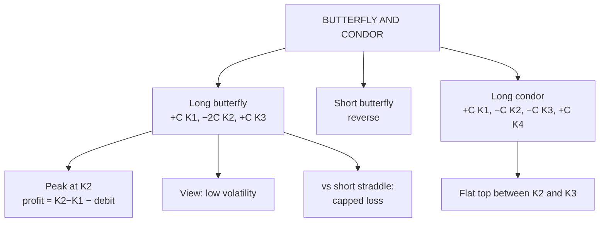

# OS-7: Butterfly and Condor Spreads

Covers: the long call butterfly with its payoff table and breakevens, the short butterfly, the long condor, and when each is used. **(syllabus)** scope, **(textbook)** Hull method.

## Where this fits in the ESE

The butterfly is a spread with three strikes and appears as a 5-mark table or as a case option "a range-bound view". It also reappears in Unit 5 as the convexity arbitrage test (OP-3). Board: **calls K90 ₹12, K100 ₹6, K110 ₹2.50, K120 ₹1**.

## Long call butterfly

**Buy one call at the low strike K₁, sell two calls at the middle strike K₂, buy one call at the high strike K₃**, with K₂ midway between K₁ and K₃ and the same expiry. View: the price will stay near K₂ (low volatility). Max profit at K₂.

*Position:* buy C90 (₹12); sell 2 × C100 (2 × ₹6 = ₹12 received); buy C110 (₹2.50).
**Net debit = 12 − 12 + 2.50 = ₹2.50.**

Profit = max(S − 90, 0) − 2 × max(S − 100, 0) + max(S − 110, 0) − 2.50.

| S at expiry | Long C90 | Short 2 × C100 | Long C110 | Payoff | **Profit** |
|---|---|---|---|---|---|
| 80 | 0 | 0 | 0 | 0 | **−2.5** |
| 90 | 0 | 0 | 0 | 0 | **−2.5** |
| 92.5 | 2.5 | 0 | 0 | 2.5 | **0** |
| 100 | 10 | 0 | 0 | 10 | **+7.5** |
| 107.5 | 17.5 | −15 | 0 | 2.5 | **0** |
| 110 | 20 | −20 | 0 | 0 | **−2.5** |
| 120 | 30 | −40 | 10 | 0 | **−2.5** |

- **Maximum loss** = net debit = **₹2.50** (S ≤ 90 or S ≥ 110).
- **Maximum profit** = (K₂ − K₁) − debit = 10 − 2.5 = **₹7.50** at S = 100.
- **Breakevens:** K₁ + debit = **₹92.50** and K₃ − debit = **₹107.50**.

**Interpretation.** For ₹2.50 of risk the trader can earn ₹7.50 if the price pins at ₹100 at expiry, a 3-to-1 reward-to-risk ratio. Profit falls away if the price moves more than about ₹7.50 either way. It is the cheap, limited-loss alternative to a **short straddle**, which has the same view but unlimited loss.

**Payoff is never negative before the debit.** Because the butterfly payoff is always ≥ 0, its price must be ≥ 0. A negative price would be an arbitrage (OP-3).

## Short butterfly

The reverse: sell one C90, buy two C100, sell one C110. Net **credit ₹2.50**; profit ₹2.50 if the price ends far from ₹100 (S ≤ 90 or S ≥ 110); maximum loss ₹7.50 at S = 100. A view that volatility will be high, with limited loss.

## Long call condor

**Buy one low-strike call (K₁), sell one call at K₂, sell one call at K₃, buy one call at K₄**, with K₁ < K₂ < K₃ < K₄. View: price will stay between K₂ and K₃. It has a flat top rather than a peak.

*Position:* buy C90 (12); sell C100 (6); sell C110 (2.50); buy C120 (1).
**Net debit = 12 − 6 − 2.5 + 1 = ₹4.50.**

| S at expiry | Profit |
|---|---|
| 80 | −4.5 |
| 90 | −4.5 |
| 94.5 | 0 |
| 100 | +5.5 |
| 105 | +5.5 |
| 110 | +5.5 |
| 115.5 | 0 |
| 120 | −4.5 |
| 130 | −4.5 |

- **Maximum profit** = (K₂ − K₁) − debit = 10 − 4.5 = **₹5.50**, for any S from 100 to 110.
- **Maximum loss** = **₹4.50**.
- **Breakevens:** 90 + 4.5 = **₹94.50** and 120 − 4.5 = **₹115.50**.

**Interpretation.** A condor trades a lower peak profit (₹5.50 vs ₹7.50) for a wider profit zone (100 to 110 vs a single point). It suits a trader who expects the price to stay in a range but cannot pin it.

## Comparison of range-bound strategies

| Strategy | Debit or credit | Max profit | Max loss | Zone |
|---|---|---|---|---|
| Short straddle | Credit 10 | 10 | Unlimited | At 100 |
| Long butterfly | Debit 2.5 | 7.5 | 2.5 | At 100, 92.5 to 107.5 |
| Long condor | Debit 4.5 | 5.5 | 4.5 | 100 to 110 flat, 94.5 to 115.5 |

## Exam layout

1. Name and view (low volatility).
2. Legs: buy/sell, ratio 1:2:1, strikes equally spaced.
3. Net debit from premiums.
4. Table at seven prices including the breakevens and strikes.
5. Max profit (middle strike minus lower strike, less debit), max loss (debit), breakevens.
6. Compare with the short straddle: same view, capped loss.

## Traps

- **The ratio is 1 : 2 : 1.** Forgetting the 2 sold calls breaks the payoff.
- **Max profit = (K₂ − K₁) − debit,** not K₃ − K₁.
- **Breakevens are K₁ + debit and K₃ − debit.**
- **A butterfly is a spread, not a combination:** it uses only one option type.
- **Wings must be equidistant.** Unequal wings give a skewed payoff.

## What to remember

- Long butterfly: +C90, −2C100, +C110: debit 2.50; max profit 7.50 at 100; breakevens 92.50 and 107.50.
- Long condor: debit 4.50; flat top 5.50 between 100 and 110; breakevens 94.50 and 115.50.
- Butterfly = limited-risk version of the short straddle.
- Profit is highest when volatility is low and the price pins at the middle strike.
- Short butterfly is the opposite bet on volatility.

## Concept map

## Flashcards
Q: Construct a long call butterfly.
A: Buy one call at K₁, sell two calls at K₂, buy one call at K₃, with K₂ the midpoint and the same expiry.

Q: Butterfly with calls 90/100/110 at 12, 6, 2.50. Net debit?
A: 12 − 2 × 6 + 2.50 = ₹2.50.

Q: Same butterfly: maximum profit, maximum loss, breakevens?
A: Max profit ₹7.50 at S = 100; max loss ₹2.50; breakevens ₹92.50 and ₹107.50.

Q: What view does a long butterfly express?
A: Low volatility: the price will stay near the middle strike.

Q: Why prefer a long butterfly to a short straddle?
A: Same view, but the loss is limited to the debit rather than unlimited.

Q: Condor 90/100/110/120 at 12, 6, 2.50, 1. Debit and max profit?
A: Debit ₹4.50; max profit ₹5.50 between 100 and 110.

Q: Condor breakevens for that position?
A: ₹94.50 and ₹115.50.

Q: What is the short butterfly's view?
A: High volatility: it profits if the price ends far from the middle strike, with a capped loss.

## Sources
- BBA301F-6 syllabus, Unit 4 (spreads)
- Hull, *Options, Futures and Other Derivatives* (6th ed.), ch. 10
- Previous: [[Derivatives Unit 4 - OS-6 Straddle Strangle Strip and Strap]] · Next: [[Derivatives Unit 4 - OS-8 Unit 4 Exam Answers]]
- [[Derivatives Unit 4 - Options and Strategies MOC (Node Map)]]
