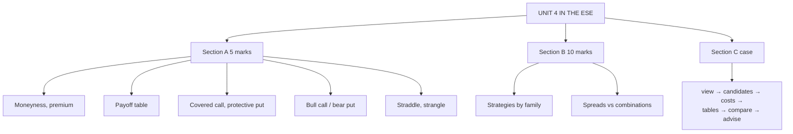

# OS-8: Unit 4 Exam Answers

Covers: what the ESE will ask from Unit 4, 5-mark and 10-mark skeletons, and a 15-mark case layout (choose and compare strategies) with a full model answer.

## What the test will ask

ESE: Section A three 5-mark questions with choice, Section B two 10-mark questions with choice, Section C one 15-mark case. Unit 4 has 10 of 45 hours and is payoff-table heavy: expect a strategy table in Section A and a strategy comparison in Section B or the case. The case is likely "given a view and an option board, construct, tabulate and recommend a strategy". This is a judgement from the syllabus, not a confirmed pattern.

## Five-mark answer skeletons

**1. Moneyness and premium split (OS-1).** Table ITM/ATM/OTM for calls and puts; intrinsic value; time value; one numeric example (call 21,800 @480: 200 + 280).

**2. Payoff of call and put (OS-2).** Four positions; profit formulas; breakevens K + c and K − p; table at five prices; zero-sum remark.

**3. Factors affecting the premium (OS-3).** Six-row direction table; one-line reasons; volatility point; one numeric illustration.

**4. Covered call or protective put (OS-4).** Position; profit formula; table; max profit, max loss, breakeven; when to use.

**5. Bull call spread or bear put spread (OS-5).** Legs; net debit; table; max profit and loss; breakeven; cap vs cost.

**6. Straddle and strangle (OS-6).** Legs; cost; two breakevens; table; comparison.

## Ten-mark answer skeletons

**A. Option trading strategies.** Four families (uncovered, covered, spreads, combinations) with one example each: naked call (loss unlimited), covered call (breakeven 97.50), bull call spread (debit 3.50), long straddle (breakevens 90, 110). End with a summary table of view, max profit, max loss.

**B. Spreads and combinations compared.** Spread = same type, different strikes or expiry; combination = call and put. Tables for bull call spread and straddle; volatility view vs direction view; cost and risk; when to use.

**C. Call and put options: payoffs.** Terminology → four positions → table at eight prices → breakevens → zero-sum → how premiums depend on S, K, T, σ, r.

**D. Butterfly and condor.** Construction, 1:2:1, table, max profit/loss, breakevens, comparison with short straddle.

## Fifteen-mark case layout (choose a strategy)

1. **Read the view (1):** direction? volatility? timeframe?
2. **List candidate strategies (2).**
3. **Compute cost and payoff table (6).**
4. **Breakevens, max profit, max loss (2).**
5. **Compare against the view (2).**
6. **Recommendation and risk (2).**

### Model answer, laid out as the exam answer

**Data (hypothetical):** Meridian Capital (fictional) expects Arrowhead Industries (fictional), trading at ₹100, to announce results next week. The market anticipates a big move, up or down by about 12%, but direction is unclear. Option board (same expiry): calls K90 ₹12, K100 ₹6, K105 ₹4, K110 ₹2.50; puts K90 ₹1.50, K95 ₹2.50, K100 ₹4.

1. **View:** high volatility, no direction. Candidates: long straddle, long strangle (and, as the opposite bet, a butterfly for a quiet result).
2. **Costs.**
   - Straddle: C100 + P100 = 6 + 4 = **₹10**.
   - Strangle: P95 + C105 = 2.50 + 4 = **₹6.50**.
   - Butterfly (for comparison): C90 − 2 × C100 + C110 = 12 − 12 + 2.50 = **₹2.50 debit**.
3. **Profit table:**

| S at expiry | Straddle | Strangle | Butterfly |
|---|---|---|---|
| 80 | +10 | +8.5 | −2.5 |
| 88 | +2 | +0.5 | −2.5 |
| 90 | 0 | −1.5 | −2.5 |
| 100 | −10 | −6.5 | +7.5 |
| 110 | 0 | −1.5 | −2.5 |
| 112 | +2 | +0.5 | −2.5 |
| 120 | +10 | +8.5 | −2.5 |

4. **Breakevens and limits:**
   - Straddle: 90 and 110; max loss ₹10 at 100; gain unlimited on the upside.
   - Strangle: 88.50 and 111.50; max loss ₹6.50 between 95 and 105.
   - Butterfly: 92.50 and 107.50; max profit ₹7.50 at 100; max loss ₹2.50.
5. **Compare with the view.** The anticipated move is ±12% (S = 88 or 112). The straddle makes **₹2** and the strangle **₹0.50**, so the straddle gives more profit if the 12% move arrives. If the result is a non-event (S = 100) the straddle loses **₹10** and the strangle **₹6.50**.
6. **Recommendation.** Buy the **straddle** if the manager believes the move will be at least 12%: it earns ₹2 at ±12% against the strangle's ₹0.50. Buy the **strangle** if the manager wants to risk less (₹6.50) and expects a very large move (20% gives ₹8.50 vs ₹10, only ₹1.50 less for 35% less capital at risk).
   **Risks:** time decay, falling implied volatility after the announcement (volatility crush), and the move being smaller than the premium. The butterfly is the right trade only if the view flips to "quiet".

Close with: *premiums are hypothetical; check the live implied volatility before trading.*

## Time rule

If short of time: name the strategy, write the legs and cost, show a five-row table with the breakevens, and give max profit and max loss. The recommendation sentence carries the interpretation marks.

## What to remember

- Four families: uncovered, covered, spread, combination.
- Straddle 10 (BE 90, 110); strangle 6.50 (BE 88.50, 111.50); butterfly 2.50 debit (BE 92.50, 107.50).
- At ±12% the straddle makes ₹2, the strangle ₹0.50; at no move they lose ₹10 and ₹6.50.
- Always tabulate at the breakevens, the strikes and the extremes.
- Always name time decay and implied volatility as risks.

## Concept map

## Flashcards
Q: Order of steps in the strategy-choice case?
A: Read the view, list candidates, compute costs and payoff table, find breakevens and limits, compare with the view, recommend with risks.

Q: Case: straddle cost, strangle cost?
A: Straddle ₹10 (C100 + P100); strangle ₹6.50 (P95 + C105).

Q: Case: profit of straddle and strangle if the price ends at 112?
A: Straddle +₹2; strangle +₹0.50.

Q: Case: loss of straddle and strangle if the price stays at 100?
A: Straddle −₹10; strangle −₹6.50.

Q: Which strategy suits a quiet result and why?
A: A long butterfly: max profit ₹7.50 at the middle strike with only ₹2.50 at risk.

Q: Skeleton for a 5-mark spread answer?
A: Legs, net debit, table at five prices, max profit and loss, breakeven, cap vs cost.

Q: What risk should every volatility strategy answer mention?
A: Time decay and a drop in implied volatility after the event.

Q: Four families of option strategies on the syllabus?
A: Uncovered, covered, spread and combination.

## Sources
- BBA301F-6 syllabus, Unit 4 and ESE pattern
- [[Derivatives Unit 4 - Options and Strategies MOC (Node Map)]]
