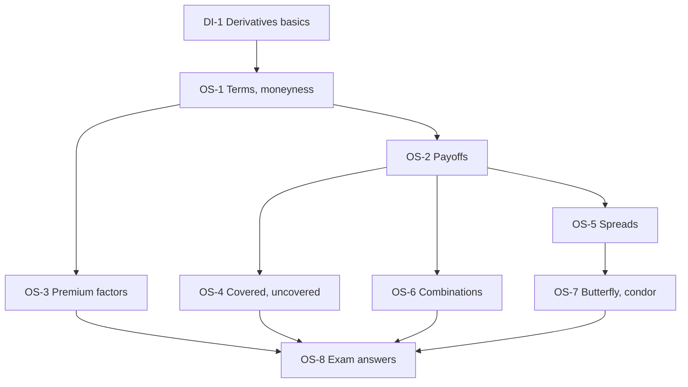

# Derivatives Unit 4: Options and its Strategies, node map

ESE: 50 marks, Section A 3 x 5, Section B 2 x 10, Section C one 15-mark case. Unit 4 is CO1, CO4 and CO5 (use of derivatives and strategy evaluation). Strategy payoff tables with breakevens are the core skill. All examples use one **hypothetical teaching board** (share ₹100; calls K90 ₹12, K100 ₹6, K105 ₹4, K110 ₹2.50, K120 ₹1; puts K90 ₹1.50, K95 ₹2.50, K100 ₹4, K110 ₹9). The board uses round numbers and is not parity-consistent; Unit 5 shows how real prices are tied together.

## Nodes

| Node | Topic | Deps | Minutes | Exam focus |
|---|---|---|---|---|
| OS-1 | Option Terminology, Types and Moneyness | DI-1 | 30 | yes |
| OS-2 | Payoffs and Breakevens | OS-1 | 35 | yes |
| OS-3 | Factors Affecting Option Premium | OS-1 | 30 | yes |
| OS-4 | Uncovered and Covered Positions | OS-2 | 35 | yes |
| OS-5 | Spreads | OS-2 | 40 | yes |
| OS-6 | Straddle, Strangle, Strip and Strap | OS-2 | 35 | yes |
| OS-7 | Butterfly and Condor | OS-5 | 30 | yes |
| OS-8 | Unit 4 Exam Answers | OS-1 to OS-7 | 35 | yes |

Total reading time: about 270 minutes.

## Dependency graph

## Headline numbers to know

- Index call 22,000 @250, lot 50: breakeven 22,250; max loss ₹12,500. Call 21,800 @480: intrinsic 200, time value 280.
- Board K100: long call breakeven 106, long put 96. Premium base ₹7.16 call, ₹4.20 put; σ 30% gives ₹9.88 and ₹6.93.
- Covered call (short C110): max profit 12.50, breakeven 97.50. Protective put (P95): max loss 7.50, breakeven 102.50. Zero-cost collar: −5 to +10.
- Bull call 100/110: debit 3.50, BE 103.50. Bear put 110/100: debit 5, BE 105. Bull put: credit 2.50, max loss 7.50.
- Straddle 10 (BE 90, 110); strangle 6.50 (88.50, 111.50); strip 14 (93, 114); strap 16 (84, 108).
- Butterfly: debit 2.50, max 7.50 at 100, BE 92.50 and 107.50. Condor: debit 4.50, max 5.50, BE 94.50 and 115.50.
- Case at ±12%: straddle +₹2, strangle +₹0.50; no move: −₹10 and −₹6.50.

## Links
- [[Derivatives MOC]]
