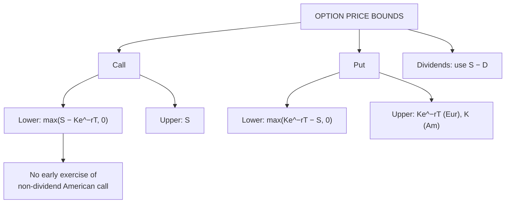

# OP-1: Lower and Upper Bounds on Option Prices

Covers: the upper and lower limits for European and American calls and puts, the dividend adjustment, why an American call on a non-dividend stock is never exercised early, and a numerical check of whether a quoted price breaks a bound. **(syllabus)** scope, **(textbook)** Hull method.

## Where this fits in the ESE

The syllabus names "lower bound, upper bound of option price" explicitly. A bound table plus one numerical check is a standard 5-mark answer, and bounds are the first test in any option arbitrage question (OP-3).

## Notation

S = spot, K = strike, r = risk-free rate (continuous), T = time to expiry, D = present value of dividends before expiry. c, p = European call and put; C, P = American. Discount factor on the strike is K e^(−rT), the present value of K.

## The bounds **(textbook)**

| Option | Lower bound | Upper bound |
|---|---|---|
| **European call (no dividends)** | **c ≥ max(S − Ke^(−rT), 0)** | **c ≤ S** |
| **American call (no dividends)** | C ≥ max(S − Ke^(−rT), 0), and C = c | C ≤ S |
| **European put (no dividends)** | **p ≥ max(Ke^(−rT) − S, 0)** | **p ≤ Ke^(−rT)** |
| **American put** | P ≥ max(K − S, 0) | **P ≤ K** |
| **With dividends (PV = D), European call** | c ≥ max(S − D − Ke^(−rT), 0) | c ≤ S |
| **With dividends, European put** | p ≥ max(D + Ke^(−rT) − S, 0) | p ≤ Ke^(−rT) |

Reasons:
- **Call ≤ S.** The right to buy a share cannot be worth more than the share.
- **Put ≤ K.** The most a put can pay is K (if S falls to zero); for a European put, K is received at T, so ≤ Ke^(−rT).
- **Call ≥ S − Ke^(−rT).** Compare buying the call and investing PV(K) in a bond, with buying the share: the call-plus-bond is worth at least the share at T.
- **American ≥ European.** The American option has extra rights.

## Why an American call on a non-dividend stock is never exercised early

An early exercise gives S − K. But the call is worth at least S − Ke^(−rT), which is **greater** than S − K whenever r > 0. So selling the call is better than exercising it. **C = c** when no dividends are paid. With dividends, early exercise can be optimal just before an ex-dividend date.

For an American put, early exercise can be optimal when deep ITM (receiving K earlier earns interest), so P > p in general.

## Worked example: does this call price break a bound?

**Data (hypothetical):** a non-dividend share trades at ₹50. A 6-month European call, K = ₹45, trades at ₹5.50. r = 6% (continuous).

1. PV of strike = 45 × e^(−0.06 × 0.5) = 45 × e^(−0.03) = 45 × 0.970446 = **₹43.67**.
2. Lower bound = max(50 − 43.67, 0) = **₹6.33**.
3. Market price ₹5.50 < ₹6.33: **bound broken by ₹0.83**. The call is too cheap.
4. Upper bound = S = ₹50: the price is below it ✓.

**Interpretation.** The call is underpriced relative to the share; arbitrage exists (OP-3: buy the call, short the share, invest PV(K); lock in ₹0.83 now).

## Worked example 2: the put

**Data:** same inputs; put with K = ₹45, S = ₹40, 6 months.

1. European lower bound = max(43.67 − 40, 0) = **₹3.67**.
2. American lower bound = max(45 − 40, 0) = **₹5.00** (immediate exercise).
3. European upper bound = ₹43.67; American upper bound = ₹45.

A European put at ₹3.00 breaks its bound by ₹0.67; an American put at ₹4.50 breaks the ₹5.00 bound by ₹0.50.

## Quick bound checker for exam answers

1. Compute PV(K) = K e^(−rT).
2. Compute the lower bound for the option type.
3. Compare the quoted price with lower and upper bound.
4. If outside, name the violation and the amount; if inside, say "no bound violation; check put-call parity next" (OP-2).

## Traps

- **Discount the strike, not the spot.** The European lower bound uses Ke^(−rT), not Ke^(rT).
- **Floor at zero.** Lower bounds use max(·, 0).
- **American call = European call only if there are no dividends.**
- **American put lower bound uses K − S** (undiscounted).
- **With dividends, subtract the PV of the dividend from S** for calls.

## What to remember

- Call: max(S − Ke^(−rT), 0) ≤ c ≤ S. Put: max(Ke^(−rT) − S, 0) ≤ p ≤ Ke^(−rT).
- American put: ≥ K − S and ≤ K.
- No-dividend American call is never exercised early.
- Example: S 50, K 45, 6 months, 6%: lower bound 6.33; a price of 5.50 breaks it by 0.83.
- Put example: S 40: European lower bound 3.67, American 5.

## Concept map

## Flashcards
Q: Lower bound for a European call on a non-dividend share?
A: max(S − Ke^(−rT), 0).

Q: Upper bound for a call? For a European put?
A: Call: S. European put: Ke^(−rT); American put: K.

Q: Lower bound for a European put?
A: max(Ke^(−rT) − S, 0).

Q: S 50, K 45, r 6%, T 0.5. Lower bound of the European call?
A: 50 − 43.67 = ₹6.33.

Q: Quoted call price ₹5.50 in the same case. What follows?
A: It breaks the lower bound by ₹0.83: the call is underpriced, arbitrage exists.

Q: Why is an American call on a non-dividend share never exercised early?
A: Its value is at least S − Ke^(−rT) > S − K, so selling beats exercising.

Q: American put lower bound?
A: max(K − S, 0), since it can be exercised immediately.

Q: How do dividends change the call lower bound?
A: Replace S by S − D (present value of dividends): c ≥ max(S − D − Ke^(−rT), 0).

## Sources
- BBA301F-6 syllabus, Unit 5 (lower bound, upper bound of option price)
- Hull, *Options, Futures and Other Derivatives* (6th ed.), ch. 9
- Previous: [[Derivatives Unit 4 - OS-3 Factors Affecting Option Premium]] · Next: [[Derivatives Unit 5 - OP-2 Put-Call Parity]]
- [[Derivatives Unit 5 - Option Pricing and Risk Management MOC (Node Map)]]
