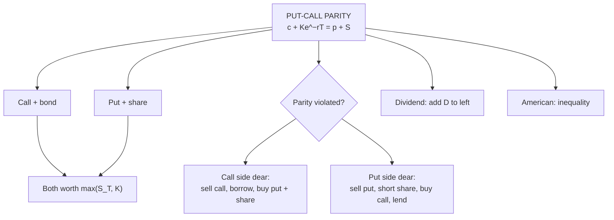

# OP-2: Put-Call Parity

Covers: the parity relationship for European options, its derivation, synthetic positions, the dividend form, the American inequality, and a step-by-step arbitrage in both directions with cash-flow tables. **(syllabus)** scope, **(textbook)** Hull method.

## Where this fits in the ESE

Put-call parity is a named syllabus topic and one of the most predictable numericals: "find the put price from the call price, then check for arbitrage". The two-way arbitrage table is the 10-mark core and a likely part of the 15-mark case.

## The relationship **(textbook)**

For **European** options on a non-dividend-paying share, same strike K and expiry T:

**c + K e^(−rT) = p + S₀**

Left side: a **call plus a zero-coupon bond** paying K at T (a "fiduciary call"). Right side: a **put plus the share** (a "protective put"). Both are worth max(S_T, K) at expiry, so they must cost the same today.

| S_T | Call + bond | Put + share |
|---|---|---|
| S_T > K | (S_T − K) + K = S_T | 0 + S_T = S_T |
| S_T ≤ K | 0 + K = K | (K − S_T) + S_T = K |

**With a known dividend (PV = D):** c + D + K e^(−rT) = p + S₀.
**With continuous dividend yield q:** c + K e^(−rT) = p + S₀ e^(−qT).

**American options (no dividends):** S₀ − K ≤ C − P ≤ S₀ − K e^(−rT). Parity holds only as an inequality.

## Synthetic positions (rearranging parity)

| To create | Combine |
|---|---|
| Synthetic long call | Long put + long share + borrow PV(K) |
| Synthetic long put | Long call + short share + lend PV(K) |
| Synthetic share | Long call + short put + lend PV(K) |
| Synthetic bond | Long put + long share + short call |

## Worked example 1: find the fair put price

**Data (hypothetical):** S₀ = ₹100, K = ₹100, r = 6% (continuous), T = 6 months, European call c = ₹8.00, no dividends.

1. PV(K) = 100 × e^(−0.03) = 100 × 0.970446 = **₹97.04**.
2. p = c + Ke^(−rT) − S₀ = 8.00 + 97.04 − 100 = **₹5.04**.

## Worked example 2: arbitrage when the put is too cheap

**Data:** same, but the market put price is **₹4.00** (fair ₹5.04).

1. Left side: c + PV(K) = 8.00 + 97.04 = **105.04**.
2. Right side: p + S₀ = 4.00 + 100 = **104.00**.
3. Left > right: the **call side is expensive**, the **put side is cheap**. Sell the call (and borrow), buy the put and the share.

| Time | Action | Cash flow (₹) |
|---|---|---|
| t = 0 | Sell the call | +8.00 |
| t = 0 | Borrow PV(K) = 97.04 (repay ₹100 at T) | +97.04 |
| t = 0 | Buy the put | −4.00 |
| t = 0 | Buy the share | −100.00 |
| **Net at t = 0** | | **+1.04** |
| t = T, S_T > 100 | Call exercised against us: deliver share, receive 100; put expires; repay loan | 100 − 100 = **0** |
| t = T, S_T < 100 | Call expires; exercise put: sell share for 100; repay loan | 100 − 100 = **0** |

**Profit: ₹1.04 now, with zero obligations at T in both cases.** (A guaranteed profit with no investment is the definition of arbitrage.)

## Worked example 3: arbitrage when the put is too dear

**Data:** market put price **₹7.00** (fair ₹5.04).

1. c + PV(K) = 105.04; p + S₀ = 7 + 100 = **107.00**.
2. Right > left: the put side is expensive. Sell the put, short the share, buy the call, lend PV(K).

| Time | Action | Cash flow (₹) |
|---|---|---|
| t = 0 | Sell the put | +7.00 |
| t = 0 | Short sell the share | +100.00 |
| t = 0 | Buy the call | −8.00 |
| t = 0 | Lend PV(K) | −97.04 |
| **Net at t = 0** | | **+1.96** |
| t = T, S_T > 100 | Loan returns 100; call exercised: pay 100, receive share, close the short | **0** |
| t = T, S_T < 100 | Loan returns 100; put assigned: pay 100, receive share, close the short | **0** |

**Profit: ₹1.96 now.**

## Worked example 4: with a dividend

**Data:** same, but a ₹2 dividend is paid in 3 months. PV(D) = 2 × e^(−0.06 × 0.25) = 2 × 0.985112 = **₹1.97**.

p = c + D + Ke^(−rT) − S₀ = 8.00 + 1.97 + 97.04 − 100 = **₹7.01**.

The dividend lowers the share price on the ex-date, which benefits put holders, so the fair put price rises from ₹5.04 to ₹7.01.

## Worked example 5: American bound check

With no dividends: 0 ≤ C − P ≤ 100 − 97.04 = 2.96. So an American call exceeding the American put by more than ₹2.96 breaks the inequality.

## The decision rule in one line

**Whichever side of c + PV(K) vs p + S is dearer, sell it and buy the cheaper side.** Profit at t = 0 is the difference.

## Exam layout

1. Write the parity relation (state European, no dividends).
2. Compute PV(K).
3. Compute both sides; find the fair put or call price.
4. Compare with the market; name the dear side.
5. Draw the t = 0 and t = T table for S_T above and below K.
6. State the profit and interpretation: arbitrage pressure restores parity.

## Traps

- **Parity applies to European options** (American only gives inequalities).
- **PV(K) uses continuous discounting e^(−rT)** (or K ÷ (1 + r)^T if the question says annual compounding).
- **Do not forget the dividend** when the question mentions one.
- **Same K and T** for the call and the put.
- **At T the net must be zero** in both cases; if it is not, you have a sign error.

## What to remember

- c + Ke^(−rT) = p + S₀.
- Example: c 8, S 100, K 100, r 6%, 6 months gives p = 5.04.
- Put at 4: profit 1.04 (sell call, borrow, buy put and share). Put at 7: profit 1.96 (reverse).
- With dividend PV 1.97: fair put 7.01.
- American: S − K ≤ C − P ≤ S − Ke^(−rT).

## Concept map

## Flashcards
Q: Put-call parity for European options with no dividends?
A: c + Ke^(−rT) = p + S₀.

Q: Why must a call plus bond equal a put plus share?
A: Both are worth max(S_T, K) at expiry.

Q: S 100, K 100, r 6%, T 0.5, call 8. Fair put?
A: 8 + 97.04 − 100 = ₹5.04.

Q: Market put ₹4.00 in that case. Which side is dear and what is the arbitrage profit?
A: The call side (105.04 vs 104.00): sell the call, borrow 97.04, buy put and share; profit ₹1.04.

Q: Market put ₹7.00. Arbitrage profit and trade?
A: Sell the put, short the share, buy the call, lend 97.04; profit ₹1.96.

Q: Parity with a PV dividend D?
A: c + D + Ke^(−rT) = p + S₀.

Q: Parity for American options?
A: Only an inequality: S₀ − K ≤ C − P ≤ S₀ − Ke^(−rT).

Q: How do you build a synthetic share from options?
A: Long call + short put + lend PV(K).

Q: What should the net cash flow at T be in a parity arbitrage table?
A: Zero in both cases (S_T above and below K).

## Sources
- BBA301F-6 syllabus, Unit 5 (put-call parity theory)
- Hull, *Options, Futures and Other Derivatives* (6th ed.), ch. 9
- Previous: [[Derivatives Unit 5 - OP-1 Bounds on Option Prices]] · Next: [[Derivatives Unit 5 - OP-3 Arbitrage in Options]]
- [[Derivatives Unit 5 - Option Pricing and Risk Management MOC (Node Map)]]
