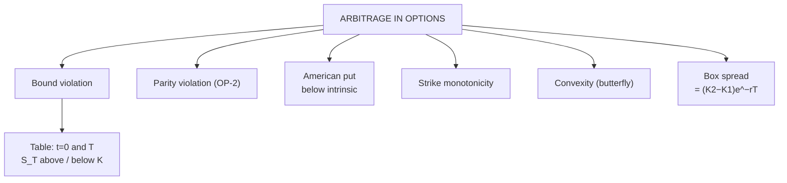

# OP-3: Arbitrage in Options

Covers: arbitrage from a broken lower bound, a broken put bound, early exercise of an American put, strike and convexity violations (butterfly), and the box spread. Parity arbitrage is in OP-2. **(syllabus)** scope, **(textbook)** Hull method.

## Where this fits in the ESE

"Arbitrage in option" is the last item of the Unit 5 syllabus line. The common exam form: "the option is quoted at X; show whether arbitrage exists, set up the trade and compute the profit." The method is always the same: compute the bound or parity, name the cheap and dear side, show a two-case cash-flow table.

## The five-step method

1. State the no-arbitrage relation (bound, parity, convexity).
2. Compute it with the given numbers.
3. Compare with the market price; name what is too cheap or too dear.
4. Buy the cheap, sell the dear, finance with PV(K).
5. Table: cash flow at t = 0 and at T for S_T above and below the strike. T-column must be ≥ 0; t = 0 column must be > 0.

## Case 1: call priced below its lower bound

**Data (hypothetical):** S = ₹50, K = ₹45, T = 6 months, r = 6%, no dividends. European call quoted at **₹5.50**. Lower bound = 50 − 43.67 = **₹6.33** (OP-1). The call is cheap by ₹0.83.

**Trade:** buy the call, short sell the share, lend PV(K) = ₹43.67.

| Time | Action | Cash flow (₹) |
|---|---|---|
| t = 0 | Buy the call | −5.50 |
| t = 0 | Short sell the share | +50.00 |
| t = 0 | Lend PV(K) = 43.67 | −43.67 |
| **Net at t = 0** | | **+0.83** |
| t = T, S_T > 45 | Loan returns 45; exercise call: pay 45, receive share, close the short | 45 − 45 = **0** |
| t = T, S_T < 45 | Loan returns 45; call expires; buy share at S_T to close the short | 45 − S_T = **> 0** |

Profit **₹0.83 now** (about ₹0.86 at T if invested at 6%: 0.83 × e^0.03), plus up to 45 − S_T more if the share falls below ₹45.

## Case 2: European put priced below its lower bound

**Data:** S = ₹40, K = ₹45, T = 6 months, r = 6%. European put quoted at **₹3.00**. Lower bound = 43.67 − 40 = **₹3.67**. Cheap by ₹0.67.

**Trade:** borrow 40 + 3 = ₹43, buy the share and the put.

| Time | Action | Cash flow (₹) |
|---|---|---|
| t = 0 | Borrow 43.00 | +43.00 |
| t = 0 | Buy the share | −40.00 |
| t = 0 | Buy the put | −3.00 |
| **Net at t = 0** | | **0** |
| t = T | Repay the loan: 43 × e^0.03 | −44.31 |
| t = T, S_T < 45 | Exercise the put: receive 45 | +45.00 → **net +0.69** |
| t = T, S_T > 45 | Sell the share at S_T | S_T − 44.31 → **net > 0.69** |

Guaranteed profit at least **₹0.69 at T** (PV ₹0.67). Zero outlay at t = 0.

## Case 3: American put below intrinsic value

**Data:** S = ₹40, K = ₹45, American put quoted at **₹4.50**. Immediate exercise would pay 45 − 40 = **₹5.00**. The option is worth less than its exercise value.

**Trade:** buy the put (₹4.50) and the share (₹40) for ₹44.50, exercise at once and receive ₹45. **Profit ₹0.50, immediately.**

## Case 4: strike monotonicity

For calls, a lower strike must cost **at least as much** as a higher strike: C(K₁) ≥ C(K₂) for K₁ < K₂. For puts the reverse. If C(100) = 6 but C(110) = 7: buy C100, sell C110, collect ₹1. The bull call spread has payoff ≥ 0, so the ₹1 is risk-free.

## Case 5: convexity (butterfly) violation

Option prices must be **convex in the strike**: C(K₂) ≤ ½[C(K₁) + C(K₃)] for equally spaced strikes. Violating it means a butterfly has a **negative price**, but a butterfly's payoff is never negative.

**Data (hypothetical):** calls K90 ₹12, K100 ₹8, K110 ₹2.50.
1. Convexity test: ½(12 + 2.5) = 7.25. Market C100 = 8 > 7.25: **violation**, since C100 is too dear.
2. **Trade:** buy C90, sell 2 × C100, buy C110.
3. Cash at t = 0 = −12 + 2 × 8 − 2.5 = **+₹1.50**.

| S at expiry | Payoff of butterfly | **Total profit (with ₹1.50 received)** |
|---|---|---|
| 80 | 0 | **+1.5** |
| 90 | 0 | **+1.5** |
| 100 | 10 | **+11.5** |
| 110 | 0 | **+1.5** |
| 120 | 0 | **+1.5** |

Never less than ₹1.50: arbitrage.

## Case 6: the box spread

A **box spread** = bull call spread (K₁, K₂) + bear put spread (K₂, K₁), all European, same expiry. Its payoff is **K₂ − K₁ in every state**, so its price must be **(K₂ − K₁) e^(−rT)**.

**Data:** K₁ = 100, K₂ = 110, r = 6%, T = 6 months. Fair price = 10 × e^(−0.03) = **₹9.70**. Using the Unit 4 board: bull call 100/110 costs 6 − 2.50 = 3.50 and bear put 110/100 costs 9 − 4 = 5.00, so the box costs **₹8.50**, below ₹9.70.

1. Buy the box for ₹8.50 (borrow ₹8.50).
2. At T: box pays ₹10; repay 8.50 × e^0.03 = ₹8.76.
3. **Profit = 10 − 8.76 = ₹1.24 at T** (PV ₹1.20 = 9.70 − 8.50).

(If the box were dearer than ₹9.70, sell it and invest the proceeds.)

## Why arbitrage is limited in practice

- Bid-ask spreads and brokerage widen the no-arbitrage zone.
- Margin on short options and short shares; STT and other charges **[VERIFY]**.
- Early assignment risk for short American options.
- In India, NSE stock and index options are European and cash or physically settled, so parity and box trades are cleaner than in American markets **[VERIFY]**.

## Traps

- **Check the direction:** a cheap call vs its lower bound means buy the call.
- **Table T-column:** for a one-sided case, show both S_T > K and S_T < K.
- **Do not compare an American option with a European bound** without checking which applies.
- **Convexity uses equally spaced strikes.** With unequal spacing, weight the middle by distances.
- **The box spread is only for European options.**

## What to remember

- Method: relation → compute → compare → cheap/dear → two-case table.
- Call ₹5.50 vs bound ₹6.33: profit ₹0.83. Put ₹3.00 vs bound ₹3.67: profit ₹0.69 at T.
- American put ₹4.50 vs exercise value ₹5.00: profit ₹0.50 at once.
- Butterfly priced at −₹1.50: profit never below ₹1.50.
- Box spread fair price ₹9.70; at ₹8.50 profit ₹1.24 at T.

## Concept map

## Flashcards
Q: Five-step method for an option arbitrage question?
A: State the relation, compute it, compare with the market, buy the cheap and sell the dear, and show a two-case table at t = 0 and T.

Q: S 50, K 45, 6 months, 6%, call 5.50. What do you do?
A: The call is below its lower bound 6.33: buy the call, short the share, lend 43.67; profit ₹0.83.

Q: S 40, K 45, put 3.00, European. Profit and trade?
A: Lower bound 3.67; borrow 43, buy share and put; at least ₹0.69 at T.

Q: American put ₹4.50, S 40, K 45. Arbitrage?
A: Buy the put and the share, exercise now for ₹45; profit ₹0.50.

Q: What must hold for call prices across strikes?
A: C(K₁) ≥ C(K₂) for K₁ < K₂, and convexity in the strike.

Q: Calls K90 12, K100 8, K110 2.50. Arbitrage?
A: Convexity violated (7.25 < 8). Buy C90, sell 2 C100, buy C110: receive ₹1.50, payoff ≥ 0.

Q: Fair price of a box spread with strikes 100 and 110, 6%, 6 months?
A: 10 × e^(−0.03) = ₹9.70.

Q: Box costs ₹8.50. Profit at expiry if financed at 6%?
A: 10 − 8.50 × e^0.03 = ₹1.24.

## Sources
- BBA301F-6 syllabus, Unit 5 (arbitrage in options)
- Hull, *Options, Futures and Other Derivatives* (6th ed.), ch. 9 and ch. 10
- Previous: [[Derivatives Unit 5 - OP-2 Put-Call Parity]] · Next: [[Derivatives Unit 5 - OP-4 Black-Scholes Model]]
- [[Derivatives Unit 5 - Option Pricing and Risk Management MOC (Node Map)]]
