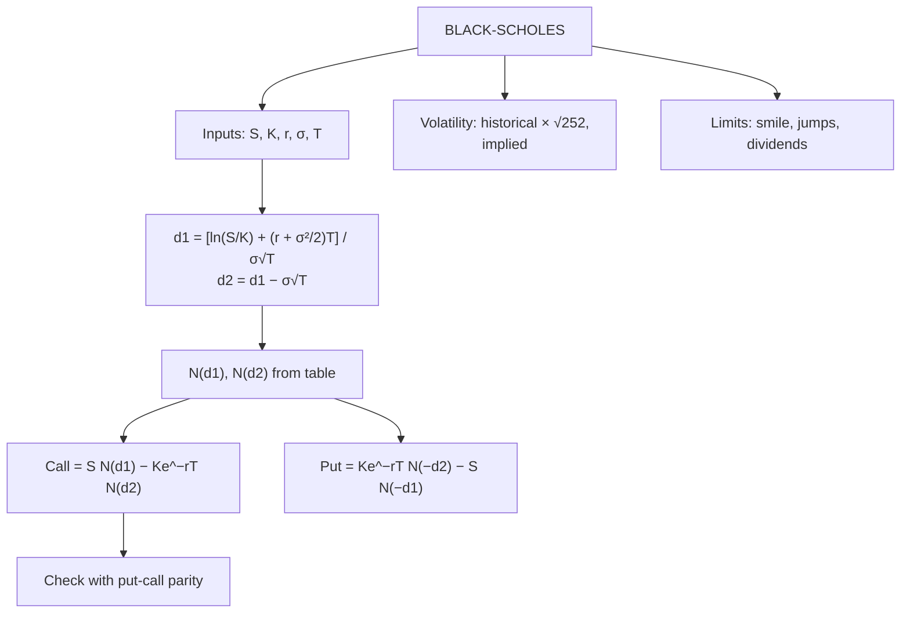

# OP-4: The Black-Scholes Model

Covers: assumptions, the formulas for d₁, d₂, call and put, how to read N(d) from the normal table, two full worked numericals, the meaning of N(d₁) and N(d₂), volatility estimation, dividends and limitations. **(syllabus)** scope, **(textbook)** Hull method (Black-Scholes-Merton).

## Where this fits in the ESE

A full Black-Scholes sum with N(d₁), N(d₂) is a certain Section B (10 marks) or case item. Marks go for: formulas, d₁ and d₂ with working, the table lookups, the call and put values, and a parity check. Bring the normal distribution table to the exam only if allowed; otherwise values will be given in the question.

## Assumptions **(textbook)**

1. Share price follows a **lognormal** process with constant volatility σ.
2. No dividends during the option's life (the base model).
3. European exercise only.
4. Constant, known risk-free rate r; continuous compounding.
5. No transaction costs, taxes or restrictions on short selling; trading is continuous.
6. No arbitrage.

## The formulas

**d₁ = [ln(S₀ ÷ K) + (r + σ²/2) T] ÷ (σ √T)**
**d₂ = d₁ − σ √T**

**Call: c = S₀ N(d₁) − K e^(−rT) N(d₂)**
**Put: p = K e^(−rT) N(−d₂) − S₀ N(−d₁)**

where N(x) is the cumulative standard normal distribution, and N(−x) = 1 − N(x).

**Meaning:** N(d₂) is the (risk-neutral) probability that the call finishes in the money. S₀N(d₁) is the present value of the share received if exercised; Ke^(−rT)N(d₂) is the present value of the strike expected to be paid. **N(d₁) is the option's delta** (OP-5).

**With a continuous dividend yield q (Merton):** replace S₀ by S₀e^(−qT) and r in d₁ by (r − q): c = S₀e^(−qT)N(d₁) − Ke^(−rT)N(d₂).

## Worked example 1: clean table lookups

**Data (hypothetical):** S₀ = ₹100, K = ₹100, r = 6%, σ = 20%, T = 1 year, no dividends. European call and put.

**Step 1: d₁ and d₂.**
- ln(S₀ ÷ K) = ln 1 = 0.
- (r + σ²/2) T = (0.06 + 0.02) × 1 = 0.08.
- σ√T = 0.20.
- d₁ = 0.08 ÷ 0.20 = **0.40**.
- d₂ = 0.40 − 0.20 = **0.20**.

**Step 2: normal table.**

| x | N(x) |
|---|---|
| N(d₁) = N(0.40) | **0.6554** |
| N(d₂) = N(0.20) | **0.5793** |
| N(−d₁) = 1 − 0.6554 | **0.3446** |
| N(−d₂) = 1 − 0.5793 | **0.4207** |

**Step 3: discount the strike.** K e^(−rT) = 100 × e^(−0.06) = **₹94.18** (94.1765).

**Step 4: call.**
c = 100 × 0.6554 − 94.1765 × 0.5793 = 65.54 − 54.56 = **₹10.98**.

**Step 5: put.**
p = 94.1765 × 0.4207 − 100 × 0.3446 = 39.62 − 34.46 = **₹5.16**.

**Step 6: parity check.** c + Ke^(−rT) − S₀ = 10.98 + 94.18 − 100 = 5.16 = p ✓.

| Result | Value |
|---|---|
| d₁, d₂ | 0.40, 0.20 |
| Call | ₹10.98 |
| Put | ₹5.16 |
| Exact (unrounded normal values) | Call ₹10.99, Put ₹5.17 |

**Interpretation.** The call is worth ₹10.98 (11% of the share price). N(d₂) = 0.5793 says there is about a 58% (risk-neutral) chance of finishing in the money. The one-paisa gap to the exact value is table rounding.

**Decision line.** If the market call price is above ₹10.98 the option is dear: sell it or buy the put side of parity (OP-2). If below, it is cheap. The model price is compared with the market to judge if the option's implied volatility is above or below 20%.

## Worked example 2: when d is not a table value

**Data (hypothetical):** S₀ = ₹100, K = ₹105, r = 6%, σ = 25%, T = 0.5.

1. ln(100 ÷ 105) = −0.04879.
2. (r + σ²/2) T = (0.06 + 0.03125) × 0.5 = 0.045625.
3. σ√T = 0.25 × 0.70711 = 0.17678.
4. d₁ = (−0.04879 + 0.045625) ÷ 0.17678 = **−0.0179**; d₂ = −0.0179 − 0.1768 = **−0.1947**.
5. **Table with d rounded to two places:** N(−0.02) = 0.4920, N(−0.19) = 0.4247. Ke^(−rT) = 105 × 0.970446 = 101.8968. c ≈ 100 × 0.4920 − 101.8968 × 0.4247 = **₹5.92**.
6. **With linear interpolation:** N(−0.0179) = 0.4929, N(−0.1947) = 0.4228 → c ≈ 49.29 − 43.08 = **₹6.21**.
7. **Exact:** c = **₹6.20**; p = **₹8.10**.

**Interpretation and trap.** Rounding d to two decimals moved the answer by ₹0.28 (about 4.5%). In an exam, if the paper says "use the table", rounding is accepted; if you have a calculator or interpolation, use it and say so. Always show d₁ and d₂ to four decimals before looking up.

## Estimating volatility

**Historical volatility:** take daily log returns uᵢ = ln(Pᵢ ÷ Pᵢ₋₁), compute the sample standard deviation s, annualise: **σ = s × √252** (trading days; Hull uses 252).

*Example (hypothetical prices):* 100, 102, 101, 103, 104.5, 103, 105 → six returns of 1.98%, −0.99%, 1.96%, 1.45%, −1.45%, 1.92%. Mean = 0.81%. Sum of squared deviations = 12.65; ÷ 5 = 2.53; s = √2.53 = **1.59%** a day. Annualised σ = 1.59% × √252 = 1.59% × 15.87 = **25.2%**.

**Implied volatility:** the σ that makes the model price equal the market price (found by trial). India VIX is an index of implied volatility from near-month Nifty options **[VERIFY]**.

## Limitations

- Constant volatility is unrealistic; observed **volatility smile/skew** (different implied σ across strikes).
- Price jumps and fat tails are ignored.
- Strictly European, no dividends. Dividend-paying and American options need adjustments or binomial trees.
- Short-term rate, liquidity and transaction costs are ignored.
- NSE index and stock options are European, so the model fits well for Indian index options, usually with the futures price (Black's model) as input **[VERIFY]**.

## Exam layout

1. Write formulas for d₁, d₂, c and p.
2. Substitute and compute d₁, d₂ (show ln and σ√T).
3. Read N(d₁), N(d₂) (and N(−d₁), N(−d₂)).
4. Compute Ke^(−rT).
5. Compute c (and p).
6. Parity check; interpret N(d₂) and compare with market price.

## Traps

- **Wrong sign of σ²/2:** it is added, not subtracted, in d₁.
- **N(−d) = 1 − N(d).** Do not read negative d from a positive-only table without this.
- **Use the same T for d₁ and discounting.** Months → years first (6 months = 0.5).
- **Volatility is annual.** A daily σ must be multiplied by √252.
- **Put formula has N(−d₂) on the strike and N(−d₁) on the share.**

## What to remember

- d₁ = [ln(S/K) + (r + σ²/2)T] ÷ σ√T; d₂ = d₁ − σ√T.
- c = S N(d₁) − Ke^(−rT) N(d₂); p = Ke^(−rT) N(−d₂) − S N(−d₁).
- Example: S = K = 100, 6%, 20%, 1 year: d₁ 0.40, d₂ 0.20; call 10.98, put 5.16.
- N(d₂) = chance of finishing ITM; N(d₁) = delta.
- σ_annual = daily s × √252: 1.59% gives 25.2%.

## Concept map

## Flashcards
Q: Black-Scholes formula for a European call?
A: c = S₀ N(d₁) − K e^(−rT) N(d₂).

Q: Black-Scholes formula for a European put?
A: p = K e^(−rT) N(−d₂) − S₀ N(−d₁).

Q: Formulas for d₁ and d₂?
A: d₁ = [ln(S₀/K) + (r + σ²/2)T] ÷ σ√T; d₂ = d₁ − σ√T.

Q: S = K = 100, r 6%, σ 20%, T 1. Find d₁ and d₂.
A: d₁ = 0.08 ÷ 0.20 = 0.40; d₂ = 0.20.

Q: Same case: N(d₁), N(d₂) and the call value?
A: 0.6554 and 0.5793; call = 65.54 − 54.56 = ₹10.98.

Q: Same case: put value and parity check?
A: Put = 39.62 − 34.46 = ₹5.16; 10.98 + 94.18 − 100 = 5.16 ✓.

Q: What does N(d₂) represent?
A: The risk-neutral probability that the call finishes in the money.

Q: What is N(d₁) called?
A: The option's delta (for a call).

Q: Daily volatility 1.59%. Annualised?
A: 1.59% × √252 = 25.2%.

Q: Name two limitations of Black-Scholes.
A: Constant volatility (smile in practice) and no jumps; also European, no-dividend base form.

## Sources
- BBA301F-6 syllabus, Unit 5 (Black-Scholes options pricing model)
- Hull, *Options, Futures and Other Derivatives* (6th ed.), Black-Scholes-Merton chapter; NSE option features **[VERIFY]**
- Previous: [[Derivatives Unit 5 - OP-3 Arbitrage in Options]] · Next: [[Derivatives Unit 5 - OP-5 Option Greeks]]
- [[Derivatives Unit 5 - Option Pricing and Risk Management MOC (Node Map)]]
