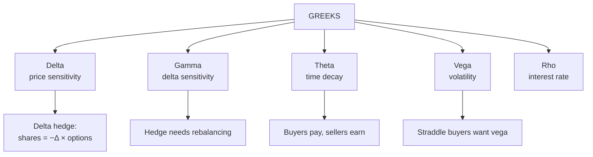

# OP-5: Option Greeks

Covers: delta, gamma, theta, vega and rho: definitions, Black-Scholes formulas, values for the Unit 5 example, the intuition for each, a delta-hedging sum that shows gamma risk, and a summary table. **(syllabus)** scope, **(textbook)** Hull method.

## Where this fits in the ESE

"Options Greeks" ends the Unit 5 syllabus line. A 5-mark question on delta and gamma (definition, sign, range, example) or a 10-mark question on all five with a hedging illustration is likely. The numerical is usually delta hedging.

## What the Greeks are **(textbook)**

Each Greek measures the **sensitivity of the option price to one input**, holding the others fixed.

| Greek | Measures change in option price for | Call formula (no dividends) | Put formula |
|---|---|---|---|
| **Delta Δ** | ₹1 change in the share price | N(d₁) | N(d₁) − 1 |
| **Gamma Γ** | ₹1 change in the share price (change in delta) | φ(d₁) ÷ (S σ √T) | same as call |
| **Theta Θ** | passage of time | −S φ(d₁) σ ÷ (2√T) − r K e^(−rT) N(d₂) | −S φ(d₁) σ ÷ (2√T) + r K e^(−rT) N(−d₂) |
| **Vega ν** | 1 unit change in volatility | S φ(d₁) √T | same as call |
| **Rho ρ** | change in the risk-free rate | K T e^(−rT) N(d₂) | −K T e^(−rT) N(−d₂) |

φ(x) = e^(−x²/2) ÷ √(2π) is the standard normal density; φ(0.40) = 0.3683.

## Worked example 1: all Greeks for the Black-Scholes case

**Data (the OP-4 example):** S = K = ₹100, r = 6%, σ = 20%, T = 1 year; d₁ = 0.40, d₂ = 0.20; φ(d₁) = 0.3683; call ₹10.99 (exact).

| Greek | Call | Put | Reading |
|---|---|---|---|
| **Delta** | 0.6554 | −0.3446 | Call gains ₹0.66 per ₹1 rise in S; put loses ₹0.34 |
| **Gamma** | 0.0184 | 0.0184 | Delta rises by 0.0184 per ₹1 rise in S |
| **Vega** (per 1 percentage point of σ) | 0.3683 | 0.3683 | A rise of σ from 20% to 21% adds ₹0.37 |
| **Theta** (per calendar day) | −0.0191 | −0.0036 | Call loses ₹0.019 a day |
| **Rho** (per 1 percentage point of r) | 0.5455 | −0.3962 | A rise in r from 6% to 7% adds ₹0.55 to the call |

Working: gamma = 0.3683 ÷ (100 × 0.20 × 1) = 0.0184; vega = 100 × 0.3683 × 1 = 36.83 per unit of σ, so 0.3683 per percentage point; call theta = −(100 × 0.3683 × 0.20 ÷ 2) − 0.06 × 94.1765 × 0.5793 = −3.683 − 3.273 = −6.956 a year, ÷ 365 = −0.0191 a day; rho = 100 × 1 × 0.941765 × 0.5793 = 54.55 per unit of r, so 0.5455 per percentage point. Delta check: put delta = call delta − 1 = −0.3446.

**Accuracy check against re-pricing** (exact Black-Scholes call):

| Change | Exact new call | Greeks estimate |
|---|---|---|
| S = 101 | 11.654 | delta only 11.645; delta + gamma 11.654 |
| S = 105 | 14.485 | delta only 14.267; delta + gamma 14.497 |
| σ = 21% | 11.359 | vega estimate 11.358 |
| One day passes | 10.970 | theta estimate 10.970 |
| r = 7% | 11.541 | rho estimate 11.535 |

**Interpretation.** Delta alone is accurate for small moves; for ₹5 the gamma term is needed (14.267 → 14.497, within ₹0.02 of the exact 14.485 after adding ½Γ(ΔS)² = 0.23).

## Intuition for each Greek

- **Delta.** Call 0 to 1, put −1 to 0. ATM call ≈ 0.5 (here 0.66 because of drift and σ). Deep ITM call → 1; far OTM → 0. Often read as a rough probability of finishing ITM. **Share-equivalent:** a call with Δ = 0.65 on 1,000 shares behaves like 655 shares.
- **Gamma.** Always positive for a long option. Highest ATM and near expiry. High gamma means delta changes fast, so hedges need frequent adjustment.
- **Theta.** Negative for a long option: it loses value every day. Accelerates close to expiry for ATM options. Sellers collect theta; buyers pay it.
- **Vega.** Positive for long options: rising implied volatility raises both calls and puts. Highest ATM and for longer maturity. Pays off for long straddles (OS-6).
- **Rho.** Positive for calls, negative for puts. Small for short-dated options; relevant for long-dated ones.

## Worked example 2: delta hedge and the gamma lesson

**Data:** a trader **sells 1,000 calls** (the OP-4 option, Δ = 0.6554) at ₹10.99 (exact price 10.9895).

1. **Delta of the short position** = −1,000 × 0.6554 = −655.4 shares. To be **delta neutral**, buy **655 shares** at ₹100.
2. **Check small move.** Share rises to ₹101: calls rise to 11.654 (loss on 1,000 short calls = 1,000 × (11.654 − 10.9895) = ₹664.5); shares gain 655 × 1 = ₹655. **Net = −₹9.5**. Almost neutral.
3. **Large moves expose gamma.**

| Share price | Loss on 1,000 short calls (₹) | Gain/loss on 655 shares (₹) | **Net (₹)** |
|---|---|---|---|
| 95 | +3,036.2 | −3,275 | **−238.8** |
| 100 | 0 | 0 | **0** |
| 101 | −664.5 | +655 | **−9.5** |
| 105 | −3,495.3 | +3,275 | **−220.3** |

(Signs: a rise in the call price is a loss for the seller; negative entries are losses.)

**Interpretation.** The hedge holds at S = 100 but loses ₹220 to ₹239 on a ₹5 move **in either direction**. That is the cost of being **short gamma**. The trader earns theta (₹19 a day on 1,000 options) as compensation. The position must be re-hedged as delta changes, with transaction costs. Indian option sellers typically hedge with index or stock futures **[VERIFY]**.

## Summary: signs for long positions

| Position | Delta | Gamma | Theta | Vega |
|---|---|---|---|---|
| Long call | + | + | − | + |
| Long put | − | + | − | + |
| Short call | − | − | + | − |
| Short put | + | − | + | − |
| Long share | +1 | 0 | 0 | 0 |

**Portfolio Greeks** add: delta of a portfolio = sum of (quantity × delta). Delta-neutral: sum = 0. To also remove gamma, add options (not shares, which have zero gamma).

## Traps

- **Put delta is negative:** N(d₁) − 1, not N(d₁).
- **Short call has negative delta.** The writer loses when the price rises.
- **Gamma is the same for call and put.**
- **Theta is quoted per year or per day.** Divide by 365 (or 252 for trading days; state it).
- **Vega is per unit of σ.** A 1 percentage point change = vega ÷ 100.
- **A delta hedge is temporary.** Delta changes with S, T and σ.

## What to remember

- Δ_call = N(d₁) = 0.6554, Δ_put = −0.3446; Γ = 0.0184; vega 0.3683 per 1 pt; call theta −0.0191 a day; rho 0.5455 per 1 pt.
- Long options: gamma and vega positive, theta negative.
- Delta hedge: short 1,000 calls needs 655 shares; a ₹5 move still leaves about −₹220 (gamma).
- Delta + gamma explain price changes for large moves.
- Option sellers earn theta, pay gamma.

## Concept map

## Flashcards
Q: What does delta measure?
A: The change in the option price for a ₹1 change in the share price.

Q: Delta range for a call? A put?
A: Call 0 to 1; put −1 to 0.

Q: Delta of a European call in Black-Scholes?
A: N(d₁); a put's delta is N(d₁) − 1.

Q: What does gamma measure and when is it highest?
A: The rate of change of delta with the share price; highest for ATM options close to expiry.

Q: Sign of theta for a long option and why?
A: Negative: the option loses time value as expiry approaches.

Q: What does vega measure?
A: The change in the option price for a unit change in volatility; positive for long calls and puts.

Q: Delta 0.6554: how many shares hedge 1,000 short calls?
A: Buy 655 shares (1,000 × 0.6554).

Q: Why does a delta-hedged short call lose on a large move either way?
A: Negative gamma: delta changes with the price, so the hedge goes stale.

Q: S = K = 100, 6%, 20%, 1 year. Call gamma?
A: φ(0.40) ÷ (100 × 0.20 × 1) = 0.3683 ÷ 20 = 0.0184.

Q: Which Greek do straddle buyers want to be positive?
A: Vega (and gamma); they pay theta.

## Sources
- BBA301F-6 syllabus, Unit 5 (option Greeks)
- Hull, *Options, Futures and Other Derivatives* (6th ed.), Greek letters chapter; values computed from the Black-Scholes formulas of [[Derivatives Unit 5 - OP-4 Black-Scholes Model]]
- Previous: [[Derivatives Unit 5 - OP-4 Black-Scholes Model]] · Next: [[Derivatives Unit 5 - OP-6 Unit 5 Exam Answers]]
- [[Derivatives Unit 5 - Option Pricing and Risk Management MOC (Node Map)]]
