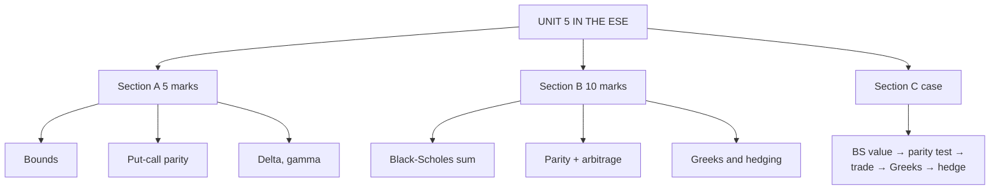

# OP-6: Unit 5 Exam Answers

Covers: what the ESE will ask from Unit 5, 5-mark and 10-mark skeletons, and a 15-mark case (Black-Scholes value, parity arbitrage, Greeks hedge) with a full model answer.

## What the test will ask

ESE: Section A three 5-mark questions with choice, Section B two 10-mark questions with choice, Section C one 15-mark case. Unit 5 has 10 of 45 hours and holds the Black-Scholes sum, so it is a strong candidate for the case. A case that prices an option, checks it against parity and hedges with delta is a natural fit. This is a judgement from the syllabus, not a confirmed pattern.

## Five-mark answer skeletons

**1. Bounds on option prices (OP-1).** Table of lower and upper bounds for European/American calls and puts; why American call is not exercised early; one numerical check (S 50, K 45: lower bound 6.33).

**2. Put-call parity (OP-2).** Relation; proof table (both sides worth max(S_T, K)); fair put numerical (c 8: put 5.04); one-line arbitrage.

**3. Parity arbitrage (OP-2).** Compute both sides; name the dear side; t = 0 and T table; profit (₹1.04).

**4. Black-Scholes assumptions and formula (OP-4).** Six assumptions; d₁, d₂, c, p formulas; meaning of N(d₂).

**5. Delta and gamma (OP-5).** Definitions; formulas; ranges; example (0.6554, 0.0184); hedge sentence.

**6. Greeks summary (OP-5).** Five Greeks with symbol, measure, sign for a long call.

## Ten-mark answer skeletons

**A. Black-Scholes model with a numerical.** Assumptions → formulas → worked sum (S = K = 100, 6%, 20%, 1 year: d₁ 0.40, d₂ 0.20, call 10.98, put 5.16) → parity check → meaning of N(d₁) and N(d₂) → volatility estimation → limitations.

**B. Put-call parity and option arbitrage.** Parity derivation → dividend form → American inequality → two-way arbitrage tables (₹1.04 and ₹1.96) → bound and convexity arbitrage (₹0.83, ₹1.50) → practical limits.

**C. Option Greeks and hedging.** Five Greeks with formulas → values → intuition → delta-hedge sum (655 shares per 1,000 calls) → gamma loss ₹220 on a ₹5 move → gamma-neutral and vega-neutral remarks.

**D. Bounds and arbitrage.** Bound table → why → example breaking a bound → trade table → box spread.

## Fifteen-mark case layout (price, test, hedge)

1. **Black-Scholes value (6):** d₁, d₂, table values, call and put.
2. **Parity test and arbitrage (4):** both sides, dear side, trade, table.
3. **Greeks and delta hedge (4):** delta, gamma, theta, vega; shares to hold.
4. **Recommendation (1).**

### Model answer, laid out as the exam answer

**Data (hypothetical):** S₀ = ₹100, K = ₹100, r = 6%, σ = 20%, T = 1 year, no dividends. Market quotes: European call ₹10.98, European put ₹5.60. A dealer has sold 5,000 calls.

**Part 1: Black-Scholes values.**
1. d₁ = [ln(100/100) + (0.06 + 0.02) × 1] ÷ 0.20 = 0.08 ÷ 0.20 = **0.40**; d₂ = **0.20**.
2. N(0.40) = 0.6554; N(0.20) = 0.5793; N(−0.40) = 0.3446; N(−0.20) = 0.4207.
3. Ke^(−rT) = 100 × e^(−0.06) = **94.18**.
4. Call = 100 × 0.6554 − 94.1765 × 0.5793 = 65.54 − 54.56 = **₹10.98**.
5. Put = 94.1765 × 0.4207 − 100 × 0.3446 = 39.62 − 34.46 = **₹5.16**.
6. Market call ₹10.98 equals the model: fairly priced. Market put ₹5.60 is **₹0.44 above** the model.

**Part 2: parity test.**
1. Left: c + Ke^(−rT) = 10.98 + 94.18 = **105.16**.
2. Right: p + S₀ = 5.60 + 100 = **105.60**.
3. Right > left: the **put is overpriced** (or the call underpriced). Arbitrage exists.
4. **Trade:** sell the put, short the share, buy the call, lend 94.18.

| Time | Action | Cash flow (₹) |
|---|---|---|
| t = 0 | Sell put | +5.60 |
| t = 0 | Short sell share | +100.00 |
| t = 0 | Buy call | −10.98 |
| t = 0 | Lend PV(K) | −94.18 |
| **Net at t = 0** | | **+0.44** |
| t = T, S_T > 100 | Exercise call: pay 100, close short; loan returns 100 | **0** |
| t = T, S_T < 100 | Put assigned: pay 100, receive share, close short; loan returns 100 | **0** |

Riskless profit **₹0.44 per share**.

**Part 3: Greeks and the dealer's hedge.**
1. **Delta** = N(d₁) = **0.6554**. **Gamma** = φ(0.40) ÷ (100 × 0.20 × 1) = 0.3683 ÷ 20 = **0.0184**.
2. **Theta (call)** = −**₹0.0191 a day**; **vega** = **₹0.3683** per 1 percentage point.
3. **Delta hedge:** the dealer is short 5,000 calls, delta −3,277; buy 5,000 × 0.6554 = **3,277 shares**.
4. **Daily theta income** = 5,000 × 0.0191 = about **₹95**. **Vega risk:** a 1-point rise in implied volatility costs 5,000 × 0.3683 = about **₹1,841**.
5. **Gamma risk:** the position is short gamma (−5,000 × 0.0184 = −92). Quick estimate of the loss on a ₹5 move in either direction = ½ × 92 × 5² = **₹1,150**. Full re-pricing (5 times the −₹220 per 1,000 options in OP-5) gives about **₹1,100**, so the estimate is close.

**Part 4: recommendation.** Take the parity arbitrage (₹0.44 a share) if transaction costs are below that. Keep the book delta hedged, re-hedge when delta moves by more than 0.05 (about 250 shares), and watch vega around events.

Close with: *prices are hypothetical; table-rounded values differ from exact ones by a paisa.*

## Time rule

If short of time: write the formulas, compute d₁ and d₂, read the four N values and give the call (and put if asked). Then one parity-check line. This secures roughly two-thirds of the marks.

## What to remember

- Case order: d₁, d₂ → N values → call, put → parity check → trade table → Greeks → hedge.
- Numbers: d₁ 0.40, d₂ 0.20, call 10.98, put 5.16; market put 5.60 gives ₹0.44.
- Delta 0.6554: 5,000 short calls need 3,277 shares.
- Short gamma loses on big moves both ways; short options earn theta.
- Always give the t = T zero rows in an arbitrage table.

## Concept map

## Flashcards
Q: Order of steps in the price-test-hedge case?
A: Black-Scholes d₁, d₂ and values; parity test; arbitrage table; Greeks; delta hedge; recommendation.

Q: Case: call and put model values?
A: Call ₹10.98, put ₹5.16.

Q: Case: market put ₹5.60. Which side is dear and what is the profit?
A: Put side (105.60 vs 105.16); sell put, short share, buy call, lend 94.18; profit ₹0.44.

Q: Case: dealer sold 5,000 calls. Shares to hold?
A: 5,000 × 0.6554 = 3,277 shares.

Q: Case: cost of a 1-point rise in implied volatility on 5,000 short calls?
A: About 5,000 × 0.3683 = ₹1,841.

Q: Skeleton for the 10-mark Black-Scholes answer?
A: Assumptions, formulas, worked sum, parity check, meaning of N(d₁) and N(d₂), volatility, limitations.

Q: What must the t = T rows of a parity arbitrage table show?
A: Net zero in both cases, S_T above and below K.

Q: Which sign pair describes a short option writer's Greeks?
A: Negative gamma and vega, positive theta.

## Sources
- BBA301F-6 syllabus, Unit 5 and ESE pattern
- [[Derivatives Unit 5 - Option Pricing and Risk Management MOC (Node Map)]]
