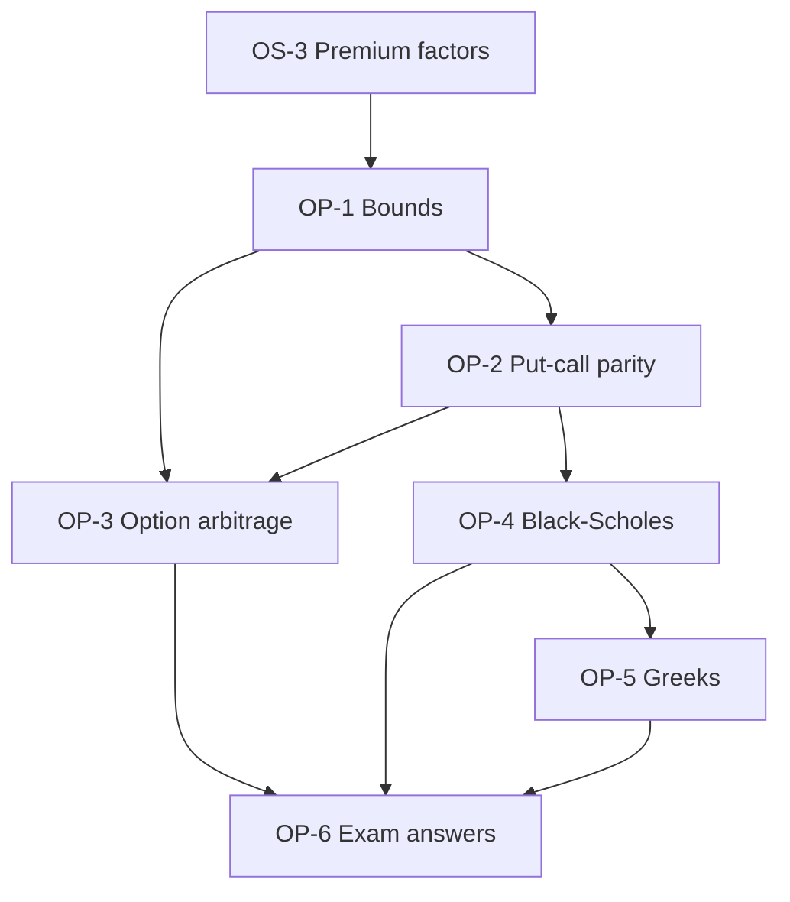

# Derivatives Unit 5: Option Pricing and Risk Management, node map

ESE: 50 marks, Section A 3 x 5, Section B 2 x 10, Section C one 15-mark case. Unit 5 is CO2, CO4 and CO5 (pricing, price sensitivity and strategy evaluation). Black-Scholes with N(d₁) and N(d₂), put-call parity arbitrage and the Greeks are the core skills. All examples are **hypothetical**.

## Nodes

| Node | Topic | Deps | Minutes | Exam focus |
|---|---|---|---|---|
| OP-1 | Bounds on Option Prices | OS-3 | 30 | yes |
| OP-2 | Put-Call Parity | OP-1 | 40 | yes |
| OP-3 | Arbitrage in Options | OP-1, OP-2 | 35 | yes |
| OP-4 | Black-Scholes Model | OP-2 | 45 | yes |
| OP-5 | Option Greeks | OP-4 | 40 | yes |
| OP-6 | Unit 5 Exam Answers | OP-1 to OP-5 | 35 | yes |

Total reading time: about 225 minutes.

## Dependency graph

## Headline numbers to know

- Bounds: S 50, K 45, 6 months, 6%: PV(K) 43.67, call lower bound 6.33 (price 5.50 breaks by 0.83). Put S 40: European 3.67, American 5.
- Parity: S 100, K 100, 6%, 0.5, call 8: put 5.04; put at 4 gives +1.04; put at 7 gives +1.96; with ₹2 dividend put 7.01; American C − P between 0 and 2.96.
- Arbitrage: put 3.00 vs 3.67 gives +0.69 at T; American put 4.50 vs 5.00 gives +0.50; butterfly convexity +1.50; box fair 9.70, at 8.50 profit 1.24 at T.
- Black-Scholes (S = K = 100, 6%, 20%, 1 year): d₁ 0.40, d₂ 0.20; N 0.6554, 0.5793; call 10.98 (exact 10.99), put 5.16 (exact 5.17). K = 105, σ 25%, 0.5 year: exact call 6.20, put 8.10.
- Volatility: 1.59% daily gives 25.2% annual.
- Greeks: delta 0.6554 and −0.3446; gamma 0.0184; vega 0.3683 per point; call theta −0.0191 a day; rho 0.5455.
- Delta hedge: 1,000 short calls need 655 shares; ₹5 move leaves about −₹220.
- Case: put at 5.60 gives +0.44; 5,000 short calls need 3,277 shares.

## Links
- [[Derivatives MOC]]
