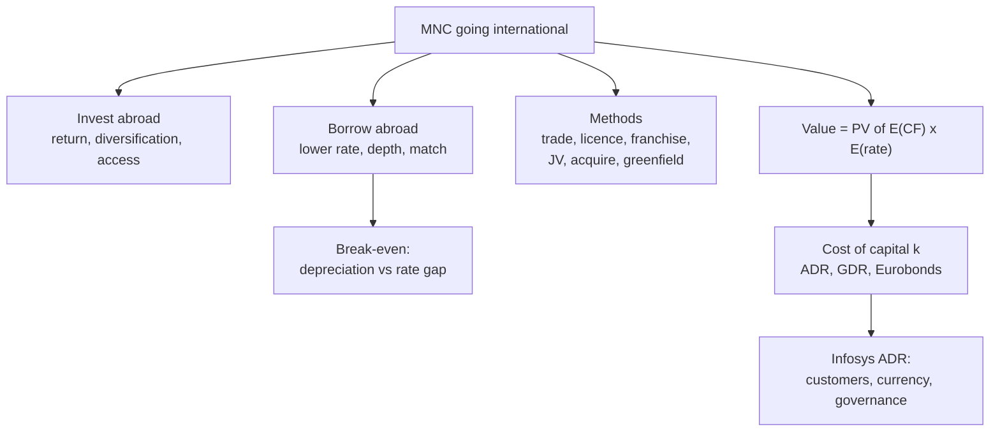

# IF-1: Motives, International Business Methods and MNC Value

Covers: why firms invest and borrow abroad, the six methods of doing international business, how international financial markets change an MNC's value, and the Week 1 question on why Infosys issued ADRs in the US. **(syllabus)** for scope, **(textbook)** for content.

## Where this fits in the ESE

Unit 1 is 5 of 45 hours and feeds CO1 (5 marks in the ESE, 10 in the mid-sem). Expect a 5-mark "motives" or "methods" question, or the ADR question reshaped as a short case. No faculty slides yet: if the faculty groups the motives differently, write the class grouping. Numbers below are **illustrative**.

## Why firms go international **(textbook)**

An **MNC** earns revenue, raises funds and holds assets in more than one country. Its finance function sits in imperfect markets, so crossing borders can add value.

**Motives for investing abroad**
- **Higher expected return.** Growth markets and cheaper factors (labour, land) lift cash flows.
- **Diversification.** Returns in different economies are not perfectly correlated, so risk per rupee of return falls.
- **Market access.** Behind tariffs or logistics, local production wins sales that exports cannot.
- **Exploiting imperfections.** Tax differences, regulation, scarce resources or technology that rivals lack.
- **Following customers.** An auto-component maker follows its OEM customer to a new plant.

**Motives for borrowing abroad**
- **Lower interest rate.** Foreign rates can be below Indian rates. The saving is real only if the currency does not depreciate by more than the rate gap.
- **Larger, deeper pool of funds.** Big tickets and long tenors that local banks cannot match.
- **Currency match.** Borrow in the currency in which revenue arrives, so the loan is hedged by the cash flow.
- **Access to new investors and visibility.**

**The break-even rule.** Borrowing at rate i_f when the home rate is i_h beats home borrowing only if the foreign currency appreciates by less than (1+i_h)/(1+i_f) − 1. With INR 9% and USD 5%, break-even = 1.09/1.05 − 1 = **3.81%** rise in the dollar. IF-5 works this as a full case.

## International business methods **(textbook)**

Ordered from low commitment and low risk to high.

| Method | What it is | Commitment | Indian illustration (qualitative) |
|---|---|---|---|
| International trade | Export or import of goods and services | Lowest | Indian IT firms exporting services |
| Licensing | Foreign firm pays royalty to use your technology or brand | Low | Brand or technology licences |
| Franchising | Foreign firm uses your business format and brand | Low | Restaurant and retail franchise chains |
| Joint venture | Shared ownership with a local partner | Medium | Foreign auto makers' JVs in India (inward) |
| Acquisition of existing operations | Buy an established foreign firm | High | Tata Motors buying JLR (2008) **[VERIFY]** |
| New foreign subsidiary (greenfield) | Build from scratch | Highest | Own plant in a host country |

Rule for the answer: more commitment gives more control and return, but more exposure to exchange, political and capital risk.

## How financial markets affect MNC value **(textbook)**

Madura's valuation frame: value of the MNC is the present value of expected cash flows converted to home currency.

**Value = Σ [ E(CF in foreign currency) × E(exchange rate) ] / (1 + k)^t**

International markets move value through three levers:
1. **Cash flows (CF).** Foreign expansion raises sales; foreign suppliers lower costs.
2. **Exchange rate.** A stronger foreign currency raises rupee value of foreign receipts.
3. **Cost of capital (k).** Access to the international money, bond and equity markets (Eurocurrency, Euro-bonds, ADRs/GDRs) can lower k and so raise value.

## International financial markets **(textbook)**

- **Eurocurrency market.** Deposits and loans in a currency held outside its home country, for example a USD deposit with a London bank. Lightly regulated, so spreads are fine. The old LIBOR benchmark has been replaced by risk-free rates such as SOFR **[VERIFY]**.
- **Eurobond vs foreign bond.** A Eurobond is sold across several markets in a currency other than that of the issuer's market or of any one market. A foreign bond is issued by a foreign borrower in one domestic market in that market's currency (Yankee in the US, Samurai in Japan). Rupee-denominated bonds issued abroad are called Masala bonds **[VERIFY current RBI rules]**.
- **ADR vs GDR.** An ADR is a depositary receipt traded in the US; a GDR is placed in more than one market, often London or Luxembourg. Indian issuance follows the depository receipts framework **[VERIFY current scheme]**.
- **ECB and FCCB (India's side).** An external commercial borrowing is a loan raised by an Indian firm from a non-resident lender, within RBI limits on end-use, cost and maturity **[VERIFY]**. An FCCB is a foreign currency bond convertible into Indian shares, with a low coupon but redemption risk if the share price does not rise **[VERIFY]**.

## The Infosys ADR question (Week 1 Socratic) **(class plan)**

**Question:** why did Infosys issue ADRs in the US instead of raising capital in India?

An **ADR** (American Depositary Receipt) is a certificate issued by a US depositary bank representing shares of a foreign company held in custody, and traded in US dollars on a US exchange. Qualitative model answer:

1. **Customers and brand.** North America was the main revenue market; a US listing built credibility with clients.
2. **Currency match.** Dollar funds line up with dollar revenue, so less exchange exposure on the balance sheet.
3. **Acquisition and employee currency.** Listed US shares can pay for deals and for stock-based pay to staff abroad.
4. **Wider investor base and liquidity.** Access to a larger pool of institutions, plausibly a lower cost of equity.
5. **Governance signal.** US listing brings stricter disclosure, a credibility benefit for global clients.
6. **The cost side.** Compliance costs, dual-market reporting, and depositary charges.

Facts to state with caution: listed on NASDAQ in 1999, first Indian IT firm to do so, and later moved to the NYSE in 2012 **[VERIFY both dates and the amount raised]**. Do not attach any amounts to it in the exam unless given.

## Worked example: value effect of a rupee forecast

**Data (illustrative):** an Indian MNC expects USD 2,00,000 from its US subsidiary at the end of year 1. k = 12%. Discount factor for year 1 = 1/1.12 = **0.893**.

| Step | Expected rate ₹/USD 88 | Expected rate ₹/USD 92 |
|---|---|---|
| 1. CF in rupees = 2,00,000 × rate | ₹1,76,00,000 | ₹1,84,00,000 |
| 2. × DF 0.893 | ₹1,57,16,800 | ₹1,64,31,200 |

3. Change in value = ₹1,64,31,200 − ₹1,57,16,800 = **₹7,14,400** (exact division by 1.12 gives ₹7,14,286; the gap is the 3-decimal DF).
4. **Decision line.** A 4.55% higher ₹/USD rate (88 to 92) lifts the PV of this one receipt by 4.55%. Foreign currency receipts gain when ₹/USD rises; foreign currency payments lose.
5. **Interpretation.** Exchange rate forecasts feed straight into MNC value, so the finance manager treats the rate as a driver of value and not as an accounting footnote. That is the case for hedging (Unit 4).

## Traps

- **ADR is not a loan or a new Indian listing.** It is a US-traded receipt on Indian shares (an issue may be fresh shares or existing ones).
- **Cheaper foreign interest is not free.** Compare the rate gap with expected depreciation.
- **Licensing and franchising need no equity.** Do not classify them as FDI.

## What to remember

- Investing abroad: return, diversification, market access, imperfections, following customers.
- Borrowing abroad: lower rate, deeper pool, currency match; break-even is the rate gap.
- Six methods run trade, licensing, franchising, JV, acquisition, greenfield by rising commitment.
- MNC value = PV of E(CF) × E(rate); markets move CF, rate and k.
- ADR answer: customers, currency match, deal currency, investor base, governance, with the cost side.

## Concept map

## Flashcards
Q: Name four motives for investing abroad.
A: Higher expected return, diversification, market access, exploiting market imperfections (or following customers).

Q: When does foreign borrowing beat home borrowing?
A: When the foreign currency appreciates by less than (1+i_h)/(1+i_f) − 1. For INR 9% and USD 5% that is 3.81%.

Q: List the international business methods in order of commitment.
A: Trade, licensing, franchising, joint venture, acquisition, new foreign subsidiary.

Q: Write the MNC valuation expression.
A: Value = Σ E(CF in foreign currency) × E(exchange rate) / (1+k)^t.

Q: What is an ADR?
A: A certificate issued by a US depositary bank representing shares of a foreign company, traded in US dollars on a US exchange.

Q: Give three reasons Infosys listed ADRs in the US.
A: US customer credibility, dollar funds matched to dollar revenue, and a share currency for deals and employee pay; also a wider investor base.

Q: Expected receipt USD 2,00,000, rate 88, k 12%. PV?
A: 2,00,000 × 88 × 0.893 = ₹1,57,16,800.

Q: Same receipt if the rate is 92?
A: ₹1,64,31,200, which is ₹7,14,400 higher.

Q: Eurobond versus foreign bond?
A: A Eurobond is sold internationally in a currency foreign to the markets where it is placed; a foreign bond is issued by a foreign borrower in one domestic market in that market's currency (Yankee, Samurai).

Q: What are ECBs and FCCBs from an Indian firm's side?
A: ECBs are loans from non-resident lenders under RBI limits; FCCBs are foreign currency bonds convertible into Indian shares, with a low coupon and redemption risk **[VERIFY rules]**.

Q: Which method gives the most control and the highest risk?
A: Setting up a new foreign subsidiary (greenfield).

## Sources
- BBA303F-6 course plan, Unit 1 and Week 1
- Vij (2022), Taxmann's International Financial Management; Madura, International Financial Management (valuation frame)
- Next: [[Global Business Finance Unit 1 - IF-2 Evolution of the International Monetary System]]
- [[Global Business Finance Unit 1 - International Financial Markets MOC (Node Map)]]
