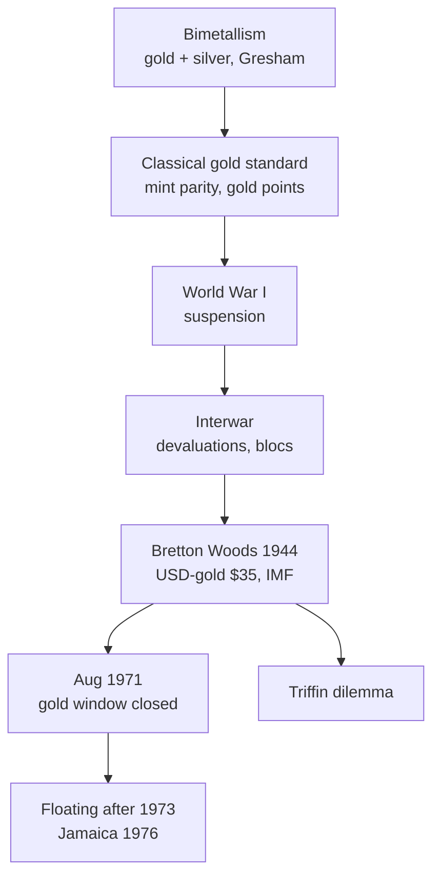

# IF-2: Evolution of the International Monetary System

Covers: bimetallism, the classical gold standard, the interwar period and Bretton Woods, with a timeline, the mint parity sum and the reasons each system broke down. **(syllabus)** for scope, **(textbook)** for content.

## Where this fits in the ESE

Week 2 asks you to build a timeline, so a "trace the evolution" 10-marker is likely. Dates are the scoring detail: learn the table. Dates and figures here are widely cited textbook facts; items marked **[VERIFY]** should be checked against Vij. No faculty slides yet.

## What an international monetary system is

The set of rules, institutions and arrangements that decide how currencies are valued against each other and how payments settle between countries. Two design questions run through all four eras: **what anchors the money** (metal, a reserve currency, nothing) and **who adjusts when a country runs a deficit**.

## Timeline

| Period | System | Anchor | Ends because |
|---|---|---|---|
| To about 1870s | Bimetallism | Gold and silver both legal tender at a fixed ratio | Gresham's law; major countries move to gold |
| About 1876 to 1914 | Classical gold standard | Gold at a fixed mint price | World War I: gold convertibility suspended |
| 1918 to 1939 | Interwar period | Attempted return to gold, then floating and controls | Great Depression, devaluations, trade blocs |
| 1944 to 1971 | Bretton Woods | USD convertible to gold; others pegged to USD | US gold losses; Nixon closes the gold window (Aug 1971) |
| After 1973 | Flexible rates (IF-3) | Market forces, managed in part | Current system |

## Bimetallism

Both gold and silver circulate as money at an official ratio (France's Latin Monetary Union used about 15.5 silver to 1 gold **[VERIFY]**). **Gresham's law:** bad money drives out good. If the market value of silver rises above its official ratio, people melt or hoard the undervalued metal and spend the overvalued one, so the system tilts to one metal. Weakness: the fixed ratio cannot follow the market ratio.

## Classical gold standard (about 1876 to 1914)

- Each currency defined as a fixed weight of gold. The **mint parity** exchange rate is the ratio of the two gold contents.
- Free convertibility and free import and export of gold.
- Money supply tied to gold reserves.
- **Price-specie-flow mechanism (Hume).** A deficit country loses gold, its money supply and prices fall, exports become cheaper and the deficit self-corrects. Surplus country does the reverse.
- Strengths: exchange-rate stability, automatic adjustment, discipline on inflation.
- Weaknesses: money supply set by gold output not by need; deflation and unemployment as the adjustment cost; no lender of last resort; collapsed under wartime financing.

### Worked example: mint parity and gold points

**Data (historic textbook figures):** US dollar defined as 1/20.67 oz of gold, so 1 oz = $20.67. Pound defined so that 1 oz of pure gold = £4.2474 **[VERIFY mint prices]**. Shipping and insurance cost to move gold = $0.03 per £.

1. **Mint parity** = 20.67 / 4.2474 = **$4.8665 per £.**
2. **Gold export point** (upper limit) = 4.8665 + 0.03 = **$4.8965**.
3. **Gold import point** (lower limit) = 4.8665 − 0.03 = **$4.8365**.

| Market rate $/£ | Position | What traders do |
|---|---|---|
| 4.9100 | Above 4.8965 | Pay dollars in gold: ship gold to London, receive pounds. US gold outflow |
| 4.8665 | Parity | No gold moves |
| 4.8200 | Below 4.8365 | Bring gold in from London |

4. **Decision line.** The market rate can never stray outside the gold points because shipping gold is cheaper than buying a dearer rate.
5. **Interpretation.** The gold standard was a fixed-rate system with a built-in band whose width is the cost of moving gold.

## Interwar period (1918 to 1939)

- WWI: convertibility suspended, rates floated, inflation. Britain returned to gold in 1925 at the pre-war parity, an overvalued pound, and left it in 1931 **[VERIFY year]**.
- 1930s: competitive devaluations, "beggar-thy-neighbour" tariffs, exchange controls, currency blocs. Trade shrank.
- Lesson drawn at Bretton Woods: stop competitive devaluation and create a body to supervise exchange rates.

## Bretton Woods system (1944 to 1971)

- Conference at Bretton Woods, New Hampshire, July 1944; 44 countries **[VERIFY]**. Created the **IMF** (short-term balance-of-payments support, rule policing) and the **World Bank/IBRD** (reconstruction and development). India is a founding member.
- **Adjustable peg.** USD convertible to gold at **$35 per ounce** (for central banks); other currencies pegged to the dollar within a band of ±1% around par **[VERIFY band]**. Devaluation allowed only for "fundamental disequilibrium".
- Dollar became the main reserve currency; US supplied dollars through deficits.
- **Triffin dilemma.** World liquidity needed US deficits, but persistent deficits eroded confidence that the US could redeem dollars for gold.
- Breakdown: US gold stock fell, deficits widened with Vietnam War and social spending. On **15 August 1971** the US suspended gold convertibility. The **Smithsonian Agreement** (Dec 1971) tried to patch with wider bands (±2.25%) and a dollar devaluation **[VERIFY]**. By 1973 major currencies floated. The **Jamaica Agreement** (1976, effective 1978) formally legalised floating and removed gold's official role **[VERIFY dates]**.

## India link (qualitative)

India joined the IMF at its start, with the rupee linked to sterling and then managed against a basket. The 1991 balance-of-payments crisis led to devaluation, then the move to a market-determined rate in 1993 **[VERIFY dates]**. IF-3 covers India's current arrangement.

## Traps

- **Bimetallism is not the gold standard.** Two metals, a fixed ratio, Gresham's law.
- **Gold standard is not Bretton Woods.** Under Bretton Woods only the USD was tied to gold, and only for central banks.
- **Mint parity uses gold content, not market prices of gold.**

## What to remember

- Four eras: bimetallism, gold standard (to 1914), interwar chaos, Bretton Woods (1944 to 1971).
- Gold standard: fixed gold content, automatic adjustment, band set by gold shipping cost.
- Bretton Woods: USD at $35/oz, adjustable peg, IMF and World Bank; ended August 1971.
- Mint parity example: $20.67 / £4.2474 = 4.8665; gold points 4.8965 and 4.8365.
- Triffin dilemma explains why Bretton Woods could not last.

## Concept map

## Flashcards
Q: What is Gresham's law in bimetallism?
A: Bad money drives out good: the overvalued metal circulates and the undervalued metal is hoarded or melted.

Q: Define mint parity.
A: The exchange rate implied by the gold content of two currencies, equal to the ratio of their gold prices.

Q: 1 oz of gold = $20.67 and = £4.2474. Mint parity $/£?
A: 20.67 / 4.2474 = 4.8665.

Q: Shipping cost is $0.03 per £. Gold points?
A: Export point 4.8965 and import point 4.8365.

Q: How did the gold standard correct a deficit?
A: Price-specie-flow: the deficit country loses gold, money and prices fall, exports rise and the deficit reverses.

Q: What did Bretton Woods set up?
A: An adjustable peg system with the USD convertible to gold at $35 per ounce, plus the IMF and the World Bank.

Q: State the Triffin dilemma.
A: The world needs US deficits for liquidity, but persistent deficits undermine confidence in the dollar's gold convertibility.

Q: When and why did Bretton Woods end?
A: August 1971, when the US suspended dollar-gold convertibility under pressure from gold losses.

Q: What was the interwar system's main problem?
A: Competitive devaluations and trade barriers with no agreed rules or institution.

## Sources
- BBA303F-6 course plan, Unit 1, Week 2
- Vij (2022); Eun and Resnick (2018), chapters on the international monetary system
- Next: [[Global Business Finance Unit 1 - IF-3 Exchange Rate Regimes and Crises]]
- [[Global Business Finance Unit 1 - International Financial Markets MOC (Node Map)]]
