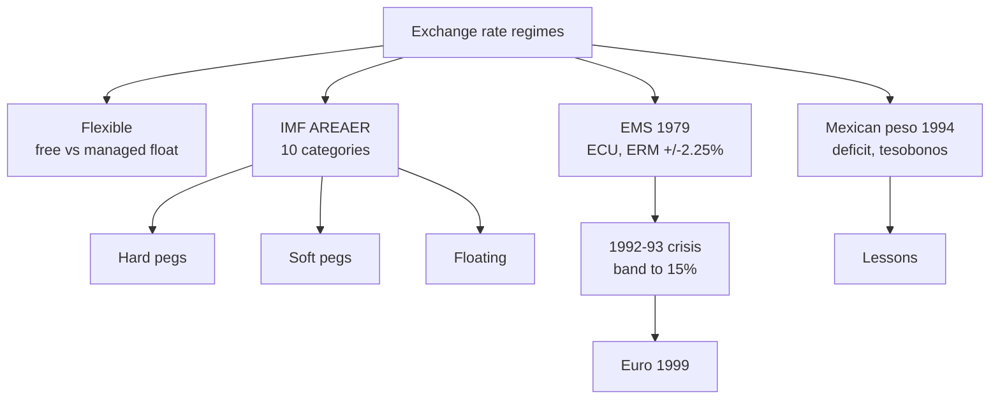

# IF-3: Exchange Rate Regimes, the EMS and the Mexican Peso Crisis

Covers: the flexible exchange rate regime, current arrangements as the IMF classifies them, the European Monetary System, and the Mexican peso crisis of 1994 with its lessons. **(syllabus)** for scope, **(textbook)** for content.

## Where this fits in the ESE

A 5-mark "IMF classification" or "peso crisis" question is likely, and either can seed the 10-mark "fixed vs flexible" answer (IF-4). Dates and classification details carry **[VERIFY]** because they change. No faculty slides yet.

## Flexible exchange rate regime **(textbook)**

Since the mid-1970s the rate of most major currencies is set by supply and demand in the forex market.

- **Free (clean) float.** No central bank intervention. Rate moves with demand and supply of the currency, driven by trade, capital flows, interest rates, inflation and expectations.
- **Managed (dirty) float.** The central bank intervenes to smooth sharp moves or lean against a trend, without a stated target rate.
- **Strengths.** Automatic adjustment of external imbalances; independent monetary policy; no need to hold large reserves to defend a rate; exchange rate absorbs shocks.
- **Weaknesses.** Volatility raises hedging cost and uncertainty for trade and investment; possible overshooting; speculative swings; imported inflation when the currency falls.

## Current exchange rate arrangements (IMF classification) **(textbook)**

The IMF's *Annual Report on Exchange Arrangements and Exchange Restrictions* (AREAER) sorts regimes by what the authorities actually do (de facto). The 2009 scheme has **ten categories** in four groups **[VERIFY current scheme]**:

| Group | Category | Meaning in one line |
|---|---|---|
| Hard pegs | No separate legal tender | Uses another country's currency (dollarisation) |
| | Currency board | Domestic money fully backed and exchangeable at a fixed rate by law |
| Soft pegs | Conventional peg | Fixed to one currency or a basket, narrow band (±1%) |
| | Stabilised arrangement | Spot rate held within a 2% band for six months or more, no floating |
| | Crawling peg | Small, periodic adjustment at a fixed rate or to indicators |
| | Crawl-like arrangement | Rate stays within a 2% band relative to a statistically identified trend |
| | Pegged within horizontal bands | Fluctuates within a band wider than ±1% around a central rate |
| Floating | Floating | Largely market determined; intervention to moderate moves |
| | Free floating | Intervention only in exceptional cases, rare |
| Residual | Other managed arrangement | Does not fit any of the above |

**India.** The RBI describes its approach as a managed float: market-determined rate, intervention to curb excess volatility, not to target a level. The IMF label for India has changed between "floating" and other managed or stabilised categories over recent years **[VERIFY current IMF label]**. State the managed float and say the IMF label should be checked.

## European Monetary System (EMS) **(textbook)**

- Launched **March 1979** by members of the European Community to create a zone of monetary stability after the end of Bretton Woods **[VERIFY]**.
- **ECU** (European Currency Unit): a weighted basket of member currencies, the unit of account for the system.
- **Exchange Rate Mechanism (ERM):** each currency had a **central rate** against the ECU, and bilateral rates could move only within ±2.25% (a wider ±6% for a few members); the central bank of a currency at its limit had to intervene **[VERIFY]**.
- The 1992 to 1993 crisis: heavy speculation after German reunification pushed up German rates; on **16 September 1992** the UK and Italy left the ERM; the bands were widened to ±15% in August 1993 **[VERIFY]**.
- The EMS led to the **euro**: introduced 1 January 1999 as an accounting currency, notes and coins in 2002 **[VERIFY]**.

### Worked example: ERM band

**Data (illustrative):** central rate 1 DM = 3.35 French francs. Band ±2.25%.

| Step | Calculation | Value |
|---|---|---|
| 1. Upper limit | 3.35 × 1.0225 | **3.4254** |
| 2. Lower limit | 3.35 × 0.9775 | **3.2746** |
| 3. Wide band after 1993 (±15%) | 3.35 × 1.15 and 3.35 × 0.85 | 3.8525 and 2.8475 |

4. **Decision line.** If the market rate reaches 3.4254, the Bank of France must buy francs (sell marks or reserves) to hold the line; if it cannot, it devalues or exits.
5. **Interpretation.** The ±15% band turned a quasi-fixed system into a nearly floating one, which is why the speculators' one-way bet was removed.

## Mexican peso crisis (1994 to 1995) **(textbook)**

**Background.** Mexico managed the peso inside a band (a crawling peg), with a deficit on the current account around 7% of GDP, financed by short-term portfolio inflows **[VERIFY]**. To calm investors, the government issued **tesobonos** (short-term, dollar-indexed debt).

**Trigger.** 1994 political shocks, rising US interest rates, falling reserves. On **20 December 1994** Mexico widened the band and devalued; on **22 December** it floated the peso **[VERIFY]**. The peso fell sharply and capital fled. Because tesobonos were dollar-linked, devaluation raised the debt burden.

**Resolution.** An international support package of about US$50 billion led by the US Treasury and the IMF in early 1995 **[VERIFY amount]**. The crisis spread to other emerging markets (the "tequila effect").

**Lessons (the examiner's usual bullets).**
1. A large current account deficit financed by hot money is fragile.
2. Pegged rates plus falling reserves invite a speculative attack.
3. Dollar-indexed short-term debt turns devaluation into a solvency problem.
4. Transparency and adequate reserves are needed; floating can reduce one-way bets.

### Worked example: why high peso yields did not compensate

**Data (illustrative round numbers):** an investor puts money in a peso bond at 12% when the peso is 3.4 per USD. The peso falls to 6.8 per USD within the year.

| Step | Calculation | Value |
|---|---|---|
| 1. Year-end dollar value of 1 dollar invested | 1.12 × (3.4 / 6.8) | **0.56** |
| 2. Dollar return | 0.56 − 1 | **−44%** |

3. **Decision line.** The 12% coupon is wiped out when the peso loses half its dollar value.
4. **Interpretation.** A high interest rate is compensation for expected depreciation, not free money. Use the same logic in IF-1 borrowing and in uncovered interest parity (FX-5).

## Traps

- **Do not call India's regime a free float.** The RBI intervenes.
- **A currency board is not a conventional peg.** The board is backed by law and reserves.
- **EMS is not the euro.** It was the preparation: euro came in 1999.

## What to remember

- Flexible regime: market-determined rate, managed float adds intervention; strong on adjustment, weak on volatility.
- IMF classifies de facto into ten categories under hard pegs, soft pegs, floating, residual.
- EMS: 1979, ECU basket, ERM ±2.25%, crisis 1992 to 1993, euro 1999.
- Mexico 1994: deficit, hot money, dollar-linked debt, devaluation on 20 December, US$50 billion rescue.
- India is a managed float; IMF label to be checked.

## Concept map

## Flashcards
Q: Difference between a free float and a managed float?
A: In a free float the central bank does not intervene; in a managed float it intervenes to smooth moves without a target rate.

Q: Name two strengths and two weaknesses of flexible rates.
A: Strengths: automatic adjustment, independent monetary policy. Weaknesses: volatility and hedging cost, possible overshooting.

Q: How many categories does the IMF's 2009 de facto scheme have?
A: Ten, in the groups hard pegs, soft pegs, floating and residual.

Q: Name the two hard peg categories.
A: No separate legal tender (dollarisation) and currency board.

Q: What was the ECU and what did the ERM do?
A: The ECU was a basket-based unit of account; the ERM held bilateral rates within ±2.25% bands around central rates.

Q: What happened to the EMS in 1992 to 1993?
A: The UK and Italy left the ERM in September 1992, and bands were widened to ±15% in August 1993.

Q: ERM central rate 3.35, band ±2.25%. Limits?
A: 3.4254 upper and 3.2746 lower.

Q: What were tesobonos and why did they matter in 1994?
A: Short-term dollar-indexed Mexican debt; devaluation raised its peso cost and deepened the crisis.

Q: Peso bond at 12%, peso halves against USD. Dollar return?
A: 1.12 × 0.5 − 1 = −44%.

Q: Give two lessons of the Mexican peso crisis.
A: Large deficits funded by hot money are fragile; pegs with falling reserves attract speculative attack.

## Sources
- BBA303F-6 course plan, Unit 1, Week 3
- IMF, Annual Report on Exchange Arrangements and Exchange Restrictions; Vij (2022); Eun and Resnick (2018)
- Next: [[Global Business Finance Unit 1 - IF-4 Fixed versus Flexible Exchange Rates]]
- [[Global Business Finance Unit 1 - International Financial Markets MOC (Node Map)]]
