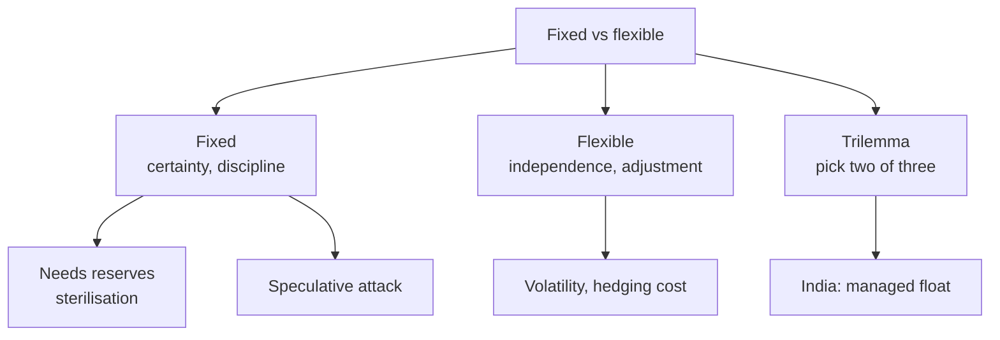

# IF-4: Fixed versus Flexible Exchange Rates

Covers: the full comparison table, the policy trilemma, what defending a peg costs in reserves, and how to write a 10-mark "fixed vs flexible" answer with an Indian conclusion. **(syllabus)** for scope, **(textbook)** for content.

## Where this fits in the ESE

This is the most predictable Unit 1 question: "Compare fixed and flexible exchange rate regimes" for 5 or 10 marks, and the core of CIA 1 (compare regimes for the host country). No faculty slides yet.

## The comparison **(textbook)**

| Basis | Fixed | Flexible |
|---|---|---|
| Rate set by | Government or central bank at a declared parity | Demand and supply in the forex market |
| Adjustment of a BoP deficit | Reserves fall, domestic money supply and demand squeezed | Currency depreciates, exports gain |
| Monetary policy | Tied to defending the peg; limited independence | Independent |
| Reserves needed | Large | Smaller |
| Certainty for trade and investment | High, low hedging cost | Low, hedging needed |
| Inflation discipline | Imports the anchor country's inflation, a discipline | Policy-dependent; depreciation can import inflation |
| Speculative attack risk | High if parity is out of line | Lower, no one-way bet |
| Cost of misalignment | Builds up, then a sudden devaluation | Continuous small adjustments, possible overshoot |
| Suited to | Small open economies, strong anchor partner | Large diversified economies |
| Examples | Currency boards, hard pegs, ERM (until 1993) | US dollar, euro, Indian rupee (managed) |

## The policy trilemma (impossible trinity)

A country cannot have all three at once: **(1) fixed exchange rate, (2) free capital movement, (3) independent monetary policy.** It must give up one.

| Choice | Gives up | Typical user |
|---|---|---|
| Fixed rate and open capital | Monetary independence | Currency board economies, euro members |
| Fixed rate and own monetary policy | Free capital flow (controls) | Capital-controlled economies |
| Free capital and own monetary policy | Fixed rate (floats) | Most large economies |

**India (qualitative).** Opted for a managed float with partial capital controls and its own monetary policy, so it sits between the corners **[VERIFY with Vij]**.

## Cost of defending a peg

### Worked example: RBI-style defence of a peg

**Data (illustrative):** a peg at ₹88 per USD. Demand for dollars exceeds supply by USD 2 billion at that rate. The central bank defends the peg.

| Step | Calculation | Result |
|---|---|---|
| 1. Dollars sold by the central bank | USD 2 billion = 200 crore dollars | Reserves fall USD 2 billion |
| 2. Rupees absorbed | 200 crore × 88 | **₹17,600 crore** |

1. USD sold = 2 billion = 200 crore dollars.
2. Rupees taken out of the system = 200 crore × 88 = **₹17,600 crore**.
3. Reserves fall by USD 2 billion; domestic money supply falls by ₹17,600 crore unless the central bank offsets it (**sterilisation**, for example buying government bonds).
4. If the gap persists for several months, reserves run out and the central bank must devalue, raise rates sharply, or impose controls.
5. **Decision line.** Defence is affordable only if the gap is temporary and reserves are large.
6. **Interpretation.** A peg shifts adjustment from the price (the exchange rate) to the quantity (reserves and money supply), and speculators know this. Flexible rates let the rate absorb the gap at once.

## Writing the 10-mark answer

Meaning of each → comparison table (ten rows) → trilemma → merits and demerits in one line each → India's managed float and why → conclusion: neither regime is best for all; choice depends on size, openness, inflation record and reserves.

## Traps

- **Fixed does not mean never changes.** Devaluation or revaluation is allowed (Bretton Woods "adjustable peg").
- **Flexible does not remove intervention.** Managed float is still flexible.
- **Depreciation helps exports only if elasticities are high enough** (the Marshall-Lerner condition, BP-3).

## What to remember

- Fixed: stability and discipline, at the cost of independence and reserves; flexible reverses this.
- Trilemma: pick two of fixed rate, open capital, independent monetary policy.
- Defending a peg: USD 2 billion at ₹88 drains ₹17,600 crore, unless sterilised.
- India: managed float, partial capital controls, own monetary policy.
- Conclusion line: regime choice depends on country characteristics.

## Concept map

## Flashcards
Q: Name three advantages of fixed rates.
A: Certainty for trade and investment, low hedging cost, and inflation discipline from the anchor currency.

Q: Name three advantages of flexible rates.
A: Automatic BoP adjustment, independent monetary policy, and lower reserves needed.

Q: What is the policy trilemma?
A: A country cannot have a fixed exchange rate, free capital movement and independent monetary policy together; it must give up one.

Q: How does a deficit adjust under a fixed regime?
A: Through falling reserves and a squeezed money supply, not through the exchange rate.

Q: The central bank sells USD 2 billion to hold ₹88. Rupees absorbed?
A: 200 crore dollars × 88 = ₹17,600 crore.

Q: What is sterilisation?
A: Offsetting the effect of intervention on the domestic money supply, for example by buying government securities.

Q: Which regime suits a small open economy with a strong trading partner?
A: Usually a fixed or hard peg to the partner's currency.

Q: Which corner of the trilemma does India lean to?
A: Own monetary policy with a managed float and partial capital controls.

Q: Give one drawback of flexible rates for an exporter.
A: Rate volatility creates uncertainty in rupee receipts and the need to hedge.

## Sources
- BBA303F-6 course plan, Unit 1, Week 3
- Vij (2022); Eun and Resnick (2018); Mundell-Fleming trilemma
- Next: [[Global Business Finance Unit 1 - IF-5 Unit 1 Exam Answers]]
- [[Global Business Finance Unit 1 - International Financial Markets MOC (Node Map)]]
