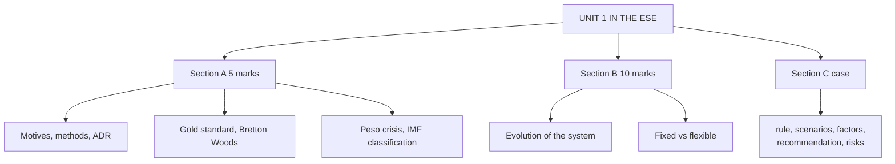

# IF-5: Unit 1 Exam Answers

Covers: likely 5-mark and 10-mark questions from Unit 1 with answer skeletons, and a 15-mark case layout with a full model answer on borrowing in dollars versus rupees. Numbers come from IF-1 to IF-4.

## What the test will ask

ESE is 50 marks: Section A three 5-mark questions with either/or, Section B two 10-mark with either/or, Section C one compulsory 15-mark case. The mid-sem (Units 1 to 3, 50 marks, handwritten, case-based) draws 10 marks from CO1. Unit 1 is mostly descriptive, so it shows up in Section A and the first 10-marker. The case may use Unit 1 as context (regime and borrowing choice) with Unit 3 arithmetic. This is a judgement from the course plan, not a confirmed pattern.

## Five-mark answer skeletons

**1. Motives for investing or borrowing abroad (IF-1).** Four motives each side; the break-even rule (INR 9% vs USD 5%, 3.81%).

**2. International business methods (IF-1).** Six methods in order of commitment with one line each and one Indian example; risk-control trade-off.

**3. Infosys ADR (IF-1).** Definition; customers, currency match, deal currency, investor base, governance; cost side.

**4. Gold standard and mint parity (IF-2).** Features; price-specie-flow; $20.67 / £4.2474 = 4.8665; gold points 4.8965 and 4.8365; why it collapsed.

**5. Bretton Woods and its collapse (IF-2).** Adjustable peg, $35/oz, IMF and World Bank, Triffin dilemma, 15 August 1971.

**6. Mexican peso crisis (IF-3).** Background, trigger (20 December 1994), tesobonos, rescue, three lessons.

**7. IMF classification of regimes (IF-3).** Ten categories in four groups; India's managed float.

## Ten-mark answer skeletons

**A. Evolution of the international monetary system.** Timeline table (bimetallism, gold standard, interwar, Bretton Woods, floating) → one paragraph per era with anchor, adjustment mechanism, breakdown → mint parity sum → Triffin dilemma → Jamaica 1976 → conclusion: each system failed on the same tension between stability and adjustment.

**B. Fixed versus flexible exchange rates.** Meanings → ten-row table → trilemma → RBI peg-defence sum (₹17,600 crore) → India's managed float → conclusion: choice depends on size, openness, reserves.

**C. Flexible regime, EMS and peso crisis.** Free versus managed float → IMF classification → EMS (ECU, ERM, 1992 to 1993, euro) with band sum 3.4254 and 3.2746 → peso crisis lessons → link to why fixed pegs attract attacks.

## Fifteen-mark case layout (borrowing and regime)

1. **Identify the decision (1).** Rupee or dollar loan, and the exposure it creates.
2. **State the rule (2).** Effective INR cost of a foreign loan = (1 + i_f) × S1/S0 − 1; break-even rise in the foreign currency = (1 + i_h)/(1 + i_f) − 1.
3. **Compute scenarios (6).** Table of exchange rate scenarios, effective rates and rupee cost.
4. **Add the qualitative factors (3).** Revenue currency, regime and RBI stance, hedge cost.
5. **Recommend with a condition (2).**
6. **Risks (1).**

### Model answer, laid out as the exam answer

**Data (illustrative):** Tamarind Auto Components Ltd (fictional) needs ₹44 crore for one year to fund a plant extension. Spot ₹88 per USD, so ₹44 crore = USD 50,00,000. Option A: rupee loan at 9%. Option B: dollar loan at 5%, unhedged, repaid with interest at year end. About 60% of Tamarind's revenue is in USD from US customers. India runs a managed float.

1. **Rupee loan cost** = 9% × ₹44 crore = **₹3.96 crore.**
2. **Dollar loan, effective rupee cost** = 1.05 × S1/88 − 1. Rupee cost = 50,00,000 × 1.05 × S1 − ₹44 crore.
3. **Break-even rate** = 88 × 1.09/1.05 = **₹91.35**, the dollar appreciates **3.81%** (₹88 to ₹91.35). In rupee-value terms the rupee falls 1 − 88/91.35 = 3.67%.

| S1 (₹/USD) | Change in S (₹/USD) | Effective rate on USD loan | Rupee cost (₹ crore) | Beats 9% rupee loan? |
|---|---|---|---|---|
| 85 | −3.4% (rupee stronger) | 1.42% | 0.625 | Yes |
| 88 | 0% | 5.00% | 2.20 | Yes |
| 90 | +2.3% | 7.39% | 3.25 | Yes |
| 91.35 | +3.8% | 9.00% | 3.96 | Equal |
| 94 | +6.8% | 12.16% | 5.35 | No |

4. **Reading the table.** The dollar loan saves money up to a rupee rate of 91.35. Beyond that the lower dollar rate is more than eaten by the rise in ₹/USD. At 94 the dollar loan costs ₹1.39 crore more than the rupee loan (5.35 − 3.96).
5. **Qualitative factors.** Tamarind earns dollars, so 60% of the dollar loan is naturally hedged by receipts; only the unmatched 40% (USD 20,00,000, ₹17.6 crore at spot) is exposed. A managed float leaves a risk of sharp moves that the RBI only smooths. A forward cover would raise the cost by the forward premium, which in an interest-parity world equals about the rate gap (FX-5), so full hedging gives roughly the rupee loan's cost.
6. **Recommendation.** Take the **dollar loan**, matched to dollar receipts, and cover the unmatched USD 20,00,000 by a forward contract (Unit 4). Condition: if forward premium takes the all-in cost above 9%, prefer the rupee loan for that portion.
7. **Risks.** Rate moves beyond 91.35, refinancing risk, and counterparty risk on the forward.

Close with: *figures are illustrative; actual loan rates, forward premium and spot would be quoted by the bank.*

## Time rule

If short of time: write the effective-cost formula, compute the break-even and one scenario, and give the match-the-currency recommendation. That secures most of the marks in a Unit 1 case.

## What to remember

- Section A Unit 1 items: motives, methods, ADR, gold standard, Bretton Woods, peso crisis, IMF classification.
- Break-even for borrowing in a foreign currency: 3.81% rise in the dollar (₹/USD) for INR 9% vs USD 5%.
- Timeline answers need dates and the reason each system ended.
- The case answer ends with a conditional recommendation and a risk line.

## Concept map

## Flashcards
Q: Steps of a borrowing-currency case answer?
A: Identify the decision, state the effective-cost formula and break-even, compute scenarios, add qualitative factors, recommend with a condition, note risks.

Q: Formula for the effective INR cost of a foreign loan?
A: (1 + i_f) × S1/S0 − 1.

Q: Tamarind case: break-even rate and depreciation?
A: ₹91.35 per USD: the dollar appreciates 3.81% (₹88 to ₹91.35).

Q: Tamarind case at S1 = 94. Which loan is cheaper and by how much?
A: The rupee loan, by ₹1.39 crore (₹5.35 crore against ₹3.96 crore).

Q: Why is the dollar loan natural for Tamarind?
A: About 60% of its revenue is in dollars, so receipts offset the repayment.

Q: Skeleton for the 10-mark monetary system question?
A: Timeline table, one paragraph per era, mint parity sum, Triffin dilemma, Jamaica 1976, conclusion.

Q: Skeleton for the 10-mark fixed vs flexible question?
A: Meanings, ten-row table, trilemma, peg-defence sum, India's managed float, conclusion.

Q: What closing line should every illustrative case carry?
A: That the figures are illustrative and actual rates would be quoted by the bank.

## Sources
- BBA303F-6 course plan, Unit 1 and ESE pattern
- [[Global Business Finance Unit 1 - International Financial Markets MOC (Node Map)]]
