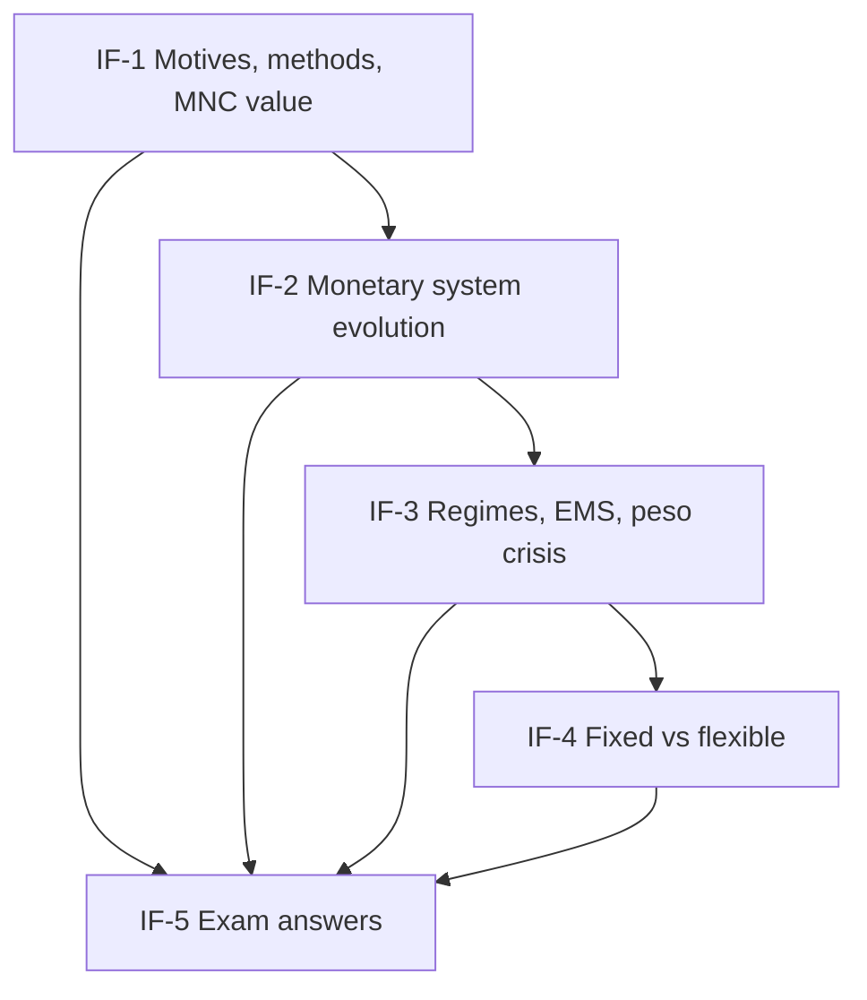

# Global Business Finance Unit 1: International Financial Markets, node map

Mid-sem and ESE: Unit 1 is CO1 (10 of the 50 mid-sem marks, 5 of the 50 ESE marks) and mostly descriptive. All examples are **illustrative numbers**. Dates and classification facts carry **[VERIFY]** tags.

## Nodes

| Node | Topic | Deps | Minutes | Exam focus |
|---|---|---|---|---|
| IF-1 | Motives, International Business Methods and MNC Value | none | 30 | yes |
| IF-2 | Evolution of the International Monetary System | IF-1 | 35 | yes |
| IF-3 | Exchange Rate Regimes and Crises | IF-2 | 35 | yes |
| IF-4 | Fixed versus Flexible Exchange Rates | IF-3 | 25 | yes |
| IF-5 | Unit 1 Exam Answers | IF-1 to IF-4 | 25 | yes |

Total reading time: about 150 minutes.

## Dependency graph

## Headline numbers to know

- Borrowing break-even: INR 9% vs USD 5% gives a 3.81% rise in the dollar; rate ₹91.35 from ₹88.
- MNC value: USD 2,00,000 at 88 and 12% gives ₹1,57,16,800; at 92 it is ₹1,64,31,200.
- Mint parity: $20.67 / £4.2474 = 4.8665; gold points 4.8965 and 4.8365.
- ERM band: central 3.35 gives 3.4254 and 3.2746 at ±2.25%.
- Defending a peg: USD 2 billion at ₹88 drains ₹17,600 crore.
- Case: Tamarind dollar loan costs ₹3.96 crore at 91.35 and ₹5.35 crore at 94.

## Links
- [[Global Business Finance MOC]]
