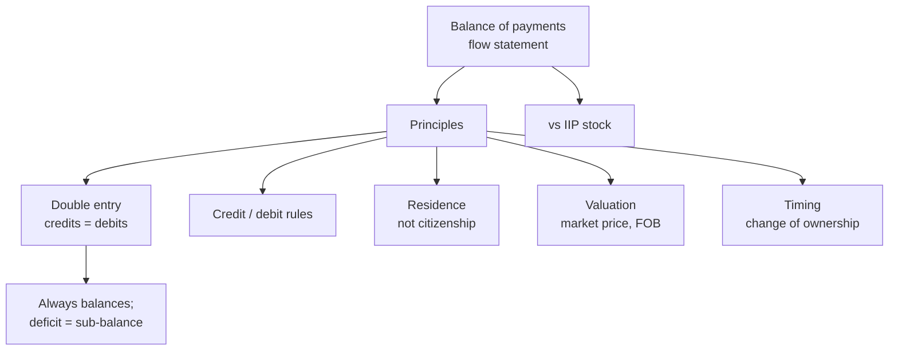

# BP-1: Concept and Principles of BoP Compilation

Covers: what the balance of payments is, five core compilation principles (double entry, credit and debit rules, residence, valuation, timing), plus gross recording and the BPM6 standard, and a double-entry worked example that always balances. **(syllabus)** for scope, **(textbook)** for content.

## Where this fits in the ESE

Unit 2 carries 7 hours and CO2 (15 of the 50 mid-sem marks, 5 of the 50 ESE marks). BP-1 gives the rules; BP-2 gives the components and the classification sum; BP-3 gives analysis. Expect "explain the principles of BoP compilation" for 5 marks. No faculty slides yet.

## Concept **(textbook)**

The **balance of payments (BoP)** is a systematic statement of all economic transactions between the residents of a country and the rest of the world over a period (a quarter or a year). It is a **flow** statement. It differs from the **international investment position (IIP)**, which is a **stock** statement of external assets and liabilities at a date.

Uses: shows how the country earns and spends foreign exchange, how a deficit is financed, and whether reserves are changing.

**Two meanings of balance.** (1) The full BoP always balances in accounting terms. (2) A **surplus or deficit** refers to the balance of selected items (for example the current account, or the overall balance before reserves). Do not confuse the two; most exam answers lose marks here.

## Principles of compilation

Five core principles (sections 1 to 5), then gross recording, unit of account and the BPM6 standard.

### 1. Double-entry bookkeeping

Every transaction has two equal entries, one credit and one debit. Total credits = total debits, so the sum of all accounts is zero (before errors and omissions).

### 2. Credit and debit rules (traditional presentation)

This is the traditional layout (BPM5 style), and the way the RBI's table reads.

| Credit (+) | Debit (−) |
|---|---|
| Exports of goods and services | Imports of goods and services |
| Income received from abroad | Income paid abroad |
| Transfers received | Transfers sent |
| Increase in liabilities to non-residents (for example FDI into India) | Increase in assets held abroad (for example Indian investment abroad) |
| Decrease in assets held abroad | Decrease in liabilities to non-residents |

Short rule: **a credit brings foreign exchange in or builds a foreign claim on us; a debit sends it out**. In this traditional presentation a rise in a financial **asset** is a debit and a rise in a **liability** is a credit.

**BPM6 proper** records the financial account as net acquisition of financial assets and net incurrence of liabilities, and shows the financial account balance as **net lending (+) or net borrowing (-)**, which equals current account balance + capital account balance. In the example below that is **+13**; the traditional presentation shows it as −13 (see step 4).

### 3. Residence

Transactions are recorded between **residents and non-residents**, not between citizens and foreigners. A unit is resident where its **centre of predominant economic interest** lies, usually where it has lived or operated for a year or more.
- An Indian citizen working in the UAE for three years is a non-resident of India for BoP purposes.
- The UAE subsidiary of an Indian company is a resident of the UAE.
- A student studying abroad and a tourist stay residents of their home country.

### 4. Valuation

Transactions are valued at **market prices** at the time of the transaction. Goods are valued **free on board (FOB)** at the exporter's border, for both exports and imports, so freight and insurance on imports are recorded under services. A country's customs trade data often values imports at **CIF**, which is one reason customs and BoP trade figures differ **[VERIFY RBI practice]**.

### 5. Timing

Recorded when **ownership changes** (accrual basis), not when cash moves. Goods shipped on 28 March but arriving on 4 April belong in the period in which title passed.

### 6. Unit of account, gross recording

Foreign currency values are converted at the market rate on the transaction date (or the period average), and entries are shown **gross**, not netted off against each other.

### 7. Standard

The IMF's BPM6 (2008) sets the format; India's RBI compiles the BoP in this format and publishes it quarterly **[VERIFY year of RBI's adoption and release lag]**.

## Worked example: double-entry on five transactions

**Data (illustrative, ₹ lakh):** classify each and record both sides.

| # | Transaction | Credit | Debit |
|---|---|---|---|
| 1 | Indian firm exports goods, 50, receives payment in its foreign-currency bank account | Goods exports 50 | Other investment (bank balance up) 50 |
| 2 | Imports machinery, 30, on six months supplier credit | Other investment (trade credit liability up) 30 | Goods imports 30 |
| 3 | Foreign investor brings FDI, 20 cash | Direct investment (liability up) 20 | Other investment (bank balance up) 20 |
| 4 | Resident sends a gift of 5 to a relative abroad | Other investment (bank balance down) 5 | Secondary income 5 |
| 5 | Interest of 2 paid to a foreign lender | Other investment (bank balance down) 2 | Primary income 2 |

1. **Total credits** = 50 + 30 + 20 + 5 + 2 = **107**.
2. **Total debits** = 50 + 30 + 20 + 5 + 2 = **107**. Balanced.
3. **Current account balance** = credit 50 − debits (30 + 5 + 2 = 37) = **+13**.
4. **Financial account, traditional presentation (net credits − debits)** = FDI +20; other investment: credits 30 + 5 + 2 = 37, debits 50 + 20 = 70, net −33. Total = 20 − 33 = **−13**.
5. **Sum of accounts** = +13 − 13 = **0**.
6. **Decision line.** A current account surplus of ₹13 lakh is matched by a ₹13 lakh net outflow on the financial account, meaning residents increased their net claims on the rest of the world by ₹13 lakh.
7. **Interpretation.** Every current-account balance is financed by an equal and opposite capital or reserve movement; there is no separate "free" surplus.

## Traps

- **Citizenship is not residence.** Always test the centre of economic interest.
- **Timing follows ownership, not payment.** Credit sales are recorded now, with a credit-side financing entry.
- **Surplus and deficit are about sub-balances.** The whole statement balances.
- **Debit and credit are not good and bad.** They are direction labels.

## What to remember

- BoP is a flow statement of resident to non-resident transactions; IIP is the stock.
- Five core rules: double entry, credit/debit, residence, valuation (market, FOB goods), timing (change of ownership); plus gross recording and the BPM6 standard.
- Credit brings foreign exchange in; debit sends it out; asset rise is a debit, liability rise is a credit.
- Sample: ₹13 lakh current account surplus is balanced by a ₹13 lakh financial account outflow.
- The full BoP always balances; deficit or surplus refers to a sub-balance.

## Concept map

## Flashcards
Q: Define the balance of payments.
A: A systematic record of all economic transactions between residents and non-residents of a country over a period.

Q: BoP versus IIP?
A: BoP is a flow statement for a period; the international investment position is a stock statement of external assets and liabilities at a date.

Q: What does "BoP always balances" mean, and what does a deficit mean?
A: Total credits equal total debits by double entry; a deficit or surplus refers to the balance on selected accounts such as the current account.

Q: What is a credit entry in the BoP?
A: A transaction that brings foreign exchange in, such as exports, income and transfers received, or a rise in liabilities to non-residents.

Q: In the traditional (BPM5-style, RBI table) presentation, how is a rise in an asset held abroad recorded?
A: As a debit in the financial account; a rise in a liability is a credit. BPM6 proper records net acquisition of assets and net incurrence of liabilities and shows the financial balance as net lending, equal to CA + KA (+13 in the BP-1 example).

Q: Residence test?
A: A unit's centre of predominant economic interest, normally where it has operated or lived for a year or more.

Q: At what value are goods recorded in the BoP?
A: Market price, free on board (FOB) for both exports and imports.

Q: When is a transaction recorded?
A: When ownership changes (accrual), not when cash is paid.

Q: A resident exports goods for ₹50 lakh and imports on credit for ₹30 lakh. Current account effect?
A: Goods balance +₹20 lakh, with financing entries in other investment on the opposite side.

## Sources
- BBA303F-6 course plan, Unit 2, Week 4
- Vij (2022); IMF BPM6 (2008)
- Next: [[Global Business Finance Unit 2 - BP-2 Components of the BoP and Classification of Transactions]]
- [[Global Business Finance Unit 2 - Balance of Payments MOC (Node Map)]]
