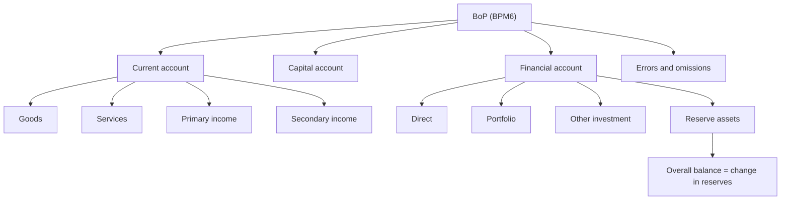

# BP-2: Components of the BoP, Factors, and Classification of Transactions

Covers: the current, capital and financial accounts, official reserves and errors and omissions, the factors that drive each, and a ten-transaction classification sum with the overall balance. **(syllabus)** for scope, **(textbook)** for content.

## Where this fits in the ESE

This is the highest-yield Unit 2 node. Week 4 asks for "classification of international transactions", so a 10-mark answer or a 5-mark classification table is likely. Two layouts exist: the **traditional** four-part layout in older textbooks, and the **BPM6** layout that the RBI uses now. Write the one the faculty uses; none are available yet, so give the BPM6 layout and mention the traditional mapping in one line.

## The structure **(textbook, BPM6)**

| Account | Items | Sign convention |
|---|---|---|
| **Current account** | Goods; services; primary income (compensation of employees, investment income such as interest and dividends); secondary income (remittances, grants, other current transfers) | Receipts are credits, payments are debits |
| **Capital account** | Capital transfers (debt forgiveness, migrants' transfers, grants for fixed assets); acquisition or disposal of non-produced non-financial assets (patents, leases, land rights) | Credits and debits |
| **Financial account** | Direct investment (FDI); portfolio investment (equity and debt securities); financial derivatives; other investment (loans, trade credit, currency and deposits); **reserve assets** | Traditional presentation: asset rise is a debit, liability rise a credit. BPM6 proper: net acquisition of assets less net incurrence of liabilities, balance shown as net lending (= CA + KA) |
| **Net errors and omissions** | Balancing item for statistical discrepancy | Plugs the gap |

**Mapping to the traditional layout:** Current account (visible trade, invisibles); Capital account (FDI, portfolio, external assistance, external commercial borrowings, banking capital and NRI deposits); Errors and omissions; Official reserves. The RBI's published presentation combines capital and financial accounts and reports a change in reserves with an opposite sign (a rise in reserves is shown as a negative) **[VERIFY exact RBI table layout]**.

**Overall balance** = current account + capital account + financial account **excluding reserves** + errors and omissions. If positive (a surplus), reserves rise by that amount. If negative, reserves fall or the central bank borrows. This is the sense in which "a country runs a BoP deficit".

## Components in detail and factors affecting each

| Component | What it records | Main drivers |
|---|---|---|
| Goods (merchandise trade) | Exports and imports of goods | Relative prices, exchange rate, income abroad and at home, tariffs, oil and commodity prices, quality |
| Services | IT and business services, travel, transport, financial services | Global demand for outsourcing, tourism flows, freight rates, visa and trade policy |
| Primary income | Interest, dividends, profits, wages of cross-border workers | Size of external debt and foreign investment stock, global interest rates, profit repatriation |
| Secondary income | Remittances, gifts, grants | Number and earnings of diaspora, oil prices in Gulf economies, host-country employment, remittance costs |
| Capital account | Debt forgiveness, asset transfers | Official debt settlements, one-off events |
| Direct investment | Lasting control, usually 10% or more of equity | Growth prospects, FDI rules, tax, ease of doing business, political stability |
| Portfolio investment | Shares and bonds without control | Interest rate gap, growth outlook, global risk appetite, the US monetary stance, taxation, capital controls |
| Other investment | Loans, trade credit, bank deposits (including NRI deposits) | Interest rates on NRI deposits, external commercial borrowing norms, credit conditions |
| Reserve assets | Central bank holdings of foreign currency, gold, SDRs, IMF reserve position | The overall balance and the central bank's intervention |

**Two themes to quote.** (1) The current account depends mostly on real economy variables: prices, income, the exchange rate. (2) The financial account depends on interest rates, expectations, regulation and global risk appetite. In India's case, a goods deficit is partly offset by services and remittance surpluses, and the remainder is financed by financial inflows (BP-3).

## Worked example: classify ten transactions and find the overall balance

**Data (illustrative, ₹ lakh).** Each transaction is recorded on both sides. Settlement is through bank balances or reserves. Sign: credit +, debit −.

| # | Transaction | Account and entry | Settlement entry |
|---|---|---|---|
| 1 | Services exports (software), 44 | Current, services **+44** | Other investment (foreign bank balance up) **−44** |
| 2 | Crude oil imports, 88, paid from reserves | Current, goods **−88** | Reserve assets (decrease) **+88** |
| 3 | Remittance from NRI to family in India, 10 | Current, secondary income **+10** | Reserve assets (increase) **−10** |
| 4 | FPI buys Indian shares, 50 | Financial, portfolio **+50** | Reserve assets (increase) **−50** |
| 5 | Dividend paid to foreign shareholder, 5 | Current, primary income **−5** | Reserve assets (decrease) **+5** |
| 6 | Foreign government gives a relief grant, 20 | Current, secondary income **+20** | Reserve assets (increase) **−20** |
| 7 | Machinery imported on six months credit, 30 | Current, goods **−30** | Other investment (trade credit liability) **+30** |
| 8 | Indian tourist spends 2 abroad | Current, services **−2** | Reserve assets (decrease) **+2** |
| 9 | Foreign creditor forgives a loan, 15 | Capital account **+15** | Other investment (liability down) **−15** |
| 10 | Indian company buys a foreign firm, 100 | Financial, direct investment **−100** | Reserve assets (decrease) **+100** |

**Step 1: current account balance.**

| Item | Credits | Debits |
|---|---|---|
| Services (1, 8) | 44 | 2 |
| Goods (2, 7) | 0 | 118 |
| Primary income (5) | 0 | 5 |
| Secondary income (3, 6) | 30 | 0 |
| **Total** | **74** | **125** |

Current account balance = 74 − 125 = **−51** (deficit).

**Step 2: capital account** = **+15** (transaction 9).

**Step 3: financial account excluding reserves.**
- Direct investment (10): −100
- Portfolio investment (4): +50
- Other investment (1, 7, 9): −44 + 30 − 15 = −29
- Total = −100 + 50 − 29 = **−79**.

**Step 4: overall balance** = −51 + 15 − 79 = **−115**.

**Step 5: reserves check.** Reserve entries: increases 10 + 50 + 20 = 80; decreases 88 + 5 + 2 + 100 = 195. Net decrease = **115**. This matches the overall balance of −115. The whole statement sums to zero.

**Step 6: decision line.** A current account deficit of ₹51 lakh and a heavy ₹100 lakh outward direct investment produce an overall deficit of ₹115 lakh, financed entirely by running down reserves.

**Step 7: interpretation.** The country is a net user of foreign exchange this period. The inflows came from services exports (44), transfers (30, including remittances and the relief grant) and portfolio flows (50). Debt forgiveness (15) is a capital transfer, not financing. If this continued, reserves would shrink and the rupee would come under pressure, so authorities would try to attract more FDI or portfolio inflows, or restrain imports.

## Traps

- **Dividends and interest are current account (primary income), not capital account.** The capital that earns them sits in the financial account.
- **FDI is the financial account, not the capital account** in BPM6 (older textbooks put it in "capital account").
- **A reserve fall is a credit** in the sum above (financing); do not read it as a "bad" sign.
- **Gifts and remittances** are secondary income, current account.

## What to remember

- BPM6: current (goods, services, primary and secondary income), capital, financial (direct, portfolio, derivatives, other, reserves), errors and omissions.
- Overall balance excludes reserves; its sign tells you the change in reserves.
- Current drivers are prices, incomes, exchange rate; financial drivers are interest gap and risk appetite.
- Worked sum: current −51, capital +15, financial (ex reserves) −79, overall −115, reserves down 115.
- Dividends, interest and remittances are current account items.

## Concept map

## Flashcards
Q: Name the four parts of the current account in BPM6.
A: Goods, services, primary income and secondary income.

Q: Where are dividends and interest recorded?
A: Current account, under primary income.

Q: Where are remittances and grants recorded?
A: Current account, under secondary income.

Q: What goes into the capital account in BPM6?
A: Capital transfers such as debt forgiveness, and acquisition or disposal of non-produced non-financial assets such as patents.

Q: List the five parts of the financial account.
A: Direct investment, portfolio investment, financial derivatives, other investment, and reserve assets.

Q: Define the overall balance.
A: Current account plus capital account plus financial account excluding reserves plus errors and omissions; it equals the change in reserves (a deficit means reserves fall); only the reserve line inside the BoP is entered with the opposite sign.

Q: Worked sum totals: current, capital, financial ex reserves?
A: −₹51 lakh, +₹15 lakh, −₹79 lakh, giving an overall balance of −₹115 lakh.

Q: Name three drivers of portfolio inflows.
A: Interest rate gap, growth outlook and global risk appetite (also US monetary stance and taxation).

Q: Is FDI in the capital account?
A: Not under BPM6, where it sits in the financial account; older textbooks include it in the capital account.

## Sources
- BBA303F-6 course plan, Unit 2, Weeks 4 and 5
- Vij (2022); IMF BPM6; RBI BoP publication
- Next: [[Global Business Finance Unit 2 - BP-3 Importance Limitations and Linkages of BoP]]
- [[Global Business Finance Unit 2 - Balance of Payments MOC (Node Map)]]
