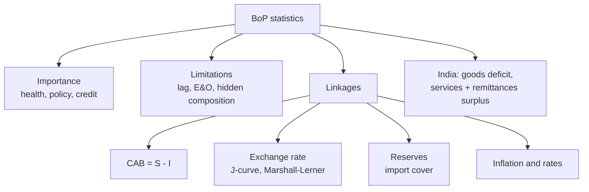

# BP-3: Importance, Limitations and Linkages of BoP Statistics

Covers: why BoP data matter, their limits, how the BoP links to GDP, savings and investment, the exchange rate, reserves and inflation, and the structure of India's BoP as the RBI reports it. **(syllabus)** for scope, **(textbook)** for content, India facts tagged **[VERIFY]**.

## Where this fits in the ESE

Week 5 pairs this node with "India's BoP statistics", and CIA 1 asks students to read a host country's BoP. Expect a 5-mark "importance and limitations" question and a 10-mark question that uses the savings-investment identity or a BoP table. No faculty slides yet.

## Importance of BoP statistics **(textbook)**

1. **External health check.** Shows whether the country earns enough foreign exchange to pay for imports and debt service.
2. **Currency pressure signal.** A persistent deficit points to depreciation or a fall in reserves.
3. **Policy input.** Guides exchange rate, trade, tariff, FDI and borrowing policy.
4. **Financing profile.** Shows whether a deficit is financed by stable FDI or by volatile short-term flows.
5. **Creditworthiness.** Rating agencies, lenders and the IMF read it.
6. **Business use.** An MNC reads the host country's BoP to judge exchange rate, convertibility and country risk before investing (CIA 1).

## Limitations

1. **Flow only.** It does not show stocks; the IIP does.
2. **Time lag and revisions.** Data come quarterly with a lag and are revised.
3. **Errors and omissions.** A statistical plug that hides unrecorded flows (informal channels, under-invoicing).
4. **Valuation and coverage gaps.** Customs vs BoP differences, under-recorded services.
5. **Composition risk is not visible.** A balanced BoP can rest on short-term hot money.
6. **"Balance" is arbitrary.** Where the line is drawn (which items are "above the line") changes the deficit.
7. **Aggregation.** Does not show bilateral or sector detail.
8. **Silent on domestic factors.** Does not explain why the deficit arose.

## Relationship with other economic variables

### GDP, savings and investment

GDP identity: Y = C + I + G + (X − M). Rearranged:

**Current account balance (CAB) = National saving − Investment = S − I**

A current account deficit means the country invests more than it saves and borrows the difference from abroad. It is not good or bad by itself; it is sustainable if foreign funds finance productive investment.

### Exchange rate

- A persistent deficit raises demand for foreign currency, putting depreciation pressure. In a fixed regime, reserves fall (IF-4).
- Depreciation can improve the balance if the **Marshall-Lerner condition** holds: the sum of export and import demand elasticities exceeds one. In the short run a **J-curve** appears: the balance worsens first because volumes adjust slowly while import bills rise in rupee terms.

### Reserves

Change in reserves = overall balance (BP-2). Adequacy is measured as **import cover** (months of imports covered) and reserves to short-term external debt.

### Inflation and interest rates

- Higher domestic inflation than abroad makes imports cheaper relative to home goods and exports dearer, widening the deficit (PPP link, FX-6).
- A higher domestic interest rate attracts portfolio inflows, improving the financial account (FX-5, FX-7).

### Growth

Fast growth raises import demand and so widens the current account deficit; weak growth abroad lowers export demand.

## India's BoP structure **(textbook, RBI)**

| Element | Typical pattern | Why |
|---|---|---|
| Merchandise trade | Large persistent deficit | Crude oil, gold, electronics and machinery imports |
| Services | Large surplus | Software and business services exports |
| Primary income | Net deficit | Interest and dividend payments on external liabilities |
| Secondary income | Large surplus | Private transfers (remittances); India is among the largest recipients **[VERIFY rank and size]** |
| Current account | Moderate deficit, 1 to 3% of GDP in most years **[VERIFY latest]** | Services and remittances fund most of the trade gap |
| Financial account | Net inflow | FDI, FPI (volatile), NRI deposits, external commercial borrowings |
| Reserves | Large buffer, built by RBI purchases | Cushion for external shocks |

**Context.** In 1990-91 India ran a current account deficit of about 3% of GDP with reserves covering only a few weeks of imports, which led to the 1991 crisis and reforms **[VERIFY figures]**. The RBI publishes the BoP quarterly with an annual summary **[VERIFY schedule]**.

## Worked example: read a BoP table and link it to savings and investment

**Data (illustrative, India-shaped, USD billion):**

| Item | Credits less debits |
|---|---|
| Goods: exports 440, imports 700 | −260 |
| Services: exports 340, imports 180 | +160 |
| Primary income (net) | −50 |
| Secondary income (net) | +125 |
| **Current account balance** | **−25** |
| FDI (net) | +10 |
| Portfolio (net) | +15 |
| Loans and ECB (net) | +12 |
| Banking capital and NRI deposits (net) | +18 |
| Other (net) | +4 |
| **Capital and financial account excluding reserves** | **+59** |
| Errors and omissions | −1 |

1. **Current account balance** = −260 + 160 − 50 + 125 = **−25**.
2. **Financing** = 10 + 15 + 12 + 18 + 4 = **+59**.
3. **Overall balance** = −25 + 59 − 1 = **+33**, so reserves rise by USD 33 billion.
4. **CAB as % of GDP** (illustrative GDP USD 3,800 billion) = 25 / 3,800 = **0.66%**.
5. **Financing mix.** Stable money (FDI 10 + loans 12 = 22) is about 37% of inflows; volatile (portfolio 15 + banking 18 = 33) is about 56%.
6. **Import cover** (reserves USD 600 billion, imports of goods and services 700 + 180 = 880 a year): 600 / (880/12) = **8.2 months**.
7. **Decision line.** A small deficit, financed more than twice over, adds to reserves, so there is no immediate pressure on the rupee. The weak spot is composition: more than half of the inflow is volatile.
8. **Interpretation.** Without volatile inflows the deficit would only be partly financed; a reversal in portfolio flows could remove the cushion.

### Savings-investment check

**Data (illustrative):** GDP ₹300 lakh crore; national saving 30% of GDP; investment 32%.

| Step | Calculation | Result |
|---|---|---|
| 1. Saving | 30% × 300 | ₹90 lakh crore |
| 2. Investment | 32% × 300 | ₹96 lakh crore |
| 3. CAB = S − I | 90 − 96 | **−₹6 lakh crore (2% of GDP)** |

Meaning: the economy invests ₹6 lakh crore more than it saves, which must be matched by net foreign borrowing or foreign investment of the same size.

## Traps

- **Do not treat every deficit as a crisis.** Look at size (percentage of GDP), financing and reserves.
- **Services and remittances reduce the "deficit" but are not in the goods balance.** Always say which balance you mean.
- **Depreciation does not fix the balance at once** (J-curve).

## What to remember

- BoP data show external health, currency pressure, financing quality and country risk.
- Limits: flow only, lagged, errors and omissions, composition hidden, arbitrary "balance".
- CAB = S − I: a ₹6 lakh crore gap here is 2% of GDP.
- Reserves change = overall balance; import cover in months.
- India: goods deficit, services and remittance surplus, financial inflows, large reserves.

## Concept map

## Flashcards
Q: Write the savings-investment form of the current account balance.
A: CAB = national saving − investment (S − I).

Q: Name three limitations of BoP statistics.
A: Flow only with lags and revisions, errors and omissions hide unrecorded flows, composition risk is not visible.

Q: State the Marshall-Lerner condition.
A: Depreciation improves the trade balance only if the sum of the export and import demand elasticities is greater than one.

Q: What is the J-curve?
A: The trade balance worsens first after depreciation because volumes adjust slowly, then improves.

Q: GDP ₹300 lakh crore, saving 30%, investment 32%. CAB?
A: −₹6 lakh crore, or 2% of GDP.

Q: Define import cover.
A: Reserves divided by monthly imports, giving the months of imports that reserves can pay for.

Q: Illustrative table: CAB −25, financing +59, E&O −1. Overall balance and effect?
A: +33; reserves rise by USD 33 billion.

Q: Describe India's BoP in one line.
A: A large goods deficit offset largely by services exports and remittances, financed by FDI, portfolio, NRI deposits and borrowing, with reserves as a buffer.

Q: Why does high domestic inflation widen the current account deficit?
A: Imports become cheaper and exports dearer in relative terms.

## Sources
- BBA303F-6 course plan, Unit 2, Week 5
- Vij (2022); RBI BoP releases; IMF BPM6
- Next: [[Global Business Finance Unit 2 - BP-4 Unit 2 Exam Answers]]
- [[Global Business Finance Unit 2 - Balance of Payments MOC (Node Map)]]
