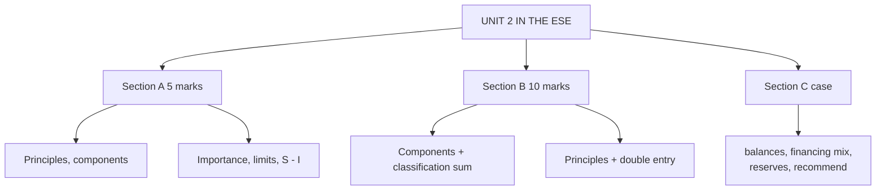

# BP-4: Unit 2 Exam Answers

Covers: likely 5-mark and 10-mark BoP questions with skeletons, and a 15-mark case layout with a model answer reading a host country's BoP for an Indian MNC (the CIA 1 scenario shape). Numbers come from BP-1 to BP-3.

## What the test will ask

Unit 2 is CO2: 15 of the 50 mid-sem marks and 5 of the 50 ESE marks. Section A tests definitions and principles; Section B tests components with a classification sum; Section C may hand you a BoP table for a country and ask for a recommendation. This is a judgement from the course plan, not a confirmed pattern.

## Five-mark answer skeletons

**1. Concept and principles of compilation (BP-1).** Definition (resident to non-resident transactions, flow); double entry; credit and debit rules; residence; valuation (market, FOB); timing (change of ownership).

**2. Components of the BoP (BP-2).** Table: current (goods, services, primary and secondary income), capital, financial (direct, portfolio, other, reserves), errors and omissions; one line each.

**3. BoP always balances, yet countries have deficits (BP-1, BP-2).** Double entry; deficit refers to sub-balance; overall balance excludes reserves; reserves absorb the gap.

**4. Importance and limitations (BP-3).** Any four of each in one line.

**5. BoP and the exchange rate (BP-3).** Deficit pressure; reserves in a peg; Marshall-Lerner and the J-curve.

**6. CAB = S − I (BP-3).** Derive from GDP identity; ₹300 lakh crore example gives −₹6 lakh crore, 2% of GDP.

## Ten-mark answer skeletons

**A. Components of BoP and factors affecting them.** Structure table → current account items with drivers → capital and financial items with drivers → overall balance and reserves → ten-transaction classification sum (current −51, capital +15, financial −79, overall −115) → conclusion on financing.

**B. Principles of compilation with a double-entry illustration.** Five principles → five-transaction double-entry table (credits 107, debits 107) → account balances (current +13, financial −13) → conclusion: surplus is matched by an outflow.

**C. Importance, limitations and linkages, with India.** Importance (six) → limitations (eight) → linkages (savings-investment, exchange rate, reserves, inflation) → India's structure → illustrative table (CAB −25, financing +59, overall +33, import cover 8.2 months).

## Fifteen-mark case layout (host-country BoP and a go/no-go)

1. **State the question (1).** Should the Indian MNC invest, and on what terms?
2. **Compute the balances (4).** Current account, financing, overall, as % of GDP.
3. **Assess financing quality (3).** Stable or volatile.
4. **Reserves and the exchange rate (3).** Import cover and likely currency pressure.
5. **Business implications (2).** Transfer risk, hedging, local costs.
6. **Recommendation: proceed, postpone or modify (2).** With a trigger.

### Model answer, laid out as the exam answer

**Data (hypothetical, USD billion, Country X):** Tamarind Auto Components (fictional, Indian MNC) plans a plant in Country X. Country X's BoP for the last year: goods exports 60, imports 85; services exports 18, imports 14; primary income net −6; secondary income net +8. FDI net +7, portfolio net +3, loans net +6. Errors and omissions −1. Opening reserves 30. GDP 400.

1. **Goods balance** = 60 − 85 = −25. **Services balance** = 18 − 14 = +4.
2. **Current account balance** = −25 + 4 − 6 + 8 = **−19**, which is 19 / 400 = **4.75% of GDP**.
3. **Financing** = 7 + 3 + 6 = **+16**.
4. **Overall balance** = −19 + 16 − 1 = **−4**, so reserves fall by 4 to 26.
5. **Import cover** = 26 / ((85 + 14)/12) = 26 / 8.25 = **3.15 months** (opening: 30 / 8.25 = 3.64 months).
6. **Funding ratio** = 16 / 19 = 84% of the deficit covered; the gap of 3 (16% of the deficit) plus the errors and omissions of 1 is met from reserves, a fall of 4.

| Indicator | Value | Reading |
|---|---|---|
| Current account deficit | 4.75% of GDP | High; above the 2 to 3% level often seen as comfortable **[VERIFY benchmark]** |
| Stable financing (FDI) | 7 of 16 = 44% | Less than half |
| Volatile financing (portfolio + loans) | 9 of 16 = 56% | More than half |
| Import cover | 3.15 months, falling | Thin, below the common 3 to 6 month comfort range **[VERIFY benchmark]** |

7. **Business implications.** Pressure on the Country X currency is likely: a wide deficit, thin reserves, and flows that can reverse. Risks for Tamarind: depreciation of profits in rupee terms, capital controls on dividend repatriation, input import costs.
8. **Recommendation: modify.** Proceed only in stages. Fund locally where possible to match local-currency revenue, hedge the dividend stream, and price export contracts in dollars. **Trigger to postpone:** if import cover falls below 3 months or the deficit widens beyond 5% of GDP, hold the second tranche.
9. **Contrast with the example in BP-3.** That table had a smaller deficit (0.66% of GDP) financed 2.4 times over; Country X is the weaker case, so the answer differs.

Close with: *the figures are hypothetical; the decision would also use political risk and host-country exchange rate regime (Unit 1).*

## Time rule

If short of time: compute the current account balance and its percentage of GDP, name the financing mix, compute import cover, and give a one-line recommendation. That secures the arithmetic and interpretation marks.

## What to remember

- Section A Unit 2 items: principles, components, importance and limitations, CAB = S − I.
- A good case answer reads deficit size, financing quality and reserves, then recommends.
- Key numbers: current −51, capital +15, financial −79, overall −115 (BP-2); Country X −19, 4.75% of GDP, import cover 3.15 months.
- Recommendation form: proceed, postpone or modify, with a trigger.

## Concept map

## Flashcards
Q: Steps of a host-country BoP case answer?
A: Compute the current account and overall balance, assess financing quality, check reserves and import cover, state business implications, recommend proceed, postpone or modify with a trigger.

Q: Country X current account balance and % of GDP?
A: −USD 19 billion, 4.75% of GDP.

Q: Country X overall balance and effect on reserves?
A: −USD 4 billion; reserves fall from 30 to 26.

Q: Country X import cover after the fall?
A: 3.15 months (26 divided by monthly imports of 8.25).

Q: Country X financing quality?
A: FDI is 44% of the inflow and portfolio plus loans 56%, so volatile money dominates.

Q: Skeleton for a 5-mark principles answer?
A: Definition, double entry, credit and debit, residence, valuation, timing.

Q: Skeleton for a 10-mark components answer?
A: Structure table, drivers of each, overall balance and reserves, a classification sum, conclusion on financing.

Q: Which numbers must a BoP case answer state?
A: The current account balance, its percentage of GDP, the financing split and the import cover.

## Sources
- BBA303F-6 course plan, Unit 2, ESE pattern and CIA 1 scenario
- [[Global Business Finance Unit 2 - Balance of Payments MOC (Node Map)]]
