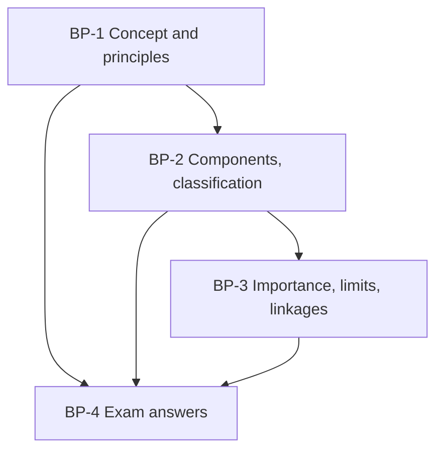

# Global Business Finance Unit 2: Balance of Payments, node map

Unit 2 is CO2 (15 of the 50 mid-sem marks, 5 of the 50 ESE marks) and feeds CIA 1. The sums are small but the classification and interpretation steps carry marks. All examples are **illustrative or hypothetical**. India facts carry **[VERIFY]** tags.

## Nodes

| Node | Topic | Deps | Minutes | Exam focus |
|---|---|---|---|---|
| BP-1 | Concept and Principles of BoP Compilation | none | 30 | yes |
| BP-2 | Components of the BoP and Classification of Transactions | BP-1 | 40 | yes |
| BP-3 | Importance, Limitations and Linkages of BoP | BP-2 | 35 | yes |
| BP-4 | Unit 2 Exam Answers | BP-1 to BP-3 | 25 | yes |

Total reading time: about 130 minutes.

## Dependency graph

## Headline numbers to know

- Double-entry sample: credits 107 = debits 107; current account +13 matched by financial −13 (₹ lakh).
- Ten-transaction sum: current −51, capital +15, financial ex reserves −79, overall −115 (₹ lakh).
- Savings-investment: 30% saving, 32% investment on ₹300 lakh crore gives −₹6 lakh crore (2% of GDP).
- India-shaped table: CAB −25, financing +59, overall +33, import cover 8.2 months (USD billion).
- Country X case: CAB −19 (4.75% of GDP), overall −4, import cover 3.15 months.

## Links
- [[Global Business Finance MOC]]
