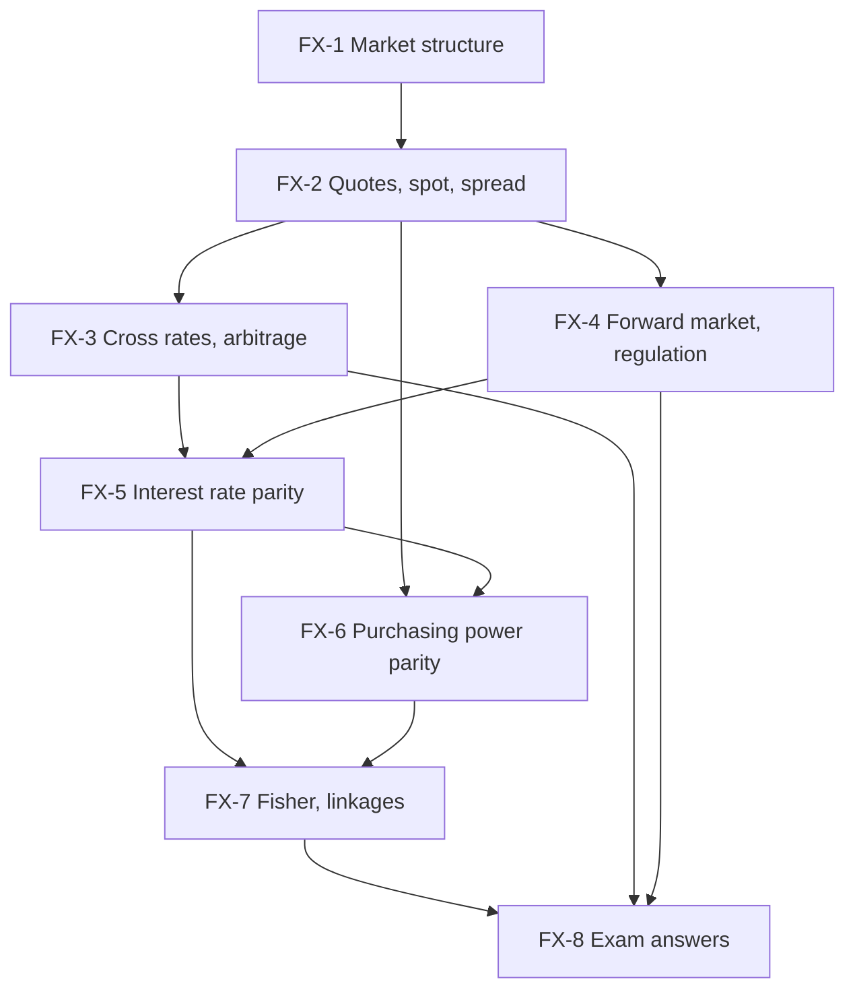

# Global Business Finance Unit 3: FOREX Market and Exchange Rate Theories, node map

Unit 3 is the heaviest unit: 12 of 45 hours, CO3, worth 25 of the 50 mid-sem marks and 15 of the 50 ESE marks. It is numerical. All examples are **illustrative or hypothetical** numbers, recomputed. Indian regulatory facts carry **[VERIFY]** tags.

## Nodes

| Node | Topic | Deps | Minutes | Exam focus |
|---|---|---|---|---|
| FX-1 | Structure, Participants and Functions of the Forex Market | none | 25 | yes |
| FX-2 | Exchange Rate Quotations, Spot and Bid-Ask Spread | FX-1 | 35 | yes |
| FX-3 | Cross Rates and Arbitrage | FX-2 | 45 | yes |
| FX-4 | Forward Market and Indian Regulation | FX-2 | 35 | yes |
| FX-5 | Interest Rate Parity | FX-3, FX-4 | 45 | yes |
| FX-6 | Purchasing Power Parity | FX-2, FX-5 | 40 | yes |
| FX-7 | Fisher Effect and How the Parity Conditions Link | FX-5, FX-6 | 40 | yes |
| FX-8 | Unit 3 Exam Answers | FX-1 to FX-7 | 40 | yes |

Total reading time: about 305 minutes (five hours). Study in order; FX-3 to FX-7 are the numerical core.

## Dependency graph

## Headline numbers to know

- Spread: USD/INR 88.40 / 88.46 gives ₹0.06 and 0.0678%; EUR/USD 0.1033%.
- Cross: EUR/INR 102.5440 / 102.7198; JPY/INR ₹58.82 / 58.89 per 100 yen.
- Arbitrage: two-point ₹90,000; triangular ₹2,210.76; covered (forward 91.00) ₹4,80,000.
- Forward: 88.88 / 88.98; annualised premium 2.26%; six-month 2.60%.
- CIRP: 88 × 1.07/1.04 = 90.5385; six-month 89.2941; forward 90.00 gives ₹5,60,000.
- PPP: ₹82.50 vs 88 (rupee undervalued 6.25%); 89.7087 (1.94%); two years 91.4507.
- Fisher: 8.15%; reverse 3.81%; IFE 90.5385; real rates 3.81% vs 2.91% give 89.7087 vs 90.4906.
- Case: EUR payable ₹2,05,43,960; forward receipt ₹7,15,20,000; arbitrage ₹2,04,000.

## Links
- [[Global Business Finance MOC]]
