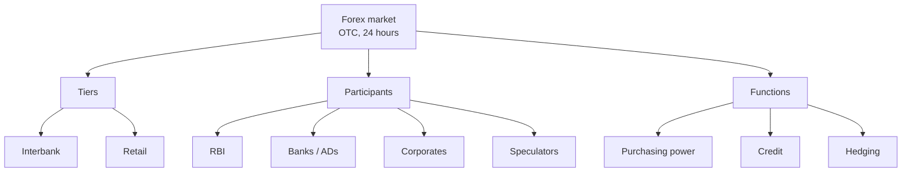

# FX-1: Structure, Participants and Functions of the Forex Market

Covers: what the foreign exchange market is, its tiers and segments, who participates, the three functions, and how an Indian customer rate is built from the interbank rate. **(syllabus)** for scope, **(textbook)** for content.

## Where this fits in the ESE

Unit 3 is 12 of 45 hours and CO3, worth 25 of the 50 mid-sem marks and 15 of the 50 ESE marks. FX-1 is the descriptive entry point (a 5-mark question on "functions" or "participants"); FX-2 to FX-7 are the numerical heart. No faculty slides yet.

## What the market is **(textbook)**

The **foreign exchange (forex, FX) market** is the network in which currencies are bought and sold against one another. It has no single building: it is an over-the-counter (OTC) market of banks and dealers linked electronically, open 24 hours on business days as trading moves across Sydney, Tokyo, London and New York.

Scale: the BIS Triennial Survey puts global turnover at several trillion US dollars a day, the largest financial market, with the US dollar on one side of most trades **[VERIFY latest BIS figure, 2025 survey]**.

## Structure: two tiers

| | Interbank (wholesale) market | Retail (customer) market |
|---|---|---|
| Who trades | Banks with banks, via brokers and electronic platforms | Banks with companies and individuals |
| Size | Very large deals, narrow spreads | Smaller deals, wider spreads |
| Rate | Interbank rate | Merchant rate = interbank rate adjusted by the bank's margin |

**Segments by product:** spot, forward, swap (spot and forward together), futures and options (exchange traded). Currency futures and options on the NSE and other exchanges are a separate exchange-traded segment in India **[VERIFY]**.

## Participants **(textbook)**

| Participant | Role |
|---|---|
| **Central bank (RBI)** | Regulates, intervenes to curb volatility, manages reserves |
| **Commercial banks / authorised dealers** | Market makers; quote two-way rates; deal for customers and for themselves |
| **Forex brokers** | Match buyers and sellers for a commission, do not take positions |
| **Corporates** (importers, exporters, MNCs) | Hedge and settle trade; raise foreign funds |
| **Investors** (FPIs, mutual funds, insurers) | Currency needed to buy foreign assets; hedge portfolios |
| **Speculators** (hedge funds, proprietary desks) | Take positions on rate moves and add liquidity |
| **Individuals** | Travellers, students, remittance senders |
| **Money changers** (full-fledged money changers in India) | Small retail notes and travellers' cheques **[VERIFY licensing terms]** |

## Functions **(textbook)**

1. **Transfer of purchasing power.** Converts one currency into another so that trade, investment and travel can settle across borders.
2. **Provision of credit.** Trade finance for importers and exporters: bills of exchange, letters of credit, trade credit.
3. **Hedging.** Provides forwards, swaps and options to cover exchange risk (Unit 4).
4. Also: speculation, price discovery of exchange rates, and the link that equalises interest rates and prices across countries (the parity conditions in FX-5 to FX-7).

## The Indian market in brief

Governed by FEMA 1999 (FX-4). Transactions are routed through **authorised dealer (AD) banks** under the RBI. The rupee is quoted mainly against the dollar. The interbank market has spot, forward and swap segments, and the exchange-traded currency derivatives segment sits alongside it. A **reference rate** is published daily by the Financial Benchmarks India Pvt Ltd (FBIL) **[VERIFY]**. Clearing of interbank forex trades is through the Clearing Corporation of India Ltd (CCIL) **[VERIFY]**. The RBI intervenes to limit disorderly moves rather than to hold a level (IF-3).

## Worked example: how a customer rate is built from the interbank rate

**Data (illustrative):** interbank USD/INR is 88.40 / 88.46 (bid / ask). A bank adds a margin of ₹0.10 on each side for customers.

1. **Customer buys USD** (importer paying abroad): bank sells at interbank ask + margin = 88.46 + 0.10 = **₹88.56**.
2. **Customer sells USD** (exporter receiving): bank buys at interbank bid − margin = 88.40 − 0.10 = **₹88.30**.

| Customer | Amount | Rate | Rupee flow | Bank covers in interbank | Bank earns |
|---|---|---|---|---|---|
| Importer pays | USD 1,00,000 | 88.56 | pays ₹88,56,000 | buys at 88.46 = ₹88,46,000 | ₹10,000 |
| Exporter receives | USD 1,00,000 | 88.30 | gets ₹88,30,000 | sells at 88.40 = ₹88,40,000 | ₹10,000 |

3. **Round-trip cost to a customer** who buys and sells dollars = 88.56 − 88.30 = ₹0.26 per USD = 0.26 / 88.56 = **0.29%**.
4. **Decision line.** The retail spread (₹0.26) is more than four times the interbank spread (₹0.06), so size and negotiating power matter.
5. **Interpretation.** A large corporate negotiates a finer margin or deals through a wholesale desk; a small remitter pays the full retail spread. This is why quotes, not the headline rate, decide the true cost of a currency conversion.

## Traps

- **"Interbank" is not the RBI.** The RBI is a participant and regulator, not the market itself.
- **A broker is not a market maker.** The bank quotes, the broker matches.
- **Customer rates differ from the interbank rate.** Always apply the margin on the correct side.

## What to remember

- Forex market: OTC, 24-hour, two tiers (interbank and retail), segments spot, forward, swap, futures, options.
- Participants: central bank, banks, brokers, corporates, investors, speculators, individuals, money changers.
- Functions: transfer of purchasing power, credit, hedging.
- Indian customer rate = interbank rate adjusted by the bank margin: importer 88.56, exporter 88.30.
- Round-trip retail cost in the example is 0.29%.

## Concept map

## Flashcards
Q: What is the forex market's trading form and hours?
A: An over-the-counter electronic network of banks and dealers, trading 24 hours on business days.

Q: Name the two tiers of the forex market.
A: The interbank (wholesale) market and the retail (customer) market.

Q: Name three functions of the forex market.
A: Transfer of purchasing power, provision of credit, and hedging.

Q: Difference between a broker and a market maker?
A: A broker matches buyers and sellers for a commission; a market maker quotes two-way prices and takes positions.

Q: Who regulates forex dealing in India?
A: The RBI under FEMA 1999, with authorised dealer banks handling transactions.

Q: Interbank USD/INR 88.40/88.46, margin ₹0.10. Importer's rate?
A: 88.46 + 0.10 = ₹88.56.

Q: Same market. Exporter's rate?
A: 88.40 − 0.10 = ₹88.30.

Q: Retail round-trip cost in that example?
A: 88.56 − 88.30 = ₹0.26 per USD, which is 0.29%.

Q: What is the role of the RBI as a participant?
A: It intervenes to curb volatility and manages reserves; it does not try to fix a level.

## Sources
- BBA303F-6 course plan, Unit 3, Week 6
- Vij (2022); Madura (2018); BIS Triennial Survey; RBI and FBIL publications
- Next: [[Global Business Finance Unit 3 - FX-2 Exchange Rate Quotations Spot and Bid-Ask Spread]]
- [[Global Business Finance Unit 3 - FOREX Market and Exchange Rate Theories MOC (Node Map)]]
