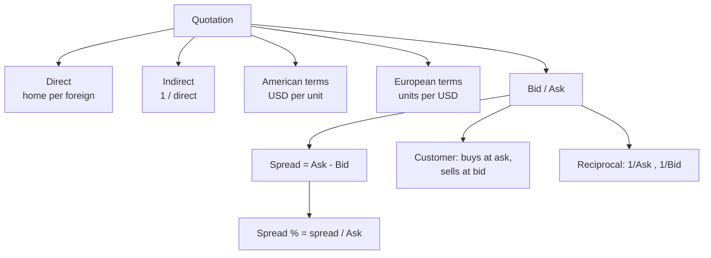

# FX-2: Exchange Rate Quotations, Spot Market and Bid-Ask Spread

Covers: direct and indirect quotes, American and European terms, base and quote currency, bid and ask, spread and spread percentage, reciprocal quotes, and spot conversions. **(syllabus)** for scope, **(textbook)** for content.

## Where this fits in the ESE

Week 6 calls this "currency conversion exercises", so an easy numerical is likely in Section A or as the first part of a case. Marks are lost on which side (bid or ask) to use, so learn the rule below. No faculty slides yet; if the faculty defines spread percentage on the bid, write the class version (both are shown).

## Quotation conventions **(textbook)**

**Base and quote currency.** In USD/INR = 88.40, USD is the **base** (one unit) and INR is the **quote** (price of one unit of base).

| Convention | Meaning | Example |
|---|---|---|
| **Direct quote** | Home currency per unit of foreign currency | For India: ₹88.40 per USD |
| **Indirect quote** | Foreign currency per unit of home currency | For India: USD 0.011312 per ₹1 (the reciprocal) |
| **American terms** | Dollars per unit of the other currency | USD 1.1600 per EUR; USD 1.3400 per GBP |
| **European terms** | Units of the other currency per dollar | ₹88.40 per USD; JPY 150.20 per USD |

India's quote for the dollar, euro and pound is direct (rupees per unit); the yen is quoted per 100 yen **[VERIFY FBIL and FEDAI convention]**. Direct and European terms coincide for USD/INR but differ for EUR/USD (American terms). In the exam, say which convention is in use before you compute.

**Reciprocal.** Indirect = 1 / Direct. 1 / 88.40 = 0.011312.

## Bid and ask **(textbook)**

A dealer gives a **two-way quote**: BID / ASK. Always from the **dealer's point of view, on the base currency**:

- **Bid** = the rate at which the dealer **buys** the base currency (pays quote currency).
- **Ask (offer)** = the rate at which the dealer **sells** the base currency.
- Ask is higher than bid; the gap is the dealer's gross margin.

**Customer's view (rule to memorise):** *the customer buys at the ask and sells at the bid.* An importer buying USD pays the ask; an exporter selling USD receives the bid.

**Spread** = Ask − Bid. Quoted in pips for major pairs (a pip is 0.0001 for EUR/USD); for USD/INR this note states the spread in rupees.

**Spread %** = (Ask − Bid) / Ask × 100 **(textbook, Madura)**. Some books divide by the bid; the difference is tiny. Ask is used here and the bid-based figure is shown beside it.

**Reciprocal of a two-way quote.** The bid of the inverse uses the ask of the original: for a quote Bid/Ask on A/B, the quote on B/A is **1/Ask  /  1/Bid**.

## The spot market **(textbook)**

Settles typically **two business days** after the trade (T+2), with USD/CAD a day **[VERIFY]**. The date is the **value date**. Same-day (cash) and next-day (tom) deals exist at different rates. Indian interbank market conventions include cash, tom and spot **[VERIFY India conventions]**.

## Worked example: spreads, conversions and reciprocals

**Data (illustrative):** USD/INR spot 88.40 / 88.46. EUR/USD spot 1.1600 / 1.1612.

**(a) Spread and spread %**
1. USD/INR spread = 88.46 − 88.40 = **₹0.06**.
2. Spread % on ask = 0.06 / 88.46 = **0.0678%** (on bid: 0.06 / 88.40 = 0.0679%).
3. EUR/USD spread = 1.1612 − 1.1600 = 0.0012 = **12 pips**; spread % = 0.0012 / 1.1612 = **0.1033%**.

**(b) Conversion of USD 50,000**
4. Importer buys USD 50,000 at ask: 50,000 × 88.46 = **₹44,23,000**.
5. Exporter sells USD 50,000 at bid: 50,000 × 88.40 = **₹44,20,000**.
6. Dealer's gross margin on a buy and sell = 44,23,000 − 44,20,000 = **₹3,000** (= 50,000 × 0.06).

**(c) Convert ₹1,00,000 into USD and back**
7. Customer buys USD with rupees at ask 88.46: 1,00,000 / 88.46 = **USD 1,130.4544** (unrounded).
8. Sells it back at bid 88.40: 1,130.4544 × 88.40 = **₹99,932.17**.
9. Loss on the round trip = 1,00,000 − 99,932.17 = **₹67.83**, which is **0.0678%** of ₹1,00,000. This equals the spread % (0.06 / 88.46) exactly, because the loss is 1,00,000 × (Ask − Bid) / Ask. Use unrounded figures, since rounding the dollars to 1,130.45 would give ₹68.22 and hide the equality.

**(d) Reciprocal of USD/INR**
10. INR/USD bid = 1 / 88.46 = **0.011305**; INR/USD ask = 1 / 88.40 = **0.011312**.

| Item | Quote | Used by |
|---|---|---|
| USD/INR (direct for India) | 88.40 / 88.46 | Indian importer buys at 88.46, exporter sells at 88.40 |
| INR/USD (indirect) | 0.011305 / 0.011312 | A US firm buying rupees pays 0.011312 per ₹ |
| EUR/USD (American terms) | 1.1600 / 1.1612 | Buying EUR costs 1.1612 dollars each |
| USD/EUR (European terms) | 0.8612 / 0.8621 | 1 / 1.1612 and 1 / 1.1600 |

11. **Decision line.** A customer converting at the quoted ask or bid always pays the spread; here 0.068% for USD/INR but 0.103% for EUR/USD, so the euro is the costlier conversion in percentage terms.
12. **Interpretation.** The spread reflects liquidity and risk. A narrow spread signals a deep market. Large corporates compare spread percentages across currency pairs and dealers before choosing where to convert.

## Traps

- **Bid and ask are from the dealer's side.** The customer does the opposite.
- **Ask in the denominator when inverting the bid.** The bid of the reciprocal is 1/Ask.
- **Direct for India is "rupees per foreign unit".** Do not mix with American terms.
- **Do not round the reciprocal early.** Carry five or six decimals.

## What to remember

- Direct quote: home per foreign. Indirect: reciprocal. American: USD per unit. European: units per USD.
- Bid: dealer buys base. Ask: dealer sells base. Customer buys at ask, sells at bid.
- Spread % = (Ask − Bid) / Ask: USD/INR 0.0678%; EUR/USD 0.1033%.
- Reciprocal of Bid/Ask is 1/Ask  /  1/Bid.
- Round trip of ₹1,00,000 loses ₹67.83, equal to the spread %.

## Concept map

## Flashcards
Q: What is a direct quote for an Indian dealer?
A: Rupees per unit of foreign currency, for example ₹88.40 per USD.

Q: Which of American and European terms is USD/INR 88.40?
A: European terms: units of the other currency per US dollar.

Q: Define bid and ask.
A: Bid is the price at which the dealer buys the base currency; ask is the price at which the dealer sells it.

Q: At which rate does an exporter sell USD to a bank?
A: At the bid.

Q: Formula for spread percentage?
A: (Ask − Bid) / Ask × 100.

Q: USD/INR 88.40/88.46. Spread and spread %?
A: ₹0.06 and 0.0678%.

Q: EUR/USD 1.1600/1.1612. Spread in pips and %?
A: 12 pips and 0.1033%.

Q: Reciprocal of USD/INR 88.40/88.46?
A: INR/USD 0.011305 / 0.011312 (1/88.46 and 1/88.40).

Q: ₹1,00,000 converted to USD at 88.46 and back at 88.40. Result?
A: USD 1,130.4544 and then ₹99,932.17, a loss of ₹67.83 (0.0678%, equal to the spread %).

Q: Spot settlement is usually when?
A: Two business days after the trade (T+2), with some exceptions such as USD/CAD.

## Sources
- BBA303F-6 course plan, Unit 3, Week 6
- Vij (2022); Madura (2018)
- Next: [[Global Business Finance Unit 3 - FX-3 Cross Rates and Arbitrage]]
- [[Global Business Finance Unit 3 - FOREX Market and Exchange Rate Theories MOC (Node Map)]]
