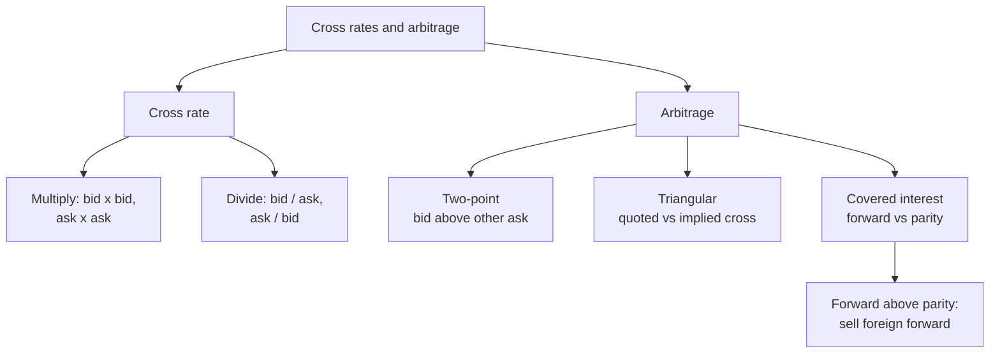

# FX-3: Cross Rates and Arbitrage

Covers: cross rates with bid and ask (multiplication and division cases), two-point (locational) arbitrage, triangular arbitrage, and covered interest arbitrage mechanics, each with a full numerical. **(syllabus)** for scope, **(textbook)** for method.

## Where this fits in the ESE

Week 7 is "cross rates, arbitrage, forward market... numericals". This is the most reliably numerical node of the mid-sem: expect one sum for 5 or 10 marks, or as part of the Section C case. All figures here are **illustrative**. No faculty slides yet; if the faculty works triangular arbitrage with mid-rates, as in part D, do the same.

## Cross rates **(textbook)**

A **cross rate** is the rate between two currencies derived from their rates against a third (usually USD). Most currencies are quoted against the dollar, so rupee-euro, rupee-yen and so on are computed.

**Rule 1: multiply (the common currency is the quote of one and the base of the other).**
- EUR/INR = EUR/USD × USD/INR.
- **Bid cross = bid × bid. Ask cross = ask × ask.**

**Rule 2: divide (both quoted per USD).**
- JPY/INR = USD/INR ÷ USD/JPY.
- **Bid cross = INR bid ÷ JPY ask. Ask cross = INR ask ÷ JPY bid.**
- Why: a dealer buying JPY converts JPY to USD at the dollar's ask (paying more JPY per USD), then sells the USD for INR at the bid.

**Rule 3: always check the answer lies between the two cross ends and that ask > bid.**

### Worked example A: multiplication cross rate

**Data:** USD/INR 88.40 / 88.46; EUR/USD 1.1600 / 1.1612.

1. EUR/INR bid = 88.40 × 1.1600 = **102.5440**.
2. EUR/INR ask = 88.46 × 1.1612 = **102.7198**.
3. Spread = 0.1758 = 0.1711% of the ask.
4. **Use.** An Indian importer paying EUR 2,00,000 pays the ask: 2,00,000 × 102.7198 = **₹2,05,43,960**. An exporter receiving EUR 2,00,000 gets 2,00,000 × 102.5440 = **₹2,05,08,800**.
5. **Interpretation.** The cross spread (0.17%) is wider than either component spread (0.068% and 0.103%) because both spreads stack up. Where it matters, a corporate negotiates a direct EUR/INR quote.

### Worked example B: division cross rate

**Data:** USD/INR 88.40 / 88.46; USD/JPY 150.20 / 150.30.

1. JPY/INR bid = 88.40 ÷ 150.30 = **0.58816** rupees per yen = ₹58.82 per 100 yen.
2. JPY/INR ask = 88.46 ÷ 150.20 = **0.58895** = ₹58.89 per 100 yen.
3. Check: ask > bid, and both lie near the mid of 58.85 per 100 yen. Good.

## Arbitrage **(textbook)**

**Arbitrage** is earning a riskless profit from price differences, using no own money and taking no exchange risk. Forms in forex: **two-point (locational)**, **triangular** and **covered interest** arbitrage. Arbitrage is the force that makes prices consistent: when profit exists, arbitrageurs trade until it disappears.

### Worked example C: two-point (locational) arbitrage

**Data:** USD/INR in Mumbai 88.40 / 88.46 (bid/ask). Another centre (London) quotes the same pair 88.55 / 88.60. Trade size USD 10,00,000. Ignore costs.

1. Compare **buy low, sell high**: buy USD at the lowest ask, sell at the highest bid. Lowest ask = Mumbai 88.46. Highest bid = London 88.55.
2. Since 88.55 > 88.46, an arbitrage exists.
3. **Buy** USD 10,00,000 in Mumbai at 88.46 = ₹8,84,60,000.
4. **Sell** USD 10,00,000 in London at 88.55 = ₹8,85,50,000.
5. **Profit** = 8,85,50,000 − 8,84,60,000 = **₹90,000** (0.09 per USD).

| Step | Market | Action | Rupees |
|---|---|---|---|
| 1 | Mumbai | Buy USD at 88.46 | −8,84,60,000 |
| 2 | London | Sell USD at 88.55 | +8,85,50,000 |
| Net | | | **+90,000** |

6. **Decision line.** Arbitrage exists whenever one centre's bid exceeds another's ask. Here bid 88.55 > ask 88.46.
7. **Interpretation.** Buying in Mumbai pushes the Mumbai ask up and selling in London pushes the London bid down, so the gap closes quickly. If London were 88.42 / 88.50 there would be no arbitrage (88.42 < 88.46).

### Worked example D: triangular arbitrage

**Data (mid-rates, ignoring spreads):** USD/INR 88.50 in India; EUR/USD 1.1500; EUR/INR 102.00. Start with ₹10,00,000.

1. **Implied cross** = 88.50 × 1.1500 = **101.775** EUR/INR.
2. **Quoted cross** = 102.00. They differ: the euro is dearer in rupees than the dollar route implies. So **sell euros for rupees** at 102.00 and acquire the euros cheaply through dollars.
3. Route: ₹ → USD → EUR → ₹.

| Step | Calculation | Holding |
|---|---|---|
| 1. Rupees to USD | 10,00,000 / 88.50 | USD 11,299.44 |
| 2. USD to EUR | 11,299.44 / 1.1500 | EUR 9,825.60 |
| 3. EUR to rupees | 9,825.60 × 102.00 | ₹10,02,210.76 |
| Profit | 10,02,210.76 − 10,00,000 | **₹2,210.76** (0.22%) |

4. **Check by the reverse route.** ₹10,00,000 → EUR at 102 = 9,803.92 → USD at 1.15 = 11,274.51 → ₹ at 88.50 = **₹9,97,794.12**, a loss of ₹2,205.88. So the first direction is the right one.
5. **Decision line.** Compute the round-trip factor 102.00 / 101.775 = 1.00221. A factor above 1 in a direction means arbitrage in that direction.
6. **Interpretation.** Trades in the three markets move the rates until the quoted cross equals 101.775. If the exam gives bid and ask in each market, run the route with each leg at the correct side (buy at ask, sell at bid).

## Covered interest arbitrage (mechanics) **(textbook)**

Uses the **interest rate difference** between two countries and a **forward contract** to lock a riskless profit when the forward rate is out of line with interest rate parity (FX-5 gives the parity). Direction rule:

- **Market forward above the parity forward:** the foreign currency is too dear forward. Borrow home currency, convert to foreign at spot, invest at the foreign rate, **sell the foreign currency forward**.
- **Market forward below parity:** borrow foreign, convert to home at spot, invest at the home rate, **buy the foreign currency forward** (worked in FX-5).

### Worked example E: covered interest arbitrage (forward above parity)

**Data:** spot USD/INR 88.00. One-year rates: India 7%, US 4%. Market one-year forward quote 91.00. (Parity forward = 88 × 1.07 / 1.04 = 90.5385, computed in FX-5.) Arbitrageur borrows ₹8,80,00,000. Ignore spreads and costs.

| Step | Calculation | Result |
|---|---|---|
| 1. Borrow rupees at 7% | Repay in one year: 8,80,00,000 × 1.07 | ₹9,41,60,000 |
| 2. Convert at spot | 8,80,00,000 / 88.00 | USD 10,00,000 |
| 3. Invest in USD at 4% | 10,00,000 × 1.04 | USD 10,40,000 at year end |
| 4. Sell the USD forward at 91.00 | 10,40,000 × 91.00 | ₹9,46,40,000 |
| 5. Repay the rupee loan | | −₹9,41,60,000 |
| Profit | 9,46,40,000 − 9,41,60,000 | **₹4,80,000** |

5. **Decision line.** The forward of 91.00 exceeds parity 90.5385 by 0.461538 (unrounded), so the arbitrage pays: 0.461538 × 10,40,000 = ₹4,80,000.
6. **Interpretation.** The profit is riskless: the forward rate fixes the rupee value of the dollars at the outset. Arbitrage pressure pushes the forward down towards 90.54. Real profits are smaller after spreads and transaction costs; the "no-arbitrage band" in FX-5 describes the gap needed.

## Traps

- **Wrong side of the quote.** Buy at ask, sell at bid; in a cross rate multiply bid by bid.
- **Division cross with the wrong pairing.** Bid cross uses the INR bid over the JPY ask.
- **Triangular direction.** Compute implied cross first, then trade where the quoted cross is higher: sell that currency dear.
- **Forgetting to repay the loan** (with interest) in covered arbitrage.

## What to remember

- Multiplication cross: bid × bid, ask × ask. Division cross: INR bid ÷ other ask; INR ask ÷ other bid.
- EUR/INR 102.5440 / 102.7198; JPY/INR 58.82 / 58.89 per 100 yen.
- Two-point arbitrage exists if one centre's bid > another's ask: profit ₹90,000 on USD 10 lakh.
- Triangular: implied 101.775 vs quoted 102.00 gives ₹2,210.76 on ₹10 lakh.
- Covered interest arbitrage with forward 91.00 vs parity 90.5385 gives ₹4,80,000.

## Concept map

## Flashcards
Q: Cross rate EUR/INR from EUR/USD and USD/INR: bid and ask rule?
A: Multiply bid by bid and ask by ask.

Q: JPY/INR from USD/INR and USD/JPY: bid and ask rule?
A: Bid cross = INR bid ÷ JPY ask; ask cross = INR ask ÷ JPY bid.

Q: USD/INR 88.40/88.46 and EUR/USD 1.1600/1.1612. EUR/INR?
A: 102.5440 / 102.7198.

Q: Importer pays EUR 2,00,000 on that cross. Rupee cost?
A: 2,00,000 × 102.7198 = ₹2,05,43,960.

Q: Condition for two-point arbitrage?
A: One centre's bid exceeds another centre's ask.

Q: Mumbai 88.40/88.46, London 88.55/88.60. Profit on USD 10,00,000?
A: Buy at 88.46, sell at 88.55: ₹90,000.

Q: USD/INR 88.50, EUR/USD 1.1500, EUR/INR 102.00. Direction and profit on ₹10,00,000?
A: Implied cross 101.775 is below 102.00, so go rupee to USD to EUR to rupee: profit ₹2,210.76.

Q: Direction rule for covered interest arbitrage when the market forward exceeds parity?
A: Borrow home currency, convert at spot, invest abroad, and sell the foreign currency forward.

Q: Spot 88, India 7%, US 4%, forward 91.00. Arbitrage profit on ₹8.8 crore borrowed?
A: ₹4,80,000 (₹9,46,40,000 from the forward sale less ₹9,41,60,000 loan repayment).

Q: Why do arbitrage opportunities vanish?
A: Arbitrageurs' trading moves the rates until the price differences disappear.

## Sources
- BBA303F-6 course plan, Unit 3, Week 7
- Vij (2022); Madura (2018); Eun and Resnick (2018)
- Next: [[Global Business Finance Unit 3 - FX-4 Forward Market and Indian Regulation]]
- [[Global Business Finance Unit 3 - FOREX Market and Exchange Rate Theories MOC (Node Map)]]
