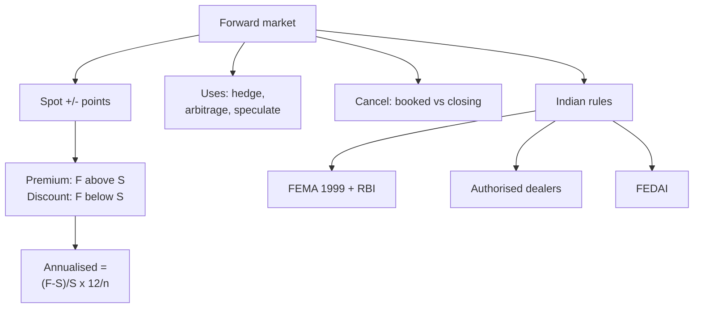

# FX-4: Forward Market, Premium and Discount, and Indian Regulation

Covers: forward contracts, forward points, premium and discount, annualised premium, forward versus spot, how a forward is cancelled, and the Indian regulatory framework (FEMA 1999, RBI, authorised dealers, FEDAI). **(syllabus)** for scope, **(textbook)** for method. Every regulatory detail here carries **[VERIFY]** unless the line says otherwise.

## Where this fits in the ESE

Week 7 pairs the forward market with "foreign exchange regulations". Expect a 5-mark numerical on premium and annualised premium, or a regulation question (FEMA, RBI, FEDAI). The forward market connects to interest rate parity in FX-5. No faculty slides yet.

## The forward market **(textbook)**

A **forward contract** is a bank-customer (or bank-bank) agreement today to exchange currencies at a **fixed rate on a future date**. No cash moves at the start; the price is fixed by the forward rate.

- **Tenor:** usually 1, 2, 3, 6, 12 months; "fixed" delivery date or an option period.
- **Use:** hedging by importers, exporters and borrowers; arbitrage; speculation.
- **Rate:** quoted as **spot plus or minus forward points** (swap points), in paise for USD/INR.

### Forward premium and discount

For a direct quote (home per foreign, ₹ per USD):

- **Forward premium** on the foreign currency if F > S. **Discount** if F < S.
- **Forward premium % for the period** = (F − S) / S × 100.
- **Annualised premium %** = (F − S) / S × (12 / n) × 100, with n = months to maturity. (Use 360 / days for a day count.)
- With an indirect quote (foreign per home) the formula reverses: (S − F) / F × (12 / n) × 100.

**Why USD/INR trades at a forward premium.** By interest rate parity (FX-5), a currency with the higher interest rate trades at a forward discount. India's rates are higher than US rates, so the rupee is at a forward discount, which means the dollar is at a forward premium in rupee terms. The size of the premium is roughly the interest rate gap.

## Forward versus spot

| | Spot | Forward |
|---|---|---|
| Delivery | T+2 | Agreed future date |
| Rate | Today's market rate | Spot adjusted for interest rate gap |
| Cash at start | None until settlement | None until settlement |
| Risk | Rate may move before delivery | Rate fixed; counterparty risk only |

**The forward rate is not a forecast.** It follows from the interest rate gap and is a price for locking the rate. Whether it predicts the future spot is the **unbiasedness** question taken up in FX-7.

## Worked example 1: forward points and annualised premium

**Data (illustrative):** spot USD/INR 88.40 / 88.46. Three-month swap points 48 / 52 paise (0.48 / 0.52).

1. **Outright forward** = spot + points: bid = 88.40 + 0.48 = **88.88**; ask = 88.46 + 0.52 = **88.98**.
2. **Mid rates:** spot = (88.40 + 88.46)/2 = 88.43; forward = (88.88 + 88.98)/2 = 88.93.
3. **Premium for 3 months** = (88.93 − 88.43) / 88.43 = 0.50 / 88.43 = **0.565%**.
4. **Annualised premium** = 0.565% × 12/3 = **2.26%**.
5. **Importer** with USD 5,00,000 payable in 3 months locks 5,00,000 × 88.98 = **₹4,44,90,000**.
6. **Exporter** with USD 8,00,000 receivable in 3 months locks 8,00,000 × 88.88 = **₹7,11,04,000**.
7. **Compare with spot:** the exporter earns 8,00,000 × (88.88 − 88.40) = **₹3,84,000** more than converting at today's spot bid.
8. **Decision line.** The dollar trades at a 2.26% annualised premium, so an exporter benefits from selling forward and an importer pays more to buy forward than at spot.
9. **Interpretation.** The premium is not a profit. It is the interest gap: an exporter who sold spot and invested the rupees would earn the extra interest anyway (FX-5).

## Worked example 2: six-month premium and a discount case

**Data:** spot ₹88.45 per USD; six-month forward ₹89.60.

| Step | Calculation | Result |
|---|---|---|
| 1. Premium for 6 months | (89.60 − 88.45) / 88.45 | 1.30% |
| 2. Annualised | 1.30% × 12/6 | **2.60%** |

3. **Discount illustration:** if the three-month forward were ₹87.60 against spot ₹88.00, annualised = (87.60 − 88.00) / 88.00 × 12/3 = **−1.82%**, a discount (the USD is cheaper forward, which would happen if US rates were above Indian rates).
4. **Interpretation.** A positive sign means premium, negative means discount, provided the quote is direct.

## Worked example 3: cancelling a forward contract

**Data (illustrative):** an exporter booked a forward sale of USD 1,00,000 at ₹88.88. The export order falls through. On the cancellation date the spot market is 88.40 / 88.46. Cancel at the bank's selling rate (the bank sells USD to the customer to close the original sale), ignoring margins and charges.

1. Customer originally contracted to sell USD at 88.88.
2. To close, the bank sells USD at the ask 88.46, so the customer buys back at 88.46.
3. Net = (88.88 − 88.46) × 1,00,000 = **₹42,000 gain** to the customer.
4. If the spot ask were 89.20 instead: (88.88 − 89.20) × 1,00,000 = **−₹32,000, a loss**.
5. **Interpretation.** Cancelling exposes the customer to the market move since booking; a gain is credited and a loss is debited. Cancellation and rollover charges apply under bank and FEDAI rules **[VERIFY details]**.

## Indian regulatory framework **[VERIFY all]**

| Element | Substance (check current text) |
|---|---|
| **FEMA 1999** | The Foreign Exchange Management Act replaced FERA 1973, shifting the regime from control and conservation to facilitation and management; in force from June 2000 |
| **RBI** | Frames the rules under FEMA, regulates authorised dealers, intervenes in the market, publishes notifications and master directions |
| **Authorised Dealers (AD)** | Banks (and some others) authorised by the RBI to deal in forex; Category I banks handle most business |
| **Current vs capital account** | Current account transactions are generally free unless restricted; capital account transactions are permitted only as the rules allow |
| **Forward cover** | Residents generally book forwards to hedge genuine underlying exposures, with rules on documentation, tenor, cancellation and rebooking; the rules have been liberalised over time |
| **FEDAI** | Foreign Exchange Dealers' Association of India: the dealers' body that issues market rules on quoting conventions, cancellation and delivery, and commissions |
| **FBIL** | Publishes the benchmark reference rate |
| **Liberalised Remittance Scheme** | Annual limit per resident individual for permitted remittances (USD 2,50,000 a year) |

Exam wording for the 5-marker: *FEMA 1999 regulates foreign exchange dealings through the RBI; only authorised dealers handle forex business; FEDAI sets market conventions; forward cover is available against underlying exposure; the regime is facilitative, not restrictive.*

## Traps

- **Wrong formula with an indirect quote.** (S − F) / F, not (F − S) / S.
- **Forgetting to annualise.** A 3-month 0.565% is 2.26% a year, not 0.565%.
- **Bid on the exporter side, ask on the importer side**, for forwards too.
- **Forward is not a prediction.** It is a hedging price.

## What to remember

- Forward = spot ± points; premium if F > S (direct quote).
- Annualised premium = (F − S) / S × 12/n; here 2.26% and 2.60%.
- Exporter locks 88.88 (bid); importer locks 88.98 (ask).
- Cancellation gain or loss = booked rate minus the closing rate.
- FEMA 1999 (RBI), authorised dealers and FEDAI are the Indian framework; verify current rules.

## Concept map

## Flashcards
Q: How is an outright forward rate formed?
A: Spot plus (or minus) forward points; for the bid add the bid points and for the ask add the ask points.

Q: Premium formula and annualised formula with a direct quote?
A: (F − S) / S, and annualised (F − S) / S × 12/n.

Q: Spot 88.40/88.46, 3-month points 48/52. Forward bid and ask?
A: 88.88 and 88.98.

Q: Mid spot 88.43, mid forward 88.93, 3 months. Annualised premium?
A: 0.50 / 88.43 × 4 = 2.26%.

Q: Which rate does an exporter get on a forward sale and an importer pay on a forward purchase?
A: Exporter the forward bid (88.88); importer the forward ask (88.98).

Q: Spot 88.45, six-month forward 89.60. Annualised premium?
A: (1.15 / 88.45) × 2 = 2.60%.

Q: Why is the USD at a forward premium against the INR?
A: Indian interest rates exceed US rates, so by interest rate parity the rupee is at a forward discount.

Q: Exporter booked a sale at 88.88; cancels when the ask is 88.46. Result?
A: Gain of 0.42 per USD, ₹42,000 on USD 1,00,000.

Q: What did FEMA 1999 replace and what is the shift?
A: It replaced FERA 1973, moving from control to facilitation and management of foreign exchange.

Q: What does FEDAI do?
A: It issues market rules for authorised dealers on quoting conventions, cancellation, delivery and commissions.

## Sources
- BBA303F-6 course plan, Unit 3, Week 7
- Vij (2022); Madura (2018); FEMA 1999 and RBI master directions [VERIFY current text]
- Next: [[Global Business Finance Unit 3 - FX-5 Interest Rate Parity]]
- [[Global Business Finance Unit 3 - FOREX Market and Exchange Rate Theories MOC (Node Map)]]
