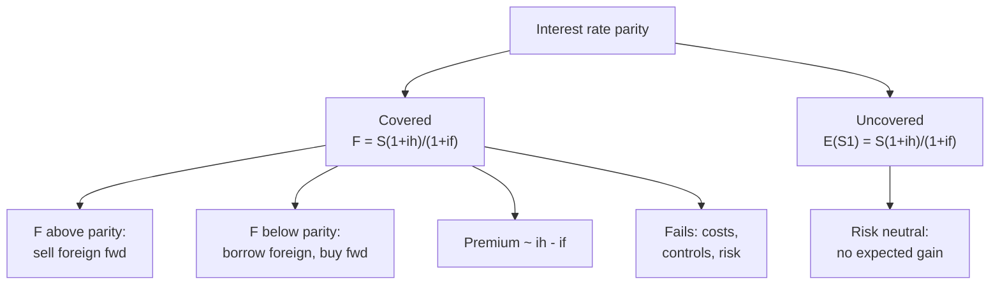

# FX-5: Interest Rate Parity (Covered and Uncovered)

Covers: the covered interest rate parity (CIRP) formula and its logic, the forward premium link, the arbitrage test when the market forward is out of line, uncovered interest parity (UIP), and why parity can fail in practice. **(syllabus)** for scope, **(textbook)** for method.

## Where this fits in the ESE

Week 8 teaches interest rate parity and PPP together, with numericals. CIRP is the most examinable theory in Unit 3: a 5-mark formula-plus-sum, or a 10-mark question with an arbitrage check. All figures are **illustrative**. No faculty slides yet; if the faculty writes the formula in a different but equivalent form, use theirs.

## Covered interest rate parity (CIRP) **(textbook)**

**Idea:** a covered (hedged) investment in the home currency and in the foreign currency must give the same return. If they do not, arbitrage (FX-3) closes the gap.

**Formula, direct quote (home currency per foreign unit, ₹ per USD):**

**F / S = (1 + i_h) / (1 + i_f)**, so **F = S × (1 + i_h) / (1 + i_f)**

where S is spot, F is the forward for the same period as the rates, i_h is the home (India) rate and i_f the foreign (US) rate for that period.

**Derivation in two lines (use it in the exam).** ₹1 invested at home grows to (1 + i_h). The same ₹1 converted at S, invested abroad at i_f and converted back at F grows to (1/S) × (1 + i_f) × F. Equating gives the formula.

**Rule of thumb.** Forward premium ≈ i_h − i_f. The higher-interest-rate currency trades at a forward **discount**. The exact premium is [(1 + i_h)/(1 + i_f)] − 1.

**For an indirect quote (foreign per home):** F / S = (1 + i_f) / (1 + i_h). Always say which quote you are using.

**Conditions.** Free movement of capital, no or small transaction costs, comparable risk (same issuer quality), no taxes that differ. In practice a **no-arbitrage band** around the parity forward exists because of costs (bid-ask spreads, brokerage).

## Uncovered interest parity (UIP) **(textbook)**

Drops the forward contract. If investors are risk neutral, the **expected** future spot satisfies:

**E(S1) = S0 × (1 + i_h) / (1 + i_f)**

so the interest rate gap equals the expected depreciation of the higher-rate currency. The investment is **uncovered**, exposed to the actual spot. UIP is the same formula as CIRP with E(S1) in place of F; they agree if the forward is an unbiased predictor of the future spot (FX-7).

## Worked example 1: the parity forward (one year and six months)

**Data (illustrative):** spot USD/INR 88.00. One-year interest: India 7%, US 4%.

1. **Parity forward (1 year)** = 88.00 × 1.07 / 1.04 = 94.16 / 1.04 = **90.5385**.
2. **Premium** = (90.5385 − 88.00) / 88.00 = **2.885%**. The approximation i_h − i_f = 3% is slightly off, because it ignores compounding: the exact figure is 1.07/1.04 − 1.
3. **Six-month forward** with the same annual rates (simple interest for half a year): i_h = 7% × 6/12 = 3.5%; i_f = 4% × 6/12 = 2%. F = 88.00 × 1.035 / 1.02 = **89.2941**.
4. **Annualised six-month premium** = (89.2941 − 88) / 88 × 2 = **2.94%**.

| Tenor | i_h | i_f | Parity forward | Premium |
|---|---|---|---|---|
| 1 year | 7% | 4% | 90.5385 | 2.885% |
| 6 months | 3.5% | 2.0% | 89.2941 | 1.47% (2.94% annualised) |

5. **Interpretation.** The rupee has the higher rate, so it must trade at a forward discount (the dollar at a premium) of about the rate gap. A forward quote far from these values signals an arbitrage.

## Worked example 2: arbitrage when the market forward is below parity

**Data:** same spot 88.00, rates 7% and 4%, one year. Market forward quoted at **90.00**. Parity is 90.5385, so the market forward is **too low**: the dollar is cheap forward.

**Direction:** borrow the foreign currency (dollars), convert to rupees at spot, invest in rupees, **buy dollars forward** to repay the dollar loan. Take USD 10,00,000.

| Step | Calculation | Result |
|---|---|---|
| 1. Borrow USD at 4% | Repay in one year: 10,00,000 × 1.04 | USD 10,40,000 |
| 2. Convert at spot | 10,00,000 × 88.00 | ₹8,80,00,000 |
| 3. Invest in rupees at 7% | 8,80,00,000 × 1.07 | ₹9,41,60,000 |
| 4. Buy USD 10,40,000 forward at 90.00 | 10,40,000 × 90.00 | −₹9,36,00,000 |
| Profit | 9,41,60,000 − 9,36,00,000 | **₹5,60,000** |

5. **Check:** the shortfall of the forward below parity is 0.538462 per USD (unrounded); 0.538462 × 10,40,000 = ₹5,60,000. ✓ Rounding the parity to 90.5385 gives ₹5,60,040, so carry the unrounded figure.
6. **Decision line.** Forward 90.00 is below parity 90.5385, so borrow USD, invest in INR and buy USD forward. Profit ₹5,60,000, riskless.
7. **Interpretation.** Buying USD forward pushes the forward up, the dollar borrowing and spot sale pushes spot down, and the rupee deposit pushes the INR rate down, until parity is restored. For comparison, the opposite case in FX-3 (forward 91.00 above parity) yields the reverse trade and ₹4,80,000.

## Worked example 3: uncovered investment and the break-even rate

**Data:** an Indian firm has ₹8,80,00,000 and compares (a) a rupee deposit at 7%; (b) converting to USD 10,00,000 at 88.00, depositing at 4%, and reconverting at the spot a year later, **uncovered**.

1. USD at year end = 10,00,000 × 1.04 = **USD 10,40,000**.
2. Rupee deposit at year end = 8,80,00,000 × 1.07 = **₹9,41,60,000**.
3. **Break-even spot** = 9,41,60,000 / 10,40,000 = **₹90.5385**, which equals the CIRP forward.

| Spot at year end | Rupees from USD route | Rupee return | Beats 7% deposit? |
|---|---|---|---|
| 89.00 | 10,40,000 × 89 = ₹9,25,60,000 | 5.18% | No |
| 90.5385 | ₹9,41,60,000 | 7.00% | Equal |
| 92.00 | 10,40,000 × 92 = ₹9,56,80,000 | 8.73% | Yes |

4. **Decision line.** The uncovered dollar deposit beats the rupee deposit only if ₹/USD rises beyond 90.54 (the rupee weakens by more than the rate gap implies). The 3-point rate gap is the compensation for taking exchange risk.
5. **Interpretation.** Under UIP the expected return is the same on both; the firm that does the uncovered trade takes exchange risk without an expected gain. A covered position at forward 90.5385 gives exactly 7%.

## Why parity can fail

- Transaction costs and spreads create a **no-arbitrage band** (small deviations are not profitable).
- **Capital controls and taxes** block the arbitrage. India's restrictions on capital flows can leave the forward premium away from parity.
- **Political and default risk** differ across deposits.
- **Limited funds** for arbitrage and collateral rules.
- In India the link is observed in the **MIFOR** (Mumbai Interbank Forward Offered Rate), the rupee rate implied by dollar rates and the forward premium **[VERIFY definition and current use; the USD benchmark is now SOFR-based after LIBOR ended in 2023]**.

## Traps

- **Direct versus indirect quote** reverses the fraction.
- **Match periods.** Rates must be for the same tenor as the forward.
- **Do not use the approximation for the arbitrage sum.** Use the exact fraction.
- **Covered versus uncovered.** Covered uses the forward; uncovered uses the expected spot.

## What to remember

- CIRP: F = S × (1 + i_h)/(1 + i_f); higher-rate currency trades at a forward discount.
- 88 × 1.07/1.04 = 90.5385; six-month 88 × 1.035/1.02 = 89.2941.
- Market forward 90.00 below parity: borrow USD, invest INR, buy USD forward, gain ₹5,60,000.
- UIP: E(S1) = S0 × (1 + i_h)/(1 + i_f); break-even spot 90.5385.
- Failures: costs, controls, risk differences.

## Concept map

## Flashcards
Q: State covered interest rate parity for a direct quote.
A: F / S = (1 + i_h) / (1 + i_f).

Q: Spot 88, India 7%, US 4%, one year. Parity forward?
A: 88 × 1.07 / 1.04 = 90.5385.

Q: Exact premium in that case?
A: 1.07/1.04 − 1 = 2.885%, against the approximation of 3%.

Q: Six-month parity forward with annual rates 7% and 4%?
A: 88 × 1.035 / 1.02 = 89.2941.

Q: What happens if the market forward is below parity?
A: Borrow the foreign currency, convert at spot, invest at home, and buy the foreign currency forward.

Q: Market forward 90.00 against parity 90.5385. Profit on USD 10,00,000 borrowed?
A: ₹5,60,000.

Q: State uncovered interest parity.
A: E(S1) = S0 × (1 + i_h) / (1 + i_f): expected depreciation equals the interest gap.

Q: Uncovered dollar deposit at 4% versus rupee deposit at 7%. Break-even spot?
A: ₹90.5385; below that the rupee deposit wins.

Q: Name two reasons covered parity fails in practice.
A: Transaction costs and capital controls or taxes (also political risk differences).

Q: What is MIFOR?
A: Mumbai Interbank Forward Offered Rate, the rupee rate implied by dollar rates and the forward premium **[VERIFY]**.

## Sources
- BBA303F-6 course plan, Unit 3, Week 8
- Vij (2022); Madura (2018); Eun and Resnick (2018)
- Next: [[Global Business Finance Unit 3 - FX-6 Purchasing Power Parity]]
- [[Global Business Finance Unit 3 - FOREX Market and Exchange Rate Theories MOC (Node Map)]]
