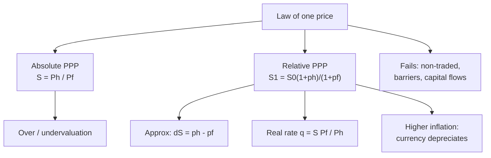

# FX-6: Purchasing Power Parity (Absolute and Relative)

Covers: the law of one price, absolute PPP, relative PPP with the exact and approximate formulas, the real exchange rate, why PPP fails, and PPP numericals with an exporter's decision. **(syllabus)** for scope, **(textbook)** for method.

## Where this fits in the ESE

Week 8 teaches PPP with IRP. Expect a 5-mark relative PPP sum or a 10-mark question that asks for both forms and the limitations. Inflation figures here are **illustrative**. No faculty slides yet; if the faculty uses the approximation, state it as an approximation and show the exact figure beside it.

## The idea **(textbook)**

**Law of one price (LOP):** in a frictionless world the same good costs the same in every country once converted at the exchange rate. If a good were cheaper abroad, buyers and arbitrageurs would shift demand until prices and the exchange rate adjusted. PPP applies LOP to a basket of goods.

### Absolute PPP

**S = P_h / P_f**

S is the home currency price of one unit of foreign currency (₹ per USD); P_h and P_f are the price levels of the same basket at home and abroad. A basket costing ₹3,300 in India and USD 40 in the US implies S = 82.50.

### Relative PPP (the version tested and used)

The **change** in the exchange rate offsets the difference in inflation rates.

**S1 / S0 = (1 + π_h) / (1 + π_f)**, so **S1 = S0 × (1 + π_h) / (1 + π_f)**

with π_h home inflation, π_f foreign inflation over the period.

**Approximation.** % change in S ≈ π_h − π_f. The exact formula divides instead of subtracts; the gap grows with large rates and long periods.

**Direction.** A country with higher inflation than its partner sees its currency **depreciate** (S rises in direct quotes). Note: the % rise in S (₹/USD) is not the % fall in the rupee's value; rupee fall = 1 − S0/S1.

### Real exchange rate

**q = S × P_f / P_h** (rupees per dollar, adjusted for relative prices). If relative PPP holds, q stays constant. A **rising q** is a **real depreciation** of the rupee: Indian goods are cheaper relative to foreign goods, helping exports. A falling q is a real appreciation.

## Worked example 1: absolute PPP and over- or undervaluation

**Data (illustrative):** the same basket costs ₹3,300 in India and USD 40 in the US. Market spot is ₹88.00.

1. **PPP rate** = 3,300 / 40 = **₹82.50 per USD**.
2. **Compare with spot:** 82.50 is below 88.00.
3. The rupee buys **less** abroad than at home: it is **undervalued** on a PPP basis by 82.50 / 88.00 − 1 = **−6.25%**. Equivalently, the dollar is 88.00 / 82.50 − 1 = **6.67%** above its PPP value.
4. **Decision line.** If absolute PPP held, the spot should move from 88.00 towards 82.50 (rupee appreciating).
5. **Interpretation.** PPP gaps persist because baskets include non-traded goods (housing, services), transport costs, tariffs and taste differences. The Economist's Big Mac index uses one product to make the same point **[VERIFY index details]**. Read PPP as a long-run anchor, not a short-run forecast.

## Worked example 2: relative PPP forecast

**Data:** spot ₹88.00 per USD. Expected annual inflation: India 5%, US 3%.

| Step | Calculation | Result |
|---|---|---|
| 1. Exact: S1 | 88.00 × 1.05 / 1.03 = 92.40 / 1.03 | **₹89.7087** |
| 2. Rise in S (₹/USD) | 89.7087 / 88 − 1 | **1.94%** |
| 2a. Fall in the rupee's value | 1 − 88 / 89.7087 | **1.90%** |
| 3. Approximate: S1 | 88.00 × (1 + 0.05 − 0.03) = 88.00 × 1.02 | ₹89.76 |
| 4. Error of approximation | 89.76 − 89.7087 | ₹0.05 |

5. **Two-year view** (same inflation each year): S2 = 88.00 × (1.05/1.03)² = **₹91.4507**, a 3.92% cumulative rise in S (not 2 × 1.94% = 3.88%); the rupee's value falls 1 − 88/91.4507 = 3.77%.
6. **Decision line.** Higher Indian inflation points to a weaker rupee: about 89.71 in a year and 91.45 in two years.
7. **Interpretation.** The rupee depreciates because Indian goods lose price competitiveness at an unchanged rate; the depreciation restores it.

## Worked example 3: real exchange rate check

**Data:** base year price indices both 100, spot 88.00. One year later, India's index is 105, the US's 103, and the actual spot is 90.50.

1. **q at base** = 88.00 × 100 / 100 = 88.00.
2. **q after one year** = 90.50 × 103 / 105 = **88.7762**.
3. **Change in q** = 88.7762 / 88.00 − 1 = **+0.88%**.
4. The relative-PPP spot was 89.7087, below the actual 90.50, so S rose by **more** than the inflation gap implies: a real depreciation of the rupee of 0.88%.
5. **Decision line.** Rupee goods became about 0.9% cheaper in real terms, which helps Indian exporters and makes imports dearer.
6. **Interpretation.** Real moves are what change competitiveness; nominal moves that only offset inflation do not.

## Worked example 4: PPP versus the forward in an exporter's decision

**Data:** an exporter expects USD 5,00,000 in one year. PPP-forecast spot = 89.7087 (example 2). The one-year forward from interest parity is 90.5385 (FX-5).

Use unrounded rates (89.708738 and 90.538462); the 4-decimal rates give figures that differ by under ₹50.

1. **Unhedged expected receipt** (PPP forecast) = 5,00,000 × 89.708738 = **₹4,48,54,369**.
2. **Forward-hedged receipt** = 5,00,000 × 90.538462 = **₹4,52,69,231**.
3. **Difference** = ₹4,14,862 in favour of the forward.
4. **Decision line.** The forward beats the PPP forecast by about ₹4.15 lakh and removes the risk, so hedge.
5. **Interpretation.** The comparison is only as good as the forecast; PPP is a weak short-run predictor. A hedge is justified by certainty, not by beating a forecast.

## Why PPP fails in the short run

- Non-traded goods and services, transport and trade barriers.
- Product differentiation and local pricing.
- Different baskets and price indices in each country.
- Capital flows dominate exchange rates in the short run, not goods trade.
- **Evidence:** PPP holds better over long horizons and for high-inflation countries. The RBI's NEER and REER indices (nominal and real effective exchange rates) are the Indian tools for tracking the real value of the rupee **[VERIFY index base and weights]**.

## Traps

- **Using the approximation as exact.** Show the exact fraction in the main answer.
- **Putting the inflation ratio upside down.** Home over foreign, with a direct quote.
- **Confusing PPP with IRP.** PPP links inflation to spot change; IRP links interest to forward premium.
- **Undervalued does not mean "weak because of poor economy".** It means price-adjusted purchasing power is higher than the market rate implies.

## What to remember

- Absolute PPP: S = P_h/P_f; relative PPP: S1 = S0 × (1 + π_h)/(1 + π_f).
- ₹3,300 and USD 40 give PPP 82.50 versus spot 88: rupee undervalued by 6.25%.
- 88 × 1.05/1.03 = 89.7087 (1.94%), against 89.76 from the approximation; two years 91.4507.
- Real exchange rate q = S × P_f/P_h; a rise is real depreciation.
- PPP is a long-run anchor; short-run fails because of non-traded goods and capital flows.

## Concept map

## Flashcards
Q: State absolute PPP.
A: S = P_h / P_f: the exchange rate equals the ratio of home to foreign price levels of the same basket.

Q: State relative PPP.
A: S1 = S0 × (1 + π_h) / (1 + π_f).

Q: Basket ₹3,300 in India, USD 40 in US, spot 88. PPP rate and verdict?
A: ₹82.50 per USD; the rupee is undervalued by 6.25% on a PPP basis.

Q: Spot 88, inflation India 5% and US 3%. Expected spot after one year?
A: 88 × 1.05 / 1.03 = ₹89.7087, a 1.94% rise in ₹/USD (the rupee's value falls 1.90%).

Q: What does the approximation give and what is its error?
A: 88 × 1.02 = 89.76, which overstates the exact figure by about ₹0.05.

Q: Same data, two years?
A: 88 × (1.05/1.03)² = ₹91.4507.

Q: Define the real exchange rate and a real depreciation.
A: q = S × P_f / P_h; a rise in q is a real depreciation and improves competitiveness.

Q: Give two reasons PPP fails in the short run.
A: Non-traded goods and trade barriers; capital flows dominate exchange rates in the short run.

Q: Difference between PPP and IRP in one line?
A: PPP links the inflation gap to the change in the spot rate; IRP links the interest gap to the forward premium.

## Sources
- BBA303F-6 course plan, Unit 3, Week 8
- Vij (2022); Madura (2018); Eun and Resnick (2018)
- Next: [[Global Business Finance Unit 3 - FX-7 Fisher Effect and How the Parity Conditions Link]]
- [[Global Business Finance Unit 3 - FOREX Market and Exchange Rate Theories MOC (Node Map)]]
