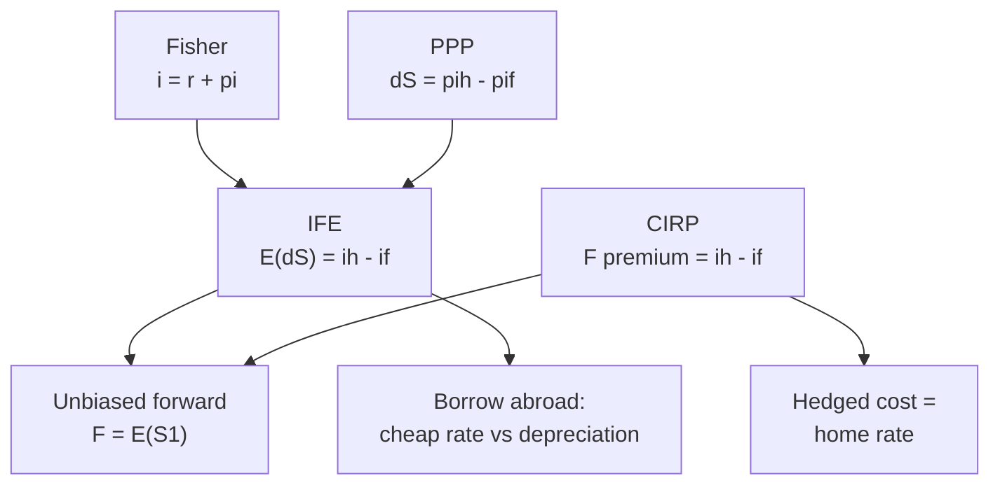

# FX-7: Fisher Effect, International Fisher Effect, and How the Parity Conditions Link

Covers: the Fisher effect, the International Fisher Effect (IFE), the unbiased forward rate idea, how PPP, IRP, Fisher and IFE connect with a numerical chain, and which one to use for which decision. **(syllabus)** for scope, **(textbook)** for method.

## Where this fits in the ESE

Week 9 is "Fisher effect and applications of exchange rate theories", the last Unit 3 topic before the mid-sem. A likely 10-mark question: "Explain the relationship between inflation, interest rates and exchange rates" with a numerical. The linkage table below is the model answer. All numbers are **illustrative**. No faculty slides yet.

## Fisher effect **(textbook)**

The nominal interest rate has two parts: the real return and compensation for expected inflation.

**(1 + i) = (1 + r) × (1 + π)**, so **i = r + π + rπ** ≈ **r + π**

i nominal rate, r real rate, π expected inflation.

If real rates are equal across countries, countries with higher expected inflation will have higher nominal rates. This is the Fisher effect applied across borders.

## International Fisher Effect (IFE) **(textbook)**

The expected change in the spot rate equals the nominal interest rate difference:

**E(S1) / S0 = (1 + i_h) / (1 + i_f)**, approximately % change ≈ i_h − i_f.

The currency with the higher nominal rate is expected to **depreciate** by about the rate gap (S rises about the rate gap; % rise in S is not the % fall in the rupee's value), so the investor earns the same expected return in either currency. IFE is the same equation as uncovered interest parity (FX-5).

**Unbiased forward rate.** If the forward rate equals the expected future spot, F = E(S1). With covered parity (FX-5) this gives UIP/IFE. Evidence shows the forward is a poor predictor in the short run; hence a "carry trade" (borrow in the low-rate currency, invest in the high-rate currency) can earn for long periods and then lose heavily.

## How the conditions link

| Relation | Links | Formula (direct quote) | Built on |
|---|---|---|---|
| **Fisher** | Inflation and nominal interest within one country | (1 + i) = (1 + r)(1 + π) | Equal real rate across countries |
| **PPP** | Inflation gap and spot change | S1/S0 = (1 + π_h)/(1 + π_f) | Law of one price |
| **IFE (UIP)** | Interest gap and expected spot change | E(S1)/S0 = (1 + i_h)/(1 + i_f) | Fisher + PPP |
| **CIRP** | Interest gap and forward premium | F/S0 = (1 + i_h)/(1 + i_f) | Arbitrage |
| **Unbiased forward** | Forward and expected spot | F = E(S1) | Risk neutrality |

If all five hold, **inflation gap = interest gap = expected depreciation = forward premium**. Covered parity holds by arbitrage and is observed closely. PPP and the IFE are statements about expectations and hold loosely, mainly over long horizons.

## Worked example 1: the Fisher effect, forwards and backwards

**Data:** real rate 3%, expected inflation 5%.

1. Exact nominal rate = 1.03 × 1.05 − 1 = **8.15%**.
2. Approximation = 3% + 5% = **8%**. The cross term rπ = 0.15% is the error.

**Reverse:** nominal 9%, expected inflation 5%.

3. Real rate = 1.09 / 1.05 − 1 = **3.81%** (the approximation 9% − 5% = 4% overstates).
4. **Decision line.** A lender who wants a 3.81% real return when inflation is 5% must demand 9%.

## Worked example 2: the IFE

**Data:** spot ₹88.00 per USD; nominal rates India 7%, US 4%.

1. Expected rise in S (₹/USD) = 1.07 / 1.04 − 1 = **2.885%** (the dollar appreciates 2.885%; the rupee's value falls 1 − 88/90.5385 = 2.80%).
2. Expected spot = 88.00 × 1.07 / 1.04 = **₹90.5385**, equal to the covered parity forward (FX-5).
3. **Application.** An Indian firm borrows USD at 4% instead of INR at 7% for one year, unhedged. Effective INR cost = (1.04 × S1 / 88.00) − 1.

| Realised S1 | Effective INR cost of the USD loan | Versus 7% rupee loan |
|---|---|---|
| 88.00 | 4.00% | Saves 3.00 points |
| 90.5385 | 7.00% | Equal (the IFE expectation) |
| 91.52 | 8.16% | Costs 1.16 points more |

4. The 91.52 case is a 4% rise in ₹/USD (88.00 × 1.04), more than the 2.885% rise the IFE expects: 1.04 × 91.52 / 88.00 − 1 = 8.16%.
5. **Decision line.** Under the IFE the cheap dollar loan carries no expected saving; its lower rate is paid for by expected depreciation. The loan saves money only if ₹/USD rises by less than 2.885%.
6. **Interpretation.** If the firm cannot bear the 8.16% outcome, it should hedge with a forward. At the parity forward the hedged dollar loan costs exactly 7%, the same as the rupee loan (see IF-5).

## Worked example 3: all the links in one chain

**Data:** real rate 3% in both countries. Expected inflation: India 5%, US 3%. Spot ₹88.00.

| Step | Calculation | Result |
|---|---|---|
| 1. Fisher, India | 1.03 × 1.05 − 1 | i_h = **8.15%** |
| 2. Fisher, US | 1.03 × 1.03 − 1 | i_f = **6.09%** |
| 3. PPP spot change | 1.05/1.03 − 1 | **1.94%** |
| 4. IFE spot change | 1.0815/1.0609 − 1 | **1.94%** |
| 5. CIRP forward premium (same period) | 1.0815/1.0609 − 1 | **1.94%** |
| 6. Forward | 88.00 × 1.0815 / 1.0609 | **₹89.7087** |

7. **Result.** PPP, IFE and the forward premium all give 1.94% and ₹89.7087, because the real rate was assumed equal and the nominal rates were built from Fisher.
8. **What if the real rates differ?** Data: India nominal 9%, inflation 5% (real 3.81%); US nominal 6%, inflation 3% (real 2.91%).
   - PPP: 88.00 × 1.05/1.03 = **89.7087** (1.94%).
   - IFE/CIRP: 88.00 × 1.09/1.06 = **₹90.4906** (2.83%).
   - The two forecasts differ by ₹0.78 (90.4906 − 89.7087) because India's real rate is 0.9 points higher.
9. **Decision line.** The chain collapses when real rates differ. The covered forward (90.4906) is still the price you can lock; the PPP figure is only a forecast.
10. **Interpretation.** The IFE reads India's extra real return as a larger expected rise in ₹/USD (2.83% against 1.94%). In practice high real-rate currencies often attract capital and do not fall by the full rate gap, which is why the IFE is a weak short-run forecaster. For hedging use the forward; for long-run valuation use PPP.

## Which theory for which decision

| Decision | Use |
|---|---|
| Price a forward or test an arbitrage | CIRP |
| Forecast the long-run rate; judge competitiveness | PPP and real exchange rate |
| Judge whether cheap foreign borrowing really saves | IFE |
| Estimate nominal rate from inflation view | Fisher |

## Traps

- **IFE is about expected, not actual, spot.** Realised spot can differ.
- **IFE and CIRP share a formula** but use different variables (E(S1) versus F).
- **Fisher with the approximation:** state it as an approximation or compute exactly.
- **Equal real rates are an assumption**, not a fact.

## What to remember

- Fisher: (1 + i) = (1 + r)(1 + π); IFE: E(S1)/S0 = (1 + i_h)/(1 + i_f).
- 1.03 × 1.05 − 1 = 8.15%; IFE spot 90.5385 equals the covered forward.
- If real rates are equal and parity holds, inflation gap = interest gap = depreciation = premium.
- With real rates 3.81% and 2.91%, PPP gives 89.7087 and IFE 90.4906.
- Cheap foreign borrowing saves only if depreciation is below the rate gap; otherwise hedge.

## Concept map

## Flashcards
Q: State the Fisher effect.
A: (1 + nominal rate) = (1 + real rate)(1 + expected inflation).

Q: Real 3%, inflation 5%. Nominal rate?
A: 1.03 × 1.05 − 1 = 8.15% (8% by approximation).

Q: Nominal 9%, inflation 5%. Real rate?
A: 1.09 / 1.05 − 1 = 3.81%.

Q: State the International Fisher Effect.
A: Expected spot change equals the interest rate gap: E(S1)/S0 = (1 + i_h)/(1 + i_f).

Q: Spot 88, India 7%, US 4%. IFE expected spot?
A: 88 × 1.07 / 1.04 = ₹90.5385, a 2.885% rise in ₹/USD (the rupee's value falls 2.80%).

Q: What is the link between IFE and covered interest parity?
A: The same formula; IFE uses the expected spot, CIRP uses the forward, and they agree if the forward is an unbiased predictor.

Q: Dollar loan at 4% versus rupee loan at 7%. Effective INR cost if ₹/USD rises 4%?
A: 1.04 × 1.04 − 1 = 8.16%, above the 7% rupee loan.

Q: Real rates equal at 3%, inflation 5% and 3%. Common rise in S?
A: 1.05/1.03 − 1 = 1.94% by PPP, IFE and the forward premium alike.

Q: When do PPP and IFE forecasts diverge?
A: When real interest rates differ across countries.

Q: Which theory prices a forward and which gives a long-run valuation?
A: CIRP prices the forward; PPP gives the long-run valuation.

## Sources
- BBA303F-6 course plan, Unit 3, Week 9
- Vij (2022); Madura (2018); Eun and Resnick (2018)
- Next: [[Global Business Finance Unit 3 - FX-8 Unit 3 Exam Answers]]
- [[Global Business Finance Unit 3 - FOREX Market and Exchange Rate Theories MOC (Node Map)]]
