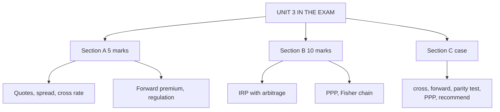

# FX-8: Unit 3 Exam Answers

Covers: a formula sheet for Unit 3, 5-mark and 10-mark answer skeletons, and a 15-mark case layout with a full model answer on an exporter that needs cross rates, forward cover, an arbitrage check and a PPP comparison. Numbers come from FX-2 to FX-7.

## What the test will ask

Unit 3 is CO3: 25 of the 50 mid-sem marks, so about half the paper. In the ESE it carries 15 of 50 marks. Expect numerical questions in all three sections: cross rate or spread in Section A, parity and arbitrage in Section B, and a Unit 3 case with Unit 1 and 2 context in Section C. This is a judgement from the course plan and the CO weights, not a confirmed pattern.

## Formula sheet (direct quote, ₹ per USD)

| Topic | Formula |
|---|---|
| Spread % | (Ask − Bid) / Ask × 100 |
| Reciprocal of Bid/Ask | 1/Ask  and  1/Bid |
| Cross rate (multiply) | bid × bid, ask × ask |
| Cross rate (divide) | bid = INR bid ÷ other ask; ask = INR ask ÷ other bid |
| Annualised forward premium | (F − S)/S × 12/n |
| CIRP | F = S × (1 + i_h)/(1 + i_f) |
| Relative PPP | S1 = S0 × (1 + π_h)/(1 + π_f) |
| Fisher | (1 + i) = (1 + r)(1 + π) |
| IFE (UIP) | E(S1) = S0 × (1 + i_h)/(1 + i_f) |

## Five-mark answer skeletons

**1. Functions and participants of the forex market (FX-1).** Definition; tiers; four participants; three functions.

**2. Direct versus indirect quote; bid and ask; spread (FX-2).** Definitions; customer buys at ask and sells at bid; spread % 0.0678% for 88.40/88.46.

**3. Cross rate numerical (FX-3).** Pick multiply or divide rule; bid × bid and ask × ask; EUR/INR 102.5440 / 102.7198.

**4. Two-point or triangular arbitrage (FX-3).** Condition (bid > other ask, or quoted cross ≠ implied cross); steps; profit ₹90,000 or ₹2,210.76.

**5. Forward premium (FX-4).** Spot plus points; premium formula; annualised 2.26%.

**6. Regulation of forex in India (FX-4).** FEMA 1999, RBI, authorised dealers, FEDAI, facilitative regime; verify current rules.

**7. Covered interest parity (FX-5).** Formula, derivation in two lines, 88 × 1.07/1.04 = 90.5385.

**8. Relative PPP with sum (FX-6).** Formula; 89.7087 and 1.94%; the approximation 89.76.

**9. Fisher effect and IFE (FX-7).** Formulas; 8.15%; IFE spot 90.5385.

## Ten-mark answer skeletons

**A. Interest rate parity with arbitrage.** Statement and derivation → parity forward (90.5385) → test market forward 90.00 below parity → direction (borrow USD, invest INR, buy USD forward) → ₹5,60,000 table → uncovered parity and break-even 90.5385 → reasons parity fails → conclusion.

**B. PPP, both forms.** Law of one price → absolute PPP with the ₹3,300 / USD 40 basket → relative PPP with 89.7087 → real exchange rate (+0.88%) → limitations → conclusion on long-run use.

**C. Relationship between inflation, interest rates and exchange rates.** Table of five relations → chain with real rate 3% (8.15%, 6.09%, 1.94% everywhere) → what changes when real rates differ (89.7087 vs 90.4906) → which theory for which decision.

**D. Forward market and cover.** Forward points → premium and annualised premium → exporter and importer rates → cancellation example → IRP link → Indian regulation.

**E. Arbitrage in forex.** Three forms; one numerical for each of two-point (₹90,000), triangular (₹2,210.76), covered (₹4,80,000); how arbitrage restores equilibrium.

## Fifteen-mark case layout (exporter with a currency decision)

1. **State the exposure (1).** Who receives or pays what, and when.
2. **Convert and cross (3).** Cross rate and cost of the payable.
3. **Price the forward (3).** Premium, annualised premium, hedged receipt.
4. **Test parity, find arbitrage (4).** Parity forward, direction, profit table.
5. **Cross-check with PPP (2).** Expected spot and unhedged receipt.
6. **Recommend with a condition (2).**

### Model answer, laid out as the exam answer

**Data (hypothetical):** Mangrove Exports Ltd (fictional Tiruppur garment exporter) will receive USD 8,00,000 in six months and must pay a European supplier EUR 2,00,000 today. Spot USD/INR 88.40 / 88.46. EUR/USD 1.1600 / 1.1612. Six-month rates (annual, simple): India 7%, US 4%. A bank quotes a six-month forward of USD/INR 89.40 / 89.50. Expected annual inflation: India 5%, US 3%.

**(a) Cross rate and the payable**
1. EUR/INR bid = 88.40 × 1.1600 = 102.5440; ask = 88.46 × 1.1612 = **102.7198**.
2. Mangrove buys EUR, so it pays the ask: 2,00,000 × 102.7198 = **₹2,05,43,960**.

**(b) Forward premium**
3. Mid spot = 88.43; mid forward = 89.45. Premium = (89.45 − 88.43)/88.43 = **1.153%** for six months; annualised **2.31%**.
4. The exporter sells USD at the forward bid 89.40: 8,00,000 × 89.40 = **₹7,15,20,000**.

**(c) Parity test and arbitrage**
5. Half-year rates: India 7% × 6/12 = 3.5%, US 4% × 6/12 = 2.0%.
6. Parity forward (from the spot bid, the rate at which an arbitrageur sells USD) = 88.40 × 1.035 / 1.02 = **89.70**.
7. The bank's forward ask is 89.50, **below** parity 89.70: dollars are cheap forward. Arbitrage on USD 10,00,000:

| Step | Calculation | Result |
|---|---|---|
| 1. Borrow USD at 2% for six months | Repay 10,00,000 × 1.02 | USD 10,20,000 |
| 2. Convert at spot bid | 10,00,000 × 88.40 | ₹8,84,00,000 |
| 3. Deposit rupees at 3.5% | 8,84,00,000 × 1.035 | ₹9,14,94,000 |
| 4. Buy USD 10,20,000 forward at ask 89.50 | 10,20,000 × 89.50 | −₹9,12,90,000 |
| Profit | 9,14,94,000 − 9,12,90,000 | **₹2,04,000** |

8. Check: (89.70 − 89.50) × 10,20,000 = ₹2,04,000. ✓ A real dealer would not quote an arbitrageable forward; the numbers are chosen to show the test.

**(d) PPP cross-check**
9. Relative PPP for six months: S = 88.40 × (1.05/1.03)^0.5 = 88.40 × 1.00966 = **89.2541**.
10. Unhedged expected receipt = 8,00,000 × 89.2541 = **₹7,14,03,301** (unrounded rate 89.254126).
11. Forward-hedged receipt ₹7,15,20,000 is higher by **₹1,16,699** (unrounded rate 89.254126).

| Option | Rate | Receipt (₹) |
|---|---|---|
| Wait and convert (PPP forecast) | 89.2541 (unrounded 89.254126) | 7,14,03,301 |
| Forward sale at bid | 89.40 | 7,15,20,000 |
| Forward at parity (bid-based) | 89.70 | 7,17,60,000 |

12. **Reading.** The forward beats the PPP forecast and removes the risk. The quoted bid (89.40) is ₹0.30 below the parity rate of 89.70, which costs the exporter 8,00,000 × 0.30 = ₹2,40,000 against a fair-price forward. The bank's whole two-way quote (89.40 / 89.50) sits below parity, which is what makes the arbitrage in (c) possible.
13. **Recommendation.** **Hedge by selling USD 8,00,000 forward**, but ask for a better bid or compare with other authorised dealers: each ₹0.10 improvement is worth ₹80,000. Pay the EUR payable at the ask cross, or negotiate a direct EUR/INR rate to avoid stacking spreads. Condition: if the bank will not move, the forward at 89.40 is still preferable to the unhedged expectation of 89.25 and its risk.
14. **Risks and assumptions.** Parity ignores bid-ask on interest rates and transaction costs; PPP is a weak six-month forecast; counterparty risk with the bank; forward cover needs an underlying exposure under FEMA rules **[VERIFY]**.

Close with: *figures are hypothetical; real quotes and rules should be confirmed with the authorised dealer.*

## Layout template for any long case

Data and exposure → required formulas written out → step-numbered calculations with a table → decision line → interpretation → recommendation with a condition → risks and assumptions → one-line closer.

## Time rule

If short of time: write the formula, compute one clean number per part, write a one-line interpretation, and give the recommendation. Show units and the side of the quote (bid or ask) on every line.

## What to remember

- Unit 3 is half the mid-sem: practise cross rate, forward premium, CIRP arbitrage, relative PPP and the Fisher chain.
- Use the correct side: customers buy at ask and sell at bid; arbitrageurs sell USD at the bid.
- Key numbers: 102.5440 / 102.7198; 2.26%; 90.5385; 89.7087; 8.15%; ₹5,60,000; ₹4,80,000.
- Case numbers: EUR payable ₹2,05,43,960; forward receipt ₹7,15,20,000; arbitrage ₹2,04,000.
- The case answer ends with a recommendation, a condition and risks.

## Concept map

## Flashcards
Q: Steps of a forex case answer?
A: State the exposure, compute the cross rate or payable, price the forward, test parity and find any arbitrage, cross-check with PPP, then recommend with a condition and risks.

Q: Mangrove case: EUR/INR ask and cost of EUR 2,00,000?
A: 102.7198 and ₹2,05,43,960.

Q: Mangrove case: annualised forward premium on mid rates?
A: 1.153% for six months, 2.31% annualised.

Q: Mangrove case: parity forward from the spot bid?
A: 88.40 × 1.035 / 1.02 = 89.70.

Q: Mangrove case: direction and profit of the arbitrage?
A: Borrow USD, convert at 88.40, deposit rupees at 3.5%, buy USD forward at 89.50: profit ₹2,04,000 on USD 10,00,000.

Q: Mangrove case: PPP six-month spot and the forward receipt versus the unhedged one?
A: 89.2541 (unrounded rate 89.254126); forward ₹7,15,20,000 against ₹7,14,03,301, higher by ₹1,16,699.

Q: What is each ₹0.10 improvement in the forward bid worth?
A: ₹80,000 on USD 8,00,000.

Q: Which side of the quote does an arbitrageur use when selling USD spot?
A: The bid.

Q: Skeleton for a 10-mark parity question?
A: Statement and derivation, parity forward, arbitrage test with a table, uncovered parity, limitations, conclusion.

Q: What closing line should a hypothetical case carry?
A: That the figures are hypothetical and real quotes and rules should be confirmed with the authorised dealer.

## Sources
- BBA303F-6 course plan, Unit 3 and ESE pattern
- [[Global Business Finance Unit 3 - FOREX Market and Exchange Rate Theories MOC (Node Map)]]
