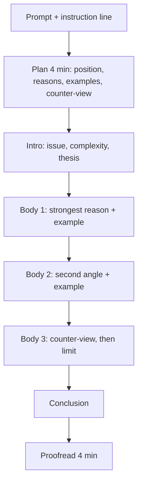

# A-1: The Issue Essay

**Why this matters:** Analytical Writing is always the first section of the test (ETS), and since 22 September 2023 it is a single 30-minute Issue task. The Argument task was removed. A tired or rushed start sets the tone for the next hour, so a repeatable plan matters.

## The task

You read a statement of opinion on an issue plus specific instructions, then write your response in 30 minutes in ETS's basic word processor (insert, delete, cut, paste, undo; no spell or grammar check). You evaluate the issue, consider its complexities, and build an argument with reasons and examples. No outside content knowledge is tested. ETS also publishes the pool of Issue topics, so you can practise on the real pool.

Read the instruction line closely. Different prompts ask different things (agree or disagree, address both sides, say under what conditions). Answering a different question is the quickest way to lose points.

## Scoring: the ETS 0 to 6 guide in own words

Raters score the whole response holistically on a 0 to 6 scale, with half-point steps in the reported score. They judge how well you address the task, support your position, and write clearly; they do not mark you on whether your position is "right", nor for a set structure or number of examples.

| Score | Label | What the response does |
|---|---|---|
| 6 | Outstanding | Insightful position, compelling reasons or examples, tight focus and organisation, fluent, near-flawless language. |
| 5 | Strong | Clear, well-considered position with sound reasons or well-chosen examples. Mostly well organised, good control of English, minor errors. |
| 4 | Adequate | Clear position with relevant support. Adequately organised and focused, some language slips. |
| 3 | Limited | Some competence but clearly flawed: vague or thin position, weak support, loose organisation, frequent or major errors that sometimes block meaning. |
| 2 | Seriously flawed | Largely ignores the task or has serious weaknesses: unclear position, few relevant reasons, poor focus, errors that obscure meaning. |
| 1 | Fundamentally deficient | Little or no grasp of the issue, disorganised or extremely short, severe and persistent errors. |
| 0 | Off topic or unscorable | Not about the topic, in another language, copied from the prompt, only keystrokes, or illegible. A blank response is reported as NS. |

Occasional spelling or grammar errors do not affect the score; serious and persistent ones lower it (ETS).

## Structure template (five paragraphs, about 450 to 550 words)

1. **Intro (2 to 3 sentences):** restate the issue in your own words, acknowledge the complexity, and state your position, including the condition or limit that shapes it.
2. **Body 1, strongest reason:** claim, one specific example (historical, social, personal or hypothetical), explanation of why it proves the claim.
3. **Body 2, second reason or a different angle:** same pattern, with a different kind of example.
4. **Body 3, the counter-view:** state the best opposing point fairly, then show why it does not overturn your position, or where it sets the limit of your position.
5. **Conclusion (2 sentences):** restate the position and the condition; do not introduce new material.

Aim for one idea per paragraph, linked by logic words (because, however, in contrast, as a result). A nuanced position ("mostly yes, but only when ...") usually scores higher than a flat one.

## Timing plan (30 minutes)

| Minutes | Do |
|---|---|
| 0 to 2 | Read the prompt and the instruction line twice. |
| 2 to 6 | Choose a position. Jot the thesis, two or three reasons, a concrete example for each, and the counter-view. |
| 6 to 25 | Write. Intro and conclusion quickly; spend the time on the body paragraphs. |
| 25 to 29 | Proofread: sentence boundaries, agreement, repeated words, clear topic sentences. |
| 29 to 30 | Final read of the thesis against the conclusion. |

If you run short, drop a body paragraph's second example, never the conclusion.

## Practice routine

1. Pick topics from the ETS pool at random.
2. Do two timed essays a week, one under exam conditions in a plain editor with no spellcheck.
3. Score yourself against the table above, then swap with a peer or use a rubric-driven checker.
4. Keep a bank of five or six reusable examples (a historical case, a scientific advance, a policy, a business case, a personal experience) that you can bend to many prompts.
5. Keep a typing speed of 40 words per minute or better; speed is part of the output.

## Concept map

## Flashcards
Q: How long is the Issue task?
A: 30 minutes (ETS).

Q: How many tasks does the AWA section have since 22 September 2023?
A: One: Analyze an Issue.

Q: Where does AWA appear in the test?
A: Always first (ETS).

Q: What is the AWA score scale and step?
A: 0 to 6, in half-point increments.

Q: What does a 4 look like?
A: Clear position, relevant support, adequate organisation, some language slips.

Q: Do raters mark you on which side you picked?
A: No. They judge how well you address the task, support your position and write.

Q: Is spellcheck available in the ETS editor?
A: No.

Q: What is a safe split of 30 minutes?
A: 4 plan, 20 to 22 write, 4 proofread.

Q: What do you do if you run short of time?
A: Trim a second example; keep the conclusion.

## Sources
- ETS, Analytical Writing measure (one 30-minute Analyze an Issue task, editor features, no spellcheck): https://www.ets.org/gre/test-takers/general-test/prepare/content/analytical-writing.html
- ETS, Analyze an Issue task and scoring (what raters judge): https://www.ets.org/gre/test-takers/general-test/prepare/content/analytical-writing/issue.html
- ETS, Analytical Writing scoring (0 to 6 level descriptions; half-point reporting): https://www.ets.org/gre/test-takers/general-test/prepare/content/analytical-writing/scoring.html
- ETS, test structure (AWA is the first section, 30 minutes): https://www.ets.org/gre/test-takers/general-test/prepare/test-structure.html
- Structure template, timing plan and practice routine are the author's own synthesis.
