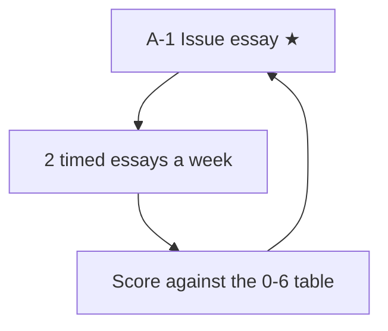

# GRE Analytical Writing: node map

Since 22 September 2023 the GRE writing section is a single 30-minute "Analyze an Issue" task, always taken first. It is scored 0 to 6 in half-point steps. The old Argument task is gone.

There is one node. It holds the task, the ETS scoring guide in plain words, a structure template and a timing plan. There is no question bank: practise from ETS's published pool of Issue topics.

## Nodes

| Node | Topic | Deps | Minutes | Exam focus |
|---|---|---|---|---|
| A-1 | Issue essay | none | 60 | yes |

## How to use it

Because AWA is the first section on test day, schedule your writing practice at the same point in your mock sequence (essay first, then Verbal and Quant).
