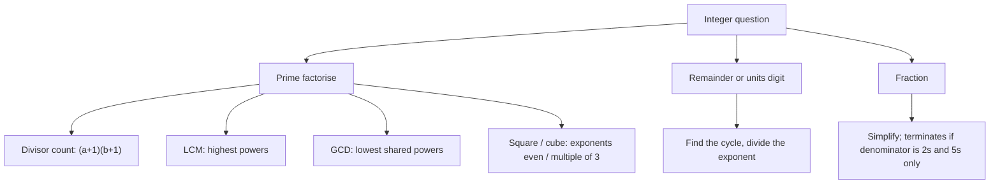

# Q-1: Arithmetic and Number Properties

**Why this matters:** 16 of the 96 ETS questions sit here, and 5 of them are Quantitative Comparisons. They are less about calculating than about whether you know what integers, primes, remainders, exponents and decimals *must* do.

## Integers, factors and multiples

- A factor (divisor) of n divides n with no remainder; n is then a multiple of it. 1 is a factor of every integer; 0 is a multiple of every integer (ETS 1.1).
- **LCM:** the least positive integer that is a multiple of both. **GCD:** the greatest positive integer that divides both. With prime factorisations, the LCM takes the *highest* power of each prime and the GCD the *lowest* power of each shared prime (ETS 1.1).
- LCM × GCD = the product of the two numbers (for two positive integers).
- **Remainders:** c divided by d gives c = qd + r with 0 ≤ r < d. The remainder is 0 exactly when d divides c (ETS 1.1). Remainders of powers repeat in a cycle: find the cycle, then divide the exponent by its length.

## Odd, even and primes

- even ± even = even, odd ± odd = even, even ± odd = odd; any product with an even factor is even, odd × odd = odd (ETS 1.1).
- A prime is an integer greater than 1 with exactly two positive divisors. 1 is not prime; 2 is the only even prime (ETS 1.1).
- Every integer greater than 1 has one prime factorisation (ETS 1.1).
- **Number of positive divisors:** write n = p^a · q^b · …; the count is (a + 1)(b + 1)…
- A number with exactly 3 divisors is the square of a prime. Exactly 4 divisors: p·q or p³.
- **Trailing zeros of n!:** count the 5s: ⌊n/5⌋ + ⌊n/25⌋ + … (there are always more 2s than 5s).
- A perfect square has every prime exponent even; a perfect cube has every exponent a multiple of 3.

## Fractions, decimals and units digits

- A simplified fraction has a terminating decimal exactly when its denominator has no prime factors other than 2 and 5. Simplify first.
- A two-digit repeating decimal 0.abab… = ab/99.
- To compare fractions, cross-multiply rather than converting.
- Units digits of powers repeat in cycles of at most 4 (2: 2, 4, 8, 6; 3: 3, 9, 7, 1; 7: 7, 9, 3, 1).

## Exponents and roots

- a^m · a^n = a^(m+n), a^m / a^n = a^(m−n), (a^m)^n = a^(mn), a⁰ = 1 for a ≠ 0, a^(−n) = 1/aⁿ (ETS 1.3, 2.2).
- √a · √b = √(ab), but √a + √b ≠ √(a + b) (ETS 1.3).
- For 0 < x < 1: √x > x > x². Raising a number between 0 and 1 to a higher power makes it smaller.
- (−a)ⁿ is positive for even n and negative for odd n; −aⁿ means −(aⁿ).
- Factor out the smallest power: 2³¹ − 2³⁰ = 2³⁰(2 − 1) = 2³⁰.

## Real numbers and absolute value

- |x| is the distance from x to 0. |r + s| ≤ |r| + |s| (the triangle inequality, ETS 1.5).
- If rs = 0, then r = 0 or s = 0 or both (ETS 1.5).

## Concept map

## Flashcards
Q: How many positive divisors does 360 = 2³ · 3² · 5 have?
A: (3 + 1)(2 + 1)(1 + 1) = 24.

Q: Which numbers have exactly 3 positive divisors?
A: Squares of primes (4, 9, 25, 49, …).

Q: When does a simplified fraction have a terminating decimal?
A: When its denominator has no prime factors other than 2 and 5.

Q: How many trailing zeros does 30! have?
A: ⌊30/5⌋ + ⌊30/25⌋ = 6 + 1 = 7.

Q: Is 1 a prime number?
A: No. A prime has exactly two positive divisors; 1 has one.

Q: For 0 < x < 1, order x, x² and √x.
A: √x > x > x².

Q: What is 0.3636… as a fraction?
A: 36/99 = 4/11.

Q: What is the cycle of units digits for powers of 7?
A: 7, 9, 3, 1, then it repeats.

Q: LCM and GCD of 84 and 126?
A: 84 = 2²·3·7, 126 = 2·3²·7. GCD = 42, LCM = 252.

Q: Is −2⁴ equal to (−2)⁴?
A: No. −2⁴ = −16, (−2)⁴ = 16.

## Sources
- ETS, *GRE Math Review*, Part 1 Arithmetic (1.1 Integers, 1.2 Fractions, 1.3 Exponents and Roots, 1.4 Decimals, 1.5 Real Numbers): https://www.ets.org/pdfs/gre/gre-math-review.pdf
- ETS, GRE Quantitative Reasoning overview (plug in 0, negatives, fractions, small and large numbers in QC): https://www.ets.org/gre/test-takers/general-test/prepare/content/quantitative-reasoning.html
