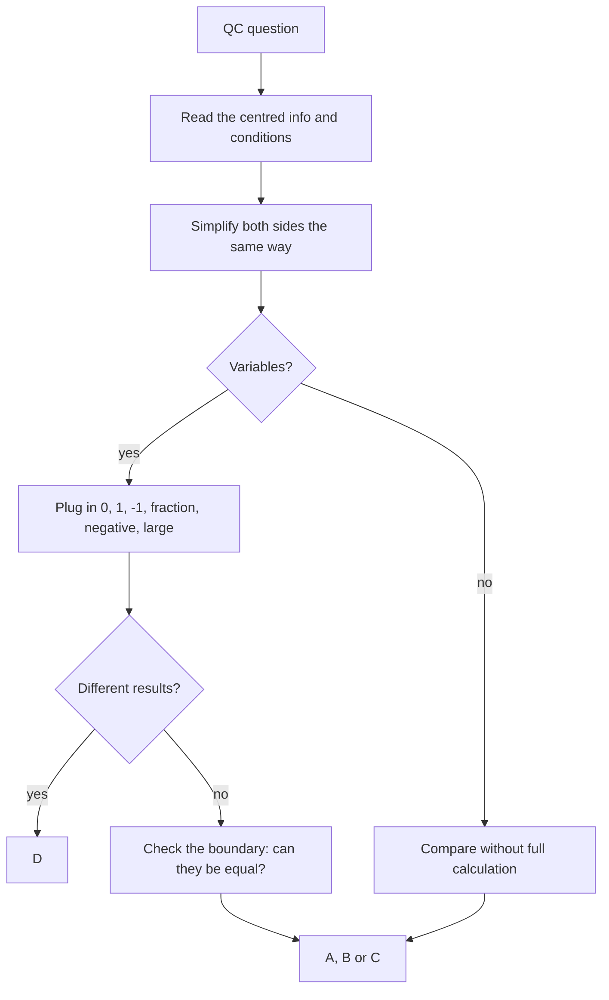

# Q-10: Quantitative Comparison Method

**Why this matters:** 245 of the 740 bank questions are Quantitative Comparisons, a third of the bank, and they come from every content node. One method covers all of them.

## The format

Two quantities, A and B, sometimes with information above them that applies to both. The four answer choices never change (ETS):

- **A** Quantity A is greater.
- **B** Quantity B is greater.
- **C** The two quantities are equal.
- **D** The relationship cannot be determined from the information given.

A, B and C each claim something is *always* true. D means at least two of them are possible.

## Method

1. **Read the centred information first.** It applies to both quantities. Note every condition: integer, positive, different, between 0 and 1.
2. **Simplify both sides the same way.** Add or subtract the same thing; multiply or divide by the same *positive* number. Never multiply or divide by something whose sign you do not know (ETS).
3. **Plug in numbers.** Try 0, 1, −1, a fraction between 0 and 1, a negative fraction and a large number (ETS). Two cases that give different answers mean D; stop there.
4. **Look for the boundary.** If the greatest or least possible value of A equals B, equality is possible, so the answer is not A or B.
5. **Don't calculate what you can compare.** Compare factor by factor (24√3 against 40: divide by 8, square, 27 against 25).

## When the answer is D

- An unknown sign (x/y > 1 says nothing about x > y).
- Two roots or two cases (x² = 49).
- An unknown angle or shape in a figure not drawn to scale.
- A range that includes the other quantity.
- Not stated as independent, lowest terms, integer, or different.

## When D is the trap

- If a quantity can only vary within a range, and that whole range is above or below the other quantity, the answer is A or B even though the value is not fixed (P(R or S) ≥ 0.7 > 0.65).
- A figure that is not to scale can still be fixed by the given angles (two sides equal with a 60° angle between them: equilateral).
- If C is possible only when the variables meet a condition the question rules out, the answer is not D.

## Traps the bank keeps setting

- Trying only positive integers.
- Forgetting the case where equality happens (x + 1/x ≥ 2, equal at x = 1).
- Trusting the figure.
- Calculating precisely when a quick bound settles it, or estimating when the gap is tiny (100 − 25π against 20 needs π < 3.2, so don't use π ≈ 3).

## Practise on

- [GRE-k002-main-h-4](/practice/question/GRE-k002-main-h-4) a range that still settles it
- [GRE-t006-s1-s1-4](/practice/question/GRE-t006-s1-s1-4) equal squares, two cases
- [GRE-t004-medium-m-3](/practice/question/GRE-t004-medium-m-3) figure not to scale
- [GRE-t006-hard-h-3](/practice/question/GRE-t006-hard-h-3) greatest value equals B
- [GRE-t011-hard-h-5](/practice/question/GRE-t011-hard-h-5) lowest terms not given
- Run the whole node from Practice: every QC in the bank is in Q-10.

## Concept map

## Flashcards
Q: What are the four QC answer choices?
A: A greater; B greater; equal; cannot be determined.

Q: Which numbers should you plug in for a QC with a variable?
A: 0, 1, −1, a fraction between 0 and 1, a negative fraction and a large number.

Q: Two plug-ins give "A greater" and "equal". Answer?
A: D.

Q: Can you divide both quantities by x if x's sign is unknown?
A: No. It may flip the comparison.

Q: Quantity A is at most 25 and can equal 25; Quantity B is 25. Answer?
A: D (equal or B greater).

Q: P(R) = 0.7, P(S) = 0.6, independence not given. P(R or S) against 0.65?
A: A. The union is at least 0.7.

Q: Positive x. Compare x + 1/x with 2.
A: D. It is never below 2 but equals 2 at x = 1.

Q: A figure is "not drawn to scale". What do you trust?
A: Only the stated facts: given lengths, angles, parallel and right-angle marks.

## Sources
- ETS, GRE Quantitative Reasoning overview (QC answer choices, plug-in advice, simplifying both quantities): https://www.ets.org/gre/test-takers/general-test/prepare/content/quantitative-reasoning.html
- ETS, General Problem-solving Steps for the GRE Quantitative Reasoning Measure: https://www.ets.org/content/dam/ets-india/pdfs/gre/quantitative-reasoning-strategies.pdf
- GRE Quant Lab question bank solutions (traps), pekalkan/gre-quant-lab @ 9bdc26e, translated in this repo
