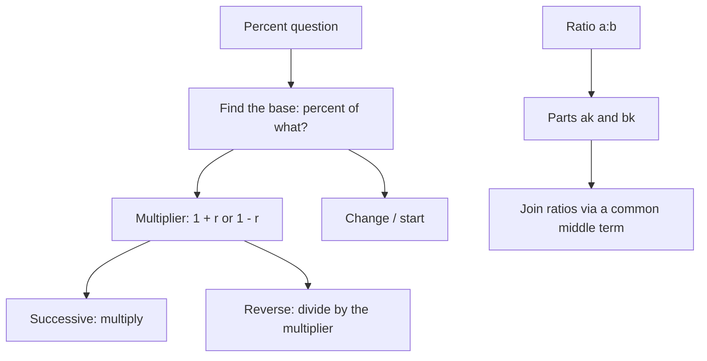

# Q-2: Percents and Ratios

**Why this matters:** 49 questions here, and percent reasoning also drives most of the 140 data interpretation questions in Q-9. Get the base right here and Q-9 gets much easier.

## Ratios

- The ratio a to b (a:b) compares two quantities; it can be written as the fraction a/b and simplified like one (ETS 1.6).
- A ratio of 3:5 means 3k and 5k for some k; the total is 8k.
- To join a:b and b:c, make the shared term the same (use the LCM of the two b values): a:b = 2:3 and b:c = 4:5 give 8:12:15.
- A proportion is an equation between two ratios; cross-multiply to solve (ETS 1.6).
- If a part stays fixed while the other part changes, the fixed part must be a multiple of both ratio numbers.

## Percent basics

- Percent means "per hundred": 32% = 32/100 = 0.32 (ETS 1.7).
- "x percent of y" = (x/100) · y. To find what percent a is of b, compute a/b × 100 (ETS 1.7).
- "a% of b" equals "b% of a".

## Percent change

- Percent change = (change ÷ the starting value) × 100. The base is always the value you start from, the one after "than" or "from" (ETS 1.7).
- An increase of r% multiplies by (1 + r/100); a decrease of r% multiplies by (1 − r/100).
- **Successive changes multiply.** +20% then −25% is 1.2 × 0.75 = 0.9, a 10% fall. Never add the percents.
- Up and down by the same r% always leaves a net loss of r²/100 percent.
- **Reverse:** original = final ÷ multiplier. After a 15% discount the price is 170, so the original is 170/0.85 = 200.
- Percentage points are not percent: from 20% to 25% is 5 points but a 25% increase.
- Doubling is a 100% increase, not 200%.

## Interest and growth

- Simple interest on P at r% for t years: P(1 + rt/100) (ETS 2.7).
- Compound interest, yearly: P(1 + r/100)^t; compounded n times a year: P(1 + r/(100n))^(nt) (ETS 2.7).
- Compound growth is never less than simple growth at the same rate. The difference is interest on interest.
- Rule of 72: a quantity growing r% a year roughly doubles in 72/r years. Check the exact year if the question says "first exceeds".

## Traps the bank keeps setting

- Adding successive percents (+10, +10, −20 is not 0; it is 0.968, a 3.2% fall).
- Taking the new value as the base for percent change.
- Adding back the percent to reverse a discount (19,200 × 1.4) instead of dividing (19,200 ÷ 0.64).
- Reading a percent change and a percentage point change as the same thing.

## Practise on

- [GRE-t003-s1-s1-2](/practice/question/GRE-t003-s1-s1-2) successive percents and the base (QC)
- [GRE-t004-medium-m-9](/practice/question/GRE-t004-medium-m-9) compound against simple interest
- [GRE-t007-hard-h-12](/practice/question/GRE-t007-hard-h-12) the rise needed to get back (numeric)
- [GRE-t008-medium-m-4](/practice/question/GRE-t008-medium-m-4) percent change property (QC)
- [GRE-t010-easy-e-6](/practice/question/GRE-t010-easy-e-6) reverse percent

## Concept map

## Flashcards
Q: What is the multiplier for a 12% decrease?
A: 0.88.

Q: A value rises 10% and then falls 10%. What is the net change?
A: 1.1 × 0.9 = 0.99, a 1% fall.

Q: 40 to 50, then 50 to 40. What are the percent changes?
A: +25% (10/40) and −20% (10/50).

Q: After a 15% discount the price is 170. What was it before?
A: 170 ÷ 0.85 = 200.

Q: A rate moves from 20% to 25%. Points and percent?
A: 5 percentage points; a 25% increase.

Q: Is 30% of 80 the same as 80% of 30?
A: Yes, both are 24.

Q: a:b = 2:3 and b:c = 4:5. What is a:c?
A: 8:15 (a:b:c = 8:12:15).

Q: Formula for $P at r% compounded yearly for t years?
A: P(1 + r/100)^t.

Q: What percent increase is doubling?
A: 100%.

## Sources
- ETS, *GRE Math Review*, 1.6 Ratio, 1.7 Percent, 2.7 Applications (interest): https://www.ets.org/pdfs/gre/gre-math-review.pdf
- GRE Quant Lab question bank solutions (traps), pekalkan/gre-quant-lab @ 9bdc26e, translated in this repo
