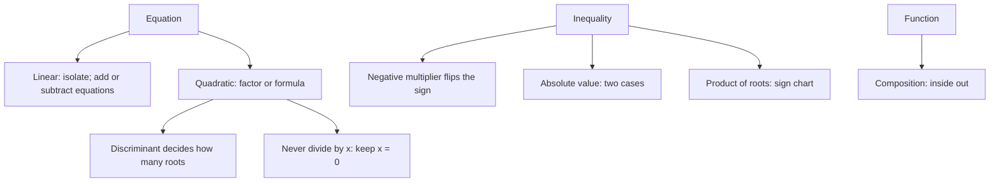

# Q-3: Algebra

**Why this matters:** the biggest content node, 160 questions, 66 of them QCs. The bank tests signs, lost roots and identities far more than long equation solving.

## Expressions and identities

- (a + b)² = a² + 2ab + b², (a − b)² = a² − 2ab + b², a² − b² = (a + b)(a − b) (ETS 2.1).
- (a + b)² − (a − b)² = 4ab, so xy = [(x+y)² − (x−y)²]/4.
- a² + b² = (a + b)² − 2ab.
- a³ + b³ = (a + b)³ − 3ab(a + b) = (a + b)(a² − ab + b²).
- (x + 1/x)² = x² + 2 + 1/x².
- When you see a difference of squares, factor it; integer solutions then come from factor pairs.

## Linear equations and systems

- Do the same thing to both sides; collect the variable on one side (ETS 2.3).
- Two equations: substitute or eliminate (ETS 2.3). Often the question asks for x + y or x − y, which adding or subtracting the equations gives at once.
- A system has no solution when the lines are parallel (same coefficient ratio, different constant ratio) and infinitely many when the equations are multiples of each other.

## Quadratics

- Solve ax² + bx + c = 0 by factoring, or by x = [−b ± √(b² − 4ac)]/(2a) (ETS 2.4).
- Discriminant b² − 4ac: positive, two different real roots; zero, one double root; negative, none.
- Sum of roots = −b/a, product = c/a.
- If a product is 0, a factor is 0. **Never divide both sides by x**: x² = 5x has roots 0 and 5.
- Squaring both sides can add a false root; check it in the original (a square root cannot be negative).
- A parabola y = a(x − h)² + k has its vertex at (h, k); equal y-values sit at equal distances from x = h, so their x-values average to h.

## Inequalities and absolute value

- Multiplying or dividing by a negative number reverses the inequality (ETS 2.5).
- Taking reciprocals reverses it only when both sides have the same sign; with unknown signs, expect D in a QC.
- |x − a| < b means a − b < x < a + b; |x − a| > b means x < a − b or x > a + b.
- (x − p)(x − q) < 0 between the roots, > 0 outside them.
- x³ < x holds for x < −1 or 0 < x < 1; don't forget the negative interval.
- x² = y² means x = y or x = −y.

## Functions and sequences

- f(x) gives one output per input; f(g(x)) works from the inside out (ETS 2.6).
- f(a + b) is generally not f(a) + f(b).
- Arithmetic sequence: aₙ = a₁ + (n − 1)d; sum = number of terms × (first + last)/2. From term 5 to term 12 is 7 steps.
- The sum of the first n odd numbers is n².

## Traps the bank keeps setting

- Dividing by a variable and losing the root x = 0.
- Missing the negative solution of x² = k or of an absolute value.
- Ignoring "different" (it rules out a double root, so the discriminant must be strictly positive).
- Assuming x > y from x/y > 1 (both could be negative).
- Writing (a + b)² as a² + b².

## Practise on

- [GRE-t001-hard-h-7](/practice/question/GRE-t001-hard-h-7) quadratic equation
- [GRE-t004-medium-m-6](/practice/question/GRE-t004-medium-m-6) identities
- [GRE-t006-s1-s1-4](/practice/question/GRE-t006-s1-s1-4) equal squares (QC)
- [GRE-t008-medium-m-11](/practice/question/GRE-t008-medium-m-11) product inequality (select all)
- [GRE-k002-main-h-3](/practice/question/GRE-k002-main-h-3) powers and sign (QC)

## Concept map

## Flashcards
Q: Solve x² = 5x.
A: x(x − 5) = 0, so x = 0 or x = 5.

Q: For ax² + bx + c = 0, what are the sum and product of the roots?
A: Sum −b/a, product c/a.

Q: When does ax² + bx + c = 0 have two different real roots?
A: When b² − 4ac > 0.

Q: |x − 3| < 4 as an interval?
A: −1 < x < 7.

Q: What happens to an inequality when you divide by −2?
A: The direction reverses.

Q: x + y = 8 and xy = 15. What is x² + y²?
A: 64 − 30 = 34.

Q: (x + 1/x) = 3 for x > 0. What is x² + 1/x²?
A: 9 − 2 = 7.

Q: Where is (x − 2)(x − 8) negative?
A: Between the roots: 2 < x < 8.

Q: Sum of the arithmetic sequence 20, 21, …, 60?
A: 41 terms × (20 + 60)/2 = 1,640.

Q: Does x/y > 1 mean x > y?
A: No. If both are negative, x < y (e.g. −4/−2 = 2).

## Sources
- ETS, *GRE Math Review*, 2.1 Algebraic Expressions, 2.2 Rules of Exponents, 2.3 Linear Equations, 2.4 Quadratic Equations, 2.5 Linear Inequalities, 2.6 Functions, 2.9 Graphs of Functions: https://www.ets.org/pdfs/gre/gre-math-review.pdf
- GRE Quant Lab question bank solutions (traps), pekalkan/gre-quant-lab @ 9bdc26e, translated in this repo
