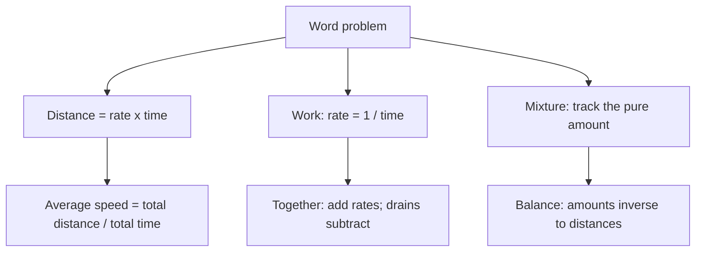

# Q-4: Word Problems and Rates

**Why this matters:** only 14 bank questions, but rate, work and mixture set-ups turn up inside other nodes too. The set-ups are fixed patterns; learn the pattern and the algebra is short.

## Translating words

- Name the unknown, write each sentence as an equation, check the answer against the words (ETS 2.7).
- Answer the question asked: the bank often asks for a total, an original value or "how many more".

## Distance, speed, time

- distance = rate × time (ETS 2.7).
- **Average speed = total distance ÷ total time**, never the average of the speeds. Over two equal distances at speeds a and b, the average is 2ab/(a + b).
- Towards each other: speeds add. Same direction: speeds subtract.
- Keep units consistent: 0.25 hours is 15 minutes, not 25.

## Work and flow

- A job done alone in t hours is a rate of 1/t of the job per hour (ETS 2.7).
- Working together, rates add: 1/a + 1/b. Time together = ab/(a + b).
- A draining pipe has a negative rate: fill 1/4, drain 1/6, net 1/12 tank per hour.
- Work as person-days: 10 people for 6 days = 60 person-days; 6 people need 10 days. More workers, less time (inverse proportion).
- A trick that helps: count the job as the LCM of the times (for 6, 9 and 12 hours, call the job 36 units).

## Mixtures

- Track the pure amount: salt in = concentration × volume (ETS 2.7). Adding water changes the volume but not the salt.
- Weighted average (balance) method: the final concentration sits closer to the larger amount. The distances to the two ingredients are in the inverse ratio of their amounts. 10% and 30% to make 25%: distances 15 and 5, so 1 part 10% to 3 parts 30%.

## Traps the bank keeps setting

- Averaging the speeds (30 and 60 over equal distances is 40, not 45).
- Adding the times or averaging them instead of adding the rates.
- Forgetting the drain in a fill-and-drain problem.
- Setting up a direct proportion where it should be inverse (more workers, fewer days).

## Practise on

- [GRE-t005-s1-s1-7](/practice/question/GRE-t005-s1-s1-7) average speed
- [GRE-t007-medium-m-9](/practice/question/GRE-t007-medium-m-9) moving towards each other
- [GRE-t004-s1-s1-5](/practice/question/GRE-t004-s1-s1-5) fill and drain
- [GRE-t005-hard-h-9](/practice/question/GRE-t005-hard-h-9) three pipes, two stages
- [GRE-t004-hard-h-12](/practice/question/GRE-t004-hard-h-12) mixture (numeric)
- [GRE-t008-hard-h-5](/practice/question/GRE-t008-hard-h-5) working together, symbolic (QC)

## Concept map

## Flashcards
Q: 30 km/h out and 60 km/h back over the same road. Average speed?
A: 2·30·60/90 = 40 km/h.

Q: A takes 6 hours, B takes 3 hours. Together?
A: 1/6 + 1/3 = 1/2 job per hour, so 2 hours.

Q: Fill in 4 hours, drain in 6 hours, both open. Time to fill?
A: 1/4 − 1/6 = 1/12, so 12 hours.

Q: Two cars 300 km apart drive towards each other at 70 and 80 km/h. When do they meet?
A: 300/150 = 2 hours.

Q: 20 litres of 30% salt water; how much water to get 12%?
A: Salt 6 litres stays; 6/(20 + w) = 0.12, so w = 30.

Q: Mixing 10% and 30% to get 25%. Ratio of amounts?
A: 1 : 3 (distances 15 and 5, reversed).

Q: 10 workers take 6 days. How long for 6 workers?
A: 60 person-days ÷ 6 = 10 days.

Q: Formula for time together for jobs of a and b hours?
A: ab/(a + b).

## Sources
- ETS, *GRE Math Review*, 2.7 Applications (rate, work, mixture problems): https://www.ets.org/pdfs/gre/gre-math-review.pdf
- GRE Quant Lab question bank solutions (traps), pekalkan/gre-quant-lab @ 9bdc26e, translated in this repo
