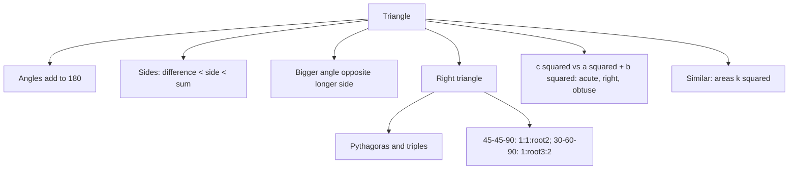

# Q-5: Lines, Angles and Triangles

**Why this matters:** 40 questions, more than half of them QCs. GRE figures are not necessarily drawn to scale, so the bank tests whether you reason from the given facts rather than from the picture.

## Lines and angles

- Angles on a straight line add to 180°; around a point, 360° (ETS 3.1).
- Vertical (opposite) angles are equal (ETS 3.1).
- A transversal across parallel lines: corresponding and alternate angles are equal; angles between the lines on the same side of the transversal add to 180° (ETS 3.1).

## Triangle basics

- The interior angles add to 180° (ETS 3.3).
- **Triangle inequality:** each side is less than the sum of the other two and more than their difference. 5, 5, 10 is a flat line, not a triangle (ETS 3.3).
- The longer side is opposite the larger angle, and the other way round (ETS 3.3).
- Isosceles: two equal sides, and the angles opposite them are equal. Equilateral: all sides equal, all angles 60° (ETS 3.3).
- In an isosceles triangle the median to the base is also the height and bisects the apex angle.
- Area = ½ × base × height, where the height is perpendicular to the base (or to its extension) (ETS 3.3).
- Two sides a and b with a free angle between them: the area is greatest, ½ab, when the angle is 90°, and can be anything from just above 0 up to that.

## Right triangles

- Pythagoras: c² = a² + b² (ETS 3.3).
- Triples to know: 3-4-5, 5-12-13, 8-15-17, 7-24-25, and their multiples (6-8-10, 9-12-15).
- **Angle type from sides** (c the longest): c² = a² + b² right; c² > a² + b² obtuse; c² < a² + b² acute.
- 45-45-90 sides are in the ratio 1 : 1 : √2; 30-60-90 sides are 1 : √3 : 2 (ETS 3.3).
- Height to the hypotenuse = (product of the legs) ÷ hypotenuse.
- The median to the hypotenuse is half the hypotenuse (its midpoint is the circumcentre).
- Equilateral triangle of side s: height (√3/2)s, area (√3/4)s².

## Similar triangles

- Equal angles mean proportional sides (ETS 3.3).
- With a length ratio k, areas scale by k² and volumes by k³.

## Traps the bank keeps setting

- Trusting the picture: "not drawn to scale" means work from the stated angles and sides.
- Seeing 6 and 8 and assuming a right triangle when no angle is given.
- Counting only one case when it is not said which side is the longest (or which angle is the apex).
- Treating "the greatest possible area" as fixed: if equality is possible, a QC answer can be D.

## Practise on

- [GRE-t003-easy-e-11](/practice/question/GRE-t003-easy-e-11) triangle inequality (select all)
- [GRE-t004-medium-m-3](/practice/question/GRE-t004-medium-m-3) angle and opposite side (QC)
- [GRE-k002-main-h-1](/practice/question/GRE-k002-main-h-1) acute angle, opposite side (QC)
- [GRE-t005-s1-s1-8](/practice/question/GRE-t005-s1-s1-8) possible triangle areas (select all)
- [GRE-t006-hard-h-3](/practice/question/GRE-t006-hard-h-3) greatest right-triangle area (QC)
- [GRE-t011-medium-m-3](/practice/question/GRE-t011-medium-m-3) 30-60-90 (QC)

## Concept map

## Flashcards
Q: Can 2, 3 and 6 be the sides of a triangle?
A: No. 2 + 3 = 5 < 6.

Q: Sides 7, 24, 25. Which kind of triangle?
A: Right-angled: 49 + 576 = 625.

Q: Sides 5, 12 and x with the angle between 5 and 12 greater than 90°. Compare x with 13.
A: x > 13 (x² > 25 + 144).

Q: Side ratios of a 30-60-90 triangle?
A: 1 : √3 : 2.

Q: Area of an equilateral triangle with side 8?
A: (√3/4) · 64 = 16√3.

Q: Legs 9 and 12. Height to the hypotenuse?
A: 9 · 12 / 15 = 7.2.

Q: Two similar triangles with sides in ratio 3:2. Ratio of areas?
A: 9:4.

Q: Isosceles triangle with a 40° angle. What can the largest angle be?
A: 100° (40° base angles) or 70° (40° apex). The greatest is 100°.

Q: Right triangle with median to the hypotenuse 6.5 and one leg 5. Other leg?
A: Hypotenuse 13, so √(169 − 25) = 12.

## Sources
- ETS, *GRE Math Review*, 3.1 Lines and Angles, 3.3 Triangles: https://www.ets.org/pdfs/gre/gre-math-review.pdf
- ETS, GRE Quantitative Reasoning overview (figures not necessarily drawn to scale): https://www.ets.org/gre/test-takers/general-test/prepare/content/quantitative-reasoning.html
- GRE Quant Lab question bank solutions (traps), pekalkan/gre-quant-lab @ 9bdc26e, translated in this repo
