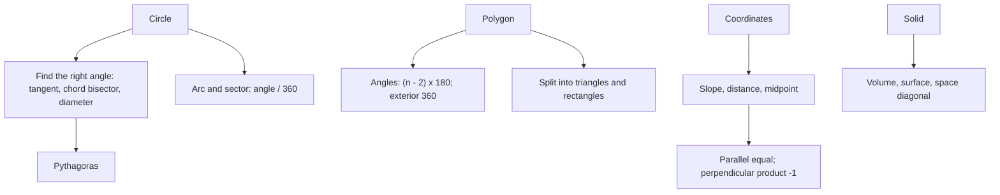

# Q-6: Circles, Polygons, Coordinates and Solids

**Why this matters:** 11 of the 96 ETS questions. Most are a formula plus one insight: a right angle on a diameter, a radius meeting a tangent, a 3D diagonal.

## Polygons and quadrilaterals

- Interior angles of an n-sided polygon add to (n − 2) · 180° (ETS 3.2). Exterior angles always add to 360°, so a regular polygon has n = 360 ÷ (180 − interior angle).
- Rectangle area lw, diagonal √(l² + w²). Square area s² = d²/2 (ETS 3.4).
- Parallelogram area = base × height (not the product of the sides); adjacent angles add to 180° (ETS 3.4).
- Trapezium area = ½(sum of the parallel sides) × height (ETS 3.4).
- Rhombus: diagonals bisect each other at right angles; area = d₁d₂/2.
- A regular hexagon of side s splits into 6 equilateral triangles: area 6 · (√3/4)s².
- For a fixed perimeter the square has the largest rectangle area; a circle beats any polygon.

## Circles

- Circumference 2πr, area πr² (ETS 3.5).
- An arc or sector is (central angle ÷ 360) of the circumference or area (ETS 3.5).
- A radius to the point of tangency is perpendicular to the tangent (ETS 3.5).
- The perpendicular from the centre to a chord bisects the chord, which gives a right triangle with the radius as hypotenuse.
- A triangle inscribed with one side a diameter is right-angled, and the other way round (ETS 3.5).
- A rectangle inscribed in a circle has its diagonal equal to the diameter. A square inscribed in a circle of radius r has area 2r².
- Ring between concentric circles: π(R² − r²). Often you only need R² − r², not R and r.

## Coordinate geometry

- Distance √((x₂−x₁)² + (y₂−y₁)²); midpoint ((x₁+x₂)/2, (y₁+y₂)/2) (ETS 2.8).
- Slope (y₂ − y₁)/(x₂ − x₁); line y = mx + b with y-intercept b (ETS 2.8).
- Parallel lines have equal slopes; perpendicular slopes multiply to −1 (ETS 2.8).
- Reflection in the x-axis flips the sign of y; in y = x it swaps x and y.
- A circle with centre (h, k) and radius r: (x − h)² + (y − k)² = r². Tangent to both axes in quadrant 1 means centre (r, r).

## Solids

- Rectangular box: volume lwh, surface area 2(lw + lh + wh), space diagonal √(l² + w² + h²) (ETS 3.6).
- Cube of side s: volume s³, surface 6s², diagonal s√3.
- Right circular cylinder: volume πr²h, total surface 2πr² + 2πrh (two bases plus the curved side) (ETS 3.6).
- Sphere volume (4/3)πr³ (given on the test when needed).

## Concept map

## Flashcards
Q: Each interior angle of a regular polygon is 140°. How many sides?
A: Exterior angle 40°, so 360/40 = 9.

Q: Area of a sector with central angle 60° in a circle of radius 9?
A: 81π/6 = 13.5π.

Q: Chord 16 in a circle of radius 10. Distance from the centre to the chord?
A: √(100 − 64) = 6.

Q: Total surface area of a cylinder, radius 3, height 8?
A: 2π·9 + 2π·3·8 = 18π + 48π = 66π.

Q: Space diagonal of a 3 × 4 × 12 box?
A: √(9 + 16 + 144) = 13.

Q: Slope of a line perpendicular to one with slope −2/3?
A: 3/2.

Q: Reflect (4, −2) in y = x, then in the x-axis.
A: (−2, 4), then (−2, −4).

Q: A square has diagonal 8. Area?
A: 64/2 = 32.

Q: Rhombus with diagonals 10 and 24. Side length?
A: Halves 5 and 12, so 13.

Q: Circle with centre (r, r) in quadrant 1 means what?
A: It is tangent to both axes.

## Sources
- ETS, *GRE Math Review*, 2.8 Coordinate Geometry, 3.2 Polygons, 3.4 Quadrilaterals, 3.5 Circles, 3.6 Three-Dimensional Figures: https://www.ets.org/pdfs/gre/gre-math-review.pdf
